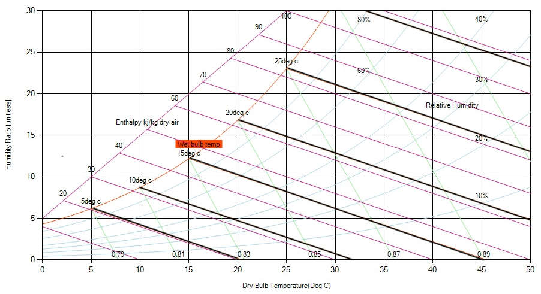

The [wet-bulb temperature](https://en.wikipedia.org/wiki/Wet-bulb_temperature) (a.k.a. saturation temperature) is the temperature measured by a thermometer as the temperature of a parcel of air would have if it were cooled to saturation (100% relative humidity) by the evaporation of water into it, with the latent heat being supplied by the parcel.

Practically it cane be measured with its bulb kept moist by shielding it with a wet/moist cloth. As air passes through the bulb the water around the bulb gets evaporated and  the bulb is cooled. Less moisture in the air will result in a faster rate of evaporation and therefore a colder reading. In practice, we can use an electronic thermometer and wrap a paper tissue over the thermocouple. Make the paper tissue moist, but not too wet that water is dripping from it. Move air over the tissue (or move the thermocouple through the air) so the water evaporates. When the air sample is saturated with water (that is, it has 100% relative humidity), no water can evaporate from the moist tissue so the WB temperature will read the same as the DB temperature. This temperature is therefore also referred to as the saturation temperature. In a psychrometric chart wet bulb temperature is indicated by diagonal lines, which is almost parallel to the constant enthalpy lines.

Fig: Wet-bulb temperature (Saturation Temperature)
