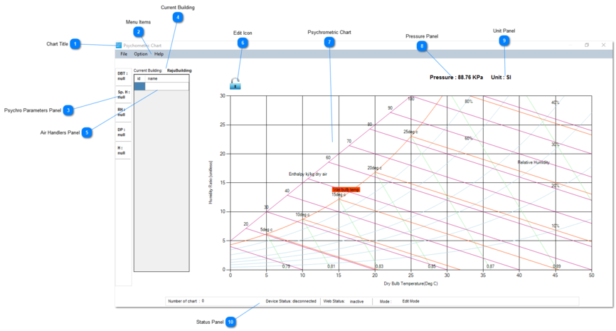
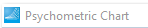
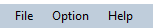
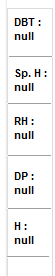
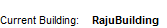
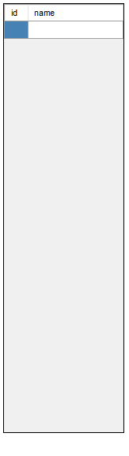
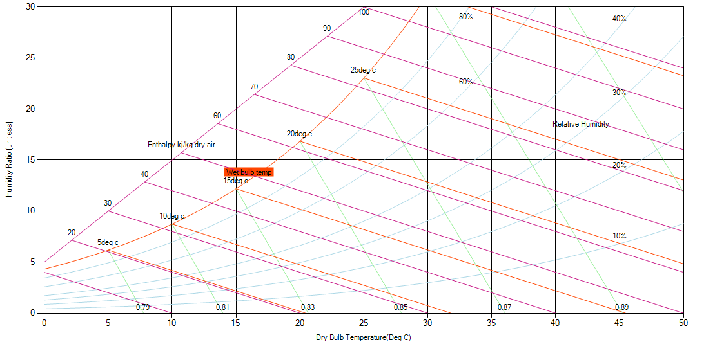
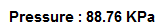
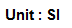
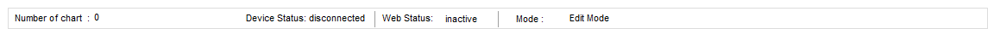

The following description may help you to understand each componets of Temco Psychrometric Tool.

## Chart Title

This is chart title , just to say you are in Temco Psychrometric Tool.

## Menu Items

This menu items helps you to choose many other items. We will discuss all items in next sections.

## Psychro Parameters Panel

This panel shows the current Dry Bulb Temperature (DBT), Specific Humidity (Sp.H) , Relative Humidity (RH), DewPoint (DP) and Enthalpy (H) of current mouse hovered position in chart.

## Current Building

This panel shows the current selected building in T3000 system. Currently, 'RajuBuilding' is chhosen in T3000 system.

## Air Handlers Panel

This panel shows all the air handlers present in the selected building. AT the moment, there is no any handlers present, so panel is blank.'id' starts from 1. You can add, modify and delete the air handlers here as your requirement.

## Edit Icon

This icon is for 'Edit' operation. You can simply click to lock and unlock it. Here, you can see 'unlock' that means you are in edit mode. If you click here again, it becomes 'lock' and system starts updating. In 'Edit mode', system will not update. When you have a blank chart, default is in 'Edit' mode.

## Psychrometric Chart

This is the main working area. You can insert node, process line and all here.  You can see all psychrometric parameters here.

## Pressure Panel

The current building has 88.76KPa atmospheric pressure . The present chart is based on the curent pressure of the selected building .

## Unit Panel

This is the unit selected in T3000. Currently we have only SI unit.

## Status Panel

This panel helps to get a quick view of the status of our system. 

'Number of chart' -> It swos total number of air handlers (one chart for each airhandler) in the selected building.

'Device Status' -> It shows the current T3000 controller status. If its connected our sytem will get updated.

'Web Status'-> It shows current internet connection ststus

'Mode' -> It shows whether our system is on either edit mode or real time mode.
