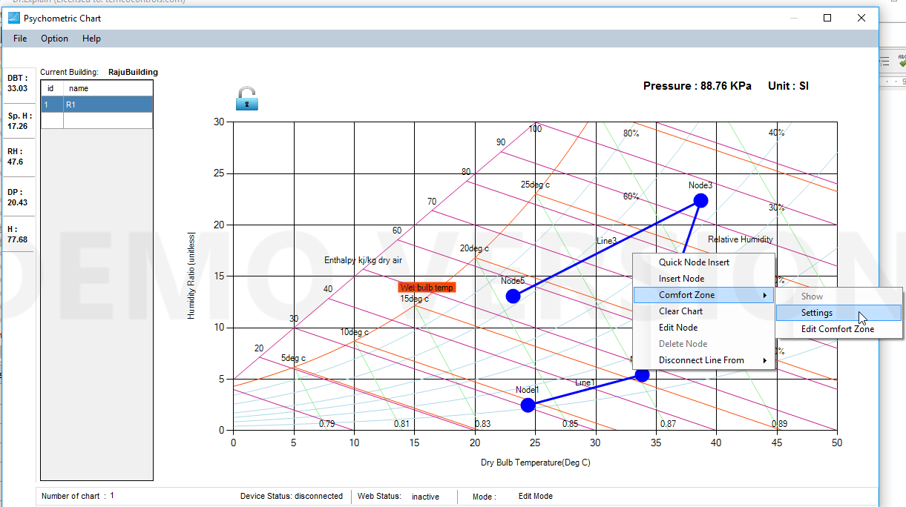
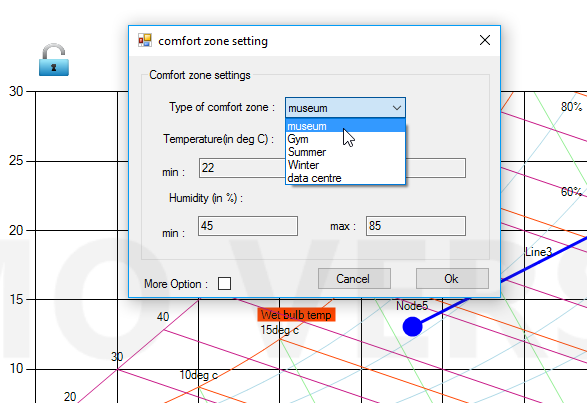
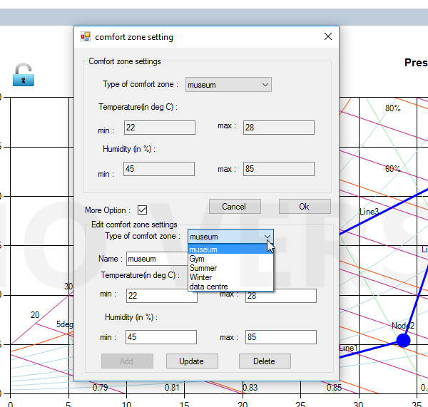
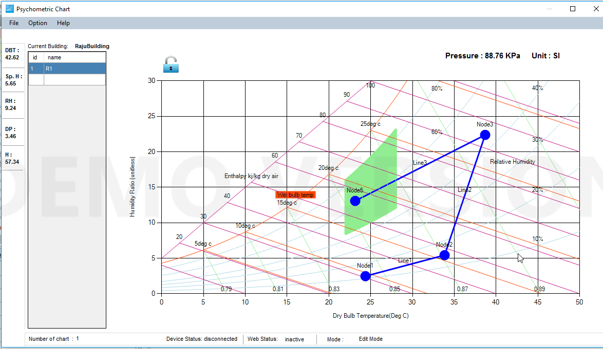
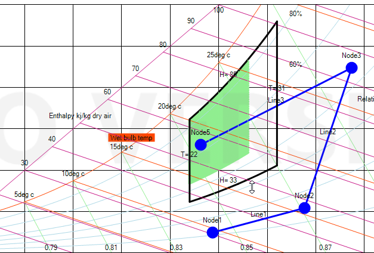
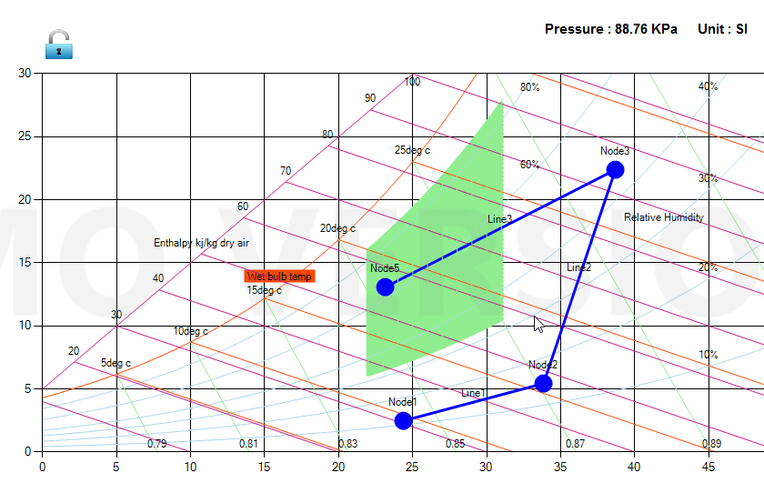

## Comfort Zone

Our tool  is quite flexible for comfort zone. We have set of comfort zones libraries available there, you can select,edit and detele them. You can also change comfort zone area by simply dragging.

Following screenshots and explanations will help you to understand the comfort zone feature.

1. Right click and choose 'Comfort Zone'. 'Show' is for whether to show comfort zone in chart or not. 'Edit Comfort Zone' is to edit the comfort zone. Once you click 'Edit Comfort Zone',the comfort zone goes into edit mode.

For the first time, you need to choose 'Setting' and choose the desired comfort zone in libary. There are few comfort zone libraries, you can also add libraries of your own if you desire it.

If you click 'More Option', you will get feature of adding new comfort zone, editing and deleting the existing comfort zone.

After chosing the desired comfort zone, please click on 'Ok' and and tick the 'Show' to see the selected ('museum' for example) in the chart.

If you want to edit the chart, click 'Edit Comfort Zone' and drag as desired.

This is new chart after editing. The new comfort zone will be saved as new name as 'museum\_2'. You can find the new comfort zone in the library.

