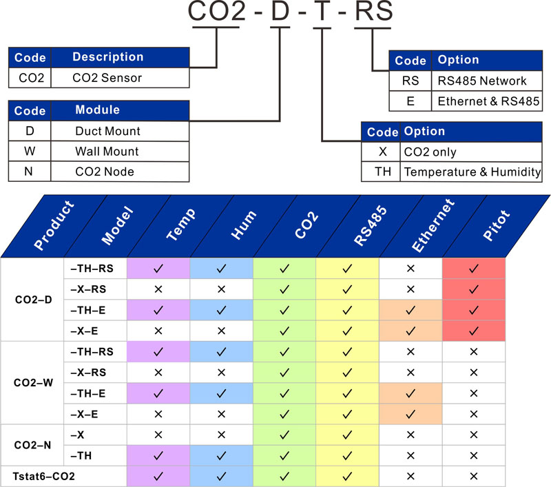
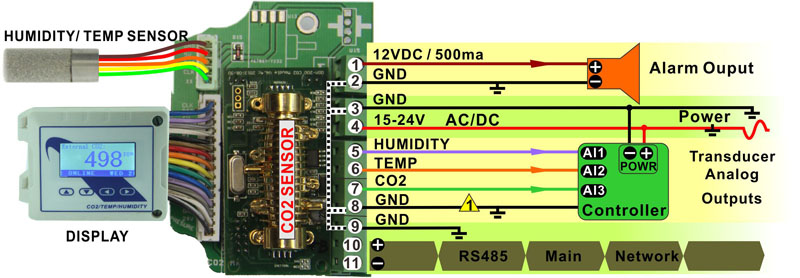

CO2 transmitters with humidity and temperature sensing, for environmental monitoring in industrial, commercial and other buildings. They are standalone units with a Modbus interface — you wire one to a bus, set it up over Modbus, and a controller reads it as points.

From the product description in the repository:

> CO2 sensor with Humidity & Temp transmitters are designed for environment monitoring and controlling in industrial, commercial and other buildings. These transmitters can be used for indoor CO2, temperature and humidity monitoring. The modbus interface provides easy setup and integration into large systems.

*The CO2 series, showing the enclosures and options offered.*

## What is published

The repository is a product repository rather than a firmware one: it carries the images, the wiring diagrams and a link to the product page, not source code. That is why this page describes the product and not an API.

- `CO2-Chart-PT_800.jpg` — the series portfolio chart, reproduced above
- `CO2_image_800.jpg` — the unit itself
- `CO2_D_Wiring_800.jpg` — the duct-mount wiring diagram, reproduced below
- `node wiring_800.jpg` — the node wiring diagram
- `co2_gif.gif` — a short animation of the unit

*Wiring for the duct-mount version.*

## Where the register detail is

Because there is no source in the repository, the Modbus register map for these transmitters is not here. Two places to look instead:

- The register maps project on this site, which is generated from Temco's Modbus register list and covers the sensor products that appear in it
- The product page at [temcocontrols.com](https://www.temcocontrols.com/products/sensors/c02-hum-aq/co2-sensors.htm), which is where the repository points

## A note on the family name

The repository is called `CO2_Sensor` and the product line covers CO2 with humidity and temperature together. The separate `CO2_HUM_PRESSURE_AIRLAB` repository is a different, much larger instrument — see [The AIRLAB air-quality transmitter](airlab.md).

## Source

`CO2_Sensor` in the Temco controls organisation.
