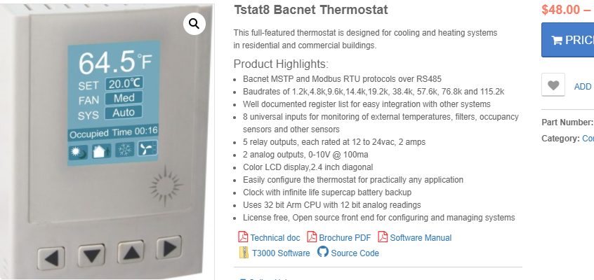

The Tstat8 is Temco's configurable BACnet thermostat. It is **legacy** — the repository says so in its first line, and points to the Tstat10E as the current programmable thermostat. This page exists because the Tstat8 is still installed, still has full source published, and its revision log is unusually detailed.

*The Tstat8, from `Docs/Tstat8.png`.*

## Configurable, not programmable

That is the difference from the Tstat10 and Tstat11. A Tstat8 is set up by writing registers: which input is which, what the setpoints are, which icons show. There is no Control Basic program to write and no screen editor. Configuration lives in EEPROM and flash, and the modbus ID and serial number are held in flash rather than EEPROM since revision 6.1.

The repository's own summary: "Bacnet Thermostat, full featured device controls most any HVAC application. Complete source code."

## What is in the tree

| Folder | What it carries |
| --- | --- |
| `bacnet` | The BACnet stack |
| `MODBUS` | The Modbus stack |
| `EEP-MAP`, `RTE` | The EEPROM map and the runtime environment |
| `STM32F10x_FWLib`, `CORE`, `HARDWARE` | The STM32F10x target and board code |
| `FreeRTOS`, `FATFS`, `FLASH`, `FILTER` | RTOS, file system, flash and filtering |
| `include`, `USER` | Headers and the application |
| `Docs` | `Revisions.txt`, `SchematicTstat8rev4_3.pdf`, `Tstat8.png` |

Two documents matter: the revision log in `Docs/Revisions.txt`, which is the closest thing to a manual this product has, and the revision 4.3 schematic.

## What the revision log tells you

`Revisions.txt` runs from revision 5.1 to revision 6.2, covering 2017 and 2018, and it is worth reading in full before servicing a unit. The entries that change behaviour:

- **6.2** (2018-03-19) — changing the serial number caused a CRC error, because the backup copy of the serial number overlapped the CRC table
- **6.1** — the Modbus ID and serial number moved from EEPROM to flash
- **6.0** — icon output control initialisation added, plus PID sampling-time and derivative-term initialisation; a PID bug where coasting mode stayed in heat was fixed by moving the optimisation to level 1
- **5.7** — negative temperatures displayed wrongly
- **5.6** (2017-11-22) — icon output control added at **registers 783 to 791**, for nine icons: day, night, occupied, unoccupied, heat, cool, fan speed 1, fan speed 2, fan speed 3
- **5.5** — RTC single-write bug; analogue input function 2 (occupancy sensor) did not work
- **5.4** — the clock time multiple-write was not a standard Modbus command; writing a year of 2017 had to be written as 17 to be compatible with the Tstat6
- **5.3** (2017-09-11) — cooling mode sometimes jumped to heating; the PID task was merged into the control logic so the PID value could not be changed by the wrong task
- **5.2** (2017-07-20) — new BACnet library, revision 10, fixing an abort message when writing from Yabe: `BACNET_MAX_PRIORITY` must be 16

Two hardware notes are in there as well: revision 5.3 added a single hex file that works with both hardware revision 3 and revision 4, and it mentions an ION board variant (`TSTAT8_HUNTER`) whose analogue output was inverted.

## If you are servicing one

Read `Docs/Revisions.txt` first and find the firmware revision on the unit. Several of the fixes above are cases where a symptom that looks like a hardware fault — a wrong display, a mode that flips, a write that fails from a BACnet tool — was a known firmware bug with a known revision that fixed it. The log is more useful than the schematic for that.

## Source

`BacnetThermostat` in the Temco controls organisation. For the current thermostat, see the Tstat11 project on this site and the ESP32 controller repository.
