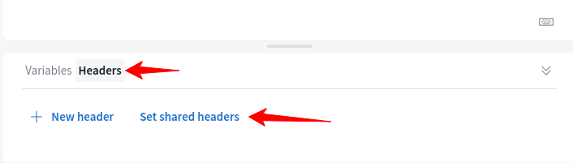
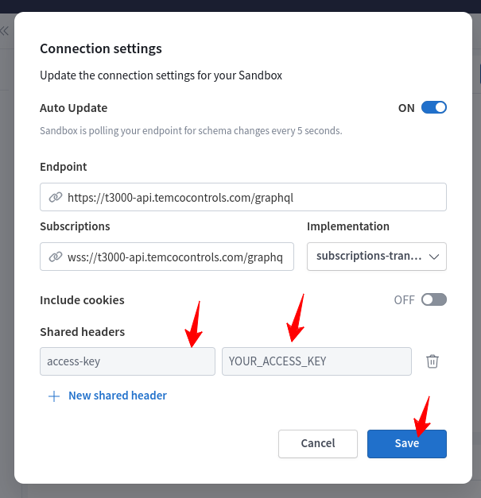
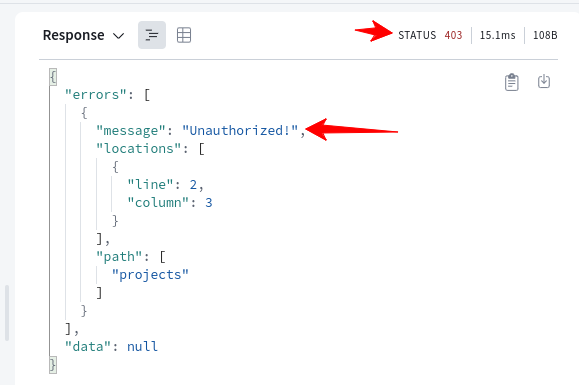

To run queries & mutations, you need to add the access-token header to your requests. You can try that with Apollo Studio Explorer first, the header section is located at the bottom left side of the Apollo Studio Explorer.

## Where to find the access key
After you install the API, you will find the access key in the root api directory inside the dot env file ".env", it will be like this

ACCESS_KEY=your_access_key

## How to use the access key
Now you can use the access key with your requests as header like this..

```
{
    "access-key": "YOUR_ACCESS_KEY"
}
```

Once you have the access key you can make requests. You can add your access key with the headers "access-token" respectfully.

Below is an example of how you might make a request to the API via cURL.

```
curl \
  -X POST \
  -H "Content-Type: application/json" \
  -H "Access-Key: {your-access-key}" \
  --data '{ "query": "{ projects { id name } }" }' \
  http://your_api_url
```

## Using access key with Apollo Studio Explorer

And you can set it in Apollo Studio Explorer as a shared header like this:



Then set it like this and click save


Now the access key will be sent as a header automatically with your queries & mutations

### What if I did not use the access-key with my queries

Apollo Studio Explorer will show the Queries and Mutations normally but when you try to preform any query or mutation you will get "Unauthorized!" error message with status code 403 as a response, like this:

