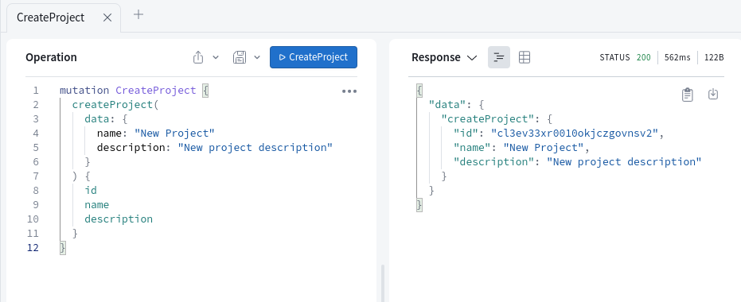
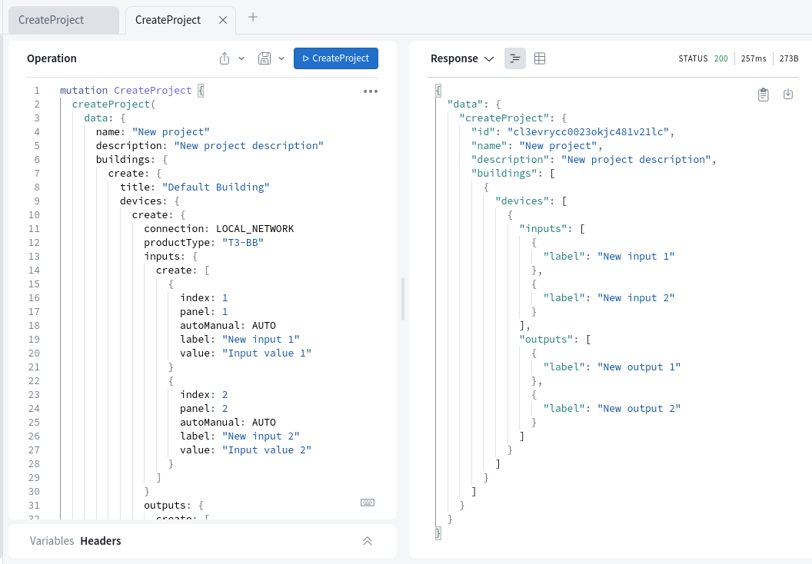
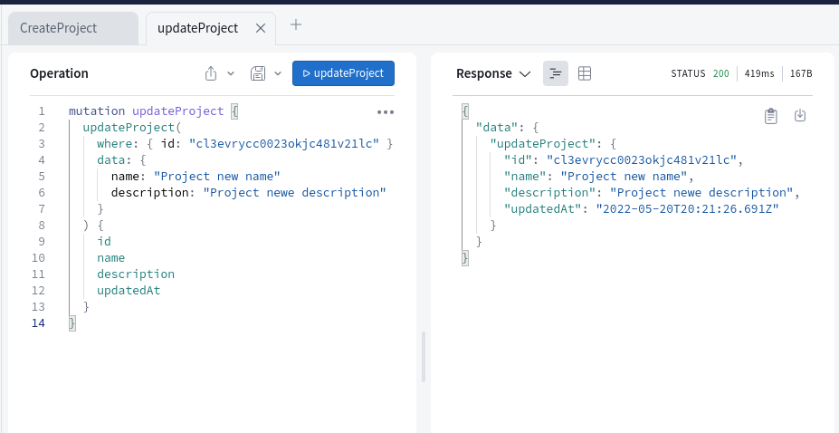
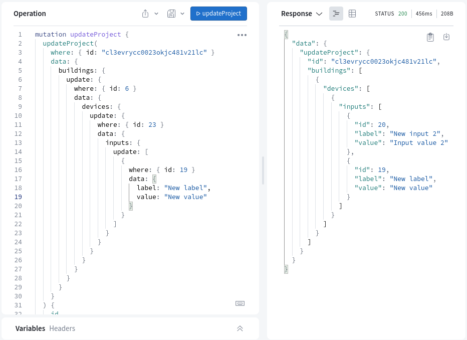
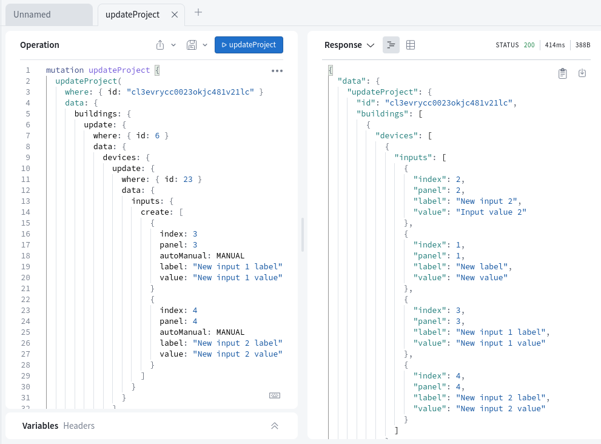
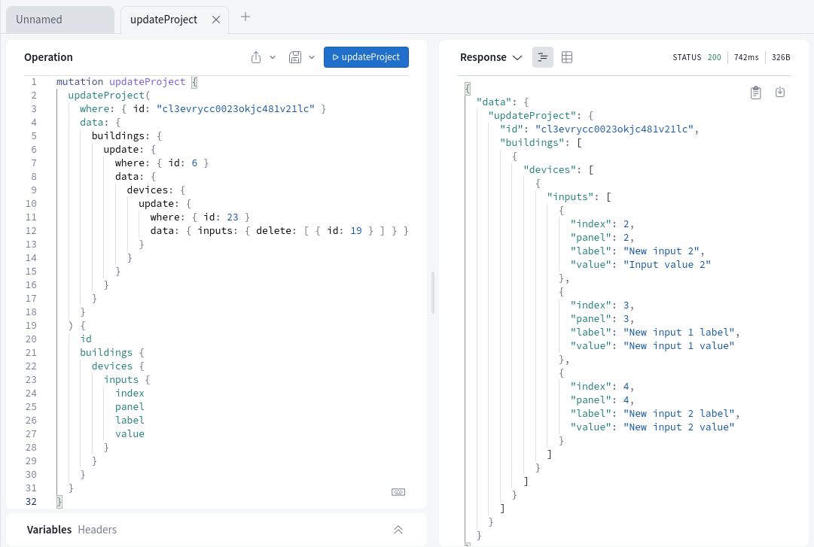

Below are some common examples of mutation projects using the API.

## Creating a new project

> You need to use the access key with the mutation, so please check "Authentication" section to see how before you go.

Below is an example of creating a single project ( with only basic fields ). In this example we write the new project fields values that we need to create, you don't have to fill all the fields, you can fill them later using `updateProject` mutation, so we will only fill some of the fields for this example to make it simple.

```graphql
mutation CreateProject {
  createProject(
    data: { name: "New Project", description: "New project description" }
  ) {
    id
    name
    description
  }
}
```

**Apollo Studio Explorer screenshot of the example above**



**Or using variables instead of inline argments**

```graphql
mutation CreateProject($createProjectData: ProjectCreateInput!) {
  createProject(data: $createProjectData) {
    id
    name
    description
  }
}
```

**Variables**

```json
{
  "createProjectData": {
    "name": "New project",
    "description": "New project description"
  }
}
```

## Creating a new project with its relations (`building, devices, inputs, outputs, ...etc`)

> You need to use the access key with the mutation, so please check "Authentication" section to see how before you go.

Below is an example of creating a single project with relations data. In this example we write the new project fields values that we need to create you don't have to fill all the fields, you can later fill them using `updateProject` mutation, so will fill the values in the `data` argment, we will only fill some fields for this example to make it simple, As you see we created a project with two inputs and two outputs, we can created the other relations ( `variables, pids, ...etc`) in the same way.

```graphql
mutation CreateProject {
  createProject(
    data: {
      name: "New project"
      description: "New project description"
      buildings: {
        create: {
          title: "Default Building"
          devices: {
            create: {
              connection: LOCAL_NETWORK
              productType: "T3-BB"
              inputs: {
                create: [
                  {
                    index: 1
                    panel: 1
                    autoManual: AUTO
                    label: "New input 1"
                    value: "Input value 1"
                  }
                  {
                    index: 2
                    panel: 2
                    autoManual: AUTO
                    label: "New input 2"
                    value: "Input value 2"
                  }
                ]
              }
              outputs: {
                create: [
                  {
                    index: 1
                    panel: 1
                    autoManual: AUTO
                    label: "New output 1"
                    value: "Output value 1"
                  }
                  {
                    index: 2
                    panel: 2
                    autoManual: AUTO
                    label: "New output 2"
                    value: "Output value 2"
                  }
                ]
              }
            }
          }
        }
      }
    }
  ) {
    id
    name
    description
    buildings {
      devices {
        inputs {
          label
        }
        outputs {
          label
        }
      }
    }
  }
}
```

**Apollo Studio Explorer screenshot of the example above**



**Or using variables instead of argments**

```graphql
mutation CreateProject($createProjectData: ProjectCreateInput!) {
  createProject(data: $createProjectData) {
    id
    name
    description
    buildings {
      devices {
        inputs {
          label
        }
        outputs {
          label
        }
      }
    }
  }
}
```

**Variables**

```json
{
  "createProjectData": {
    "name": "New project",
    "description": "New project description",
     "buildings": {
        "create": {
          "title": "Default Building",
          "devices": {
            "create": {
              "connection": "LOCAL_NETWORK",
              "productType": "T3-BB",
              "inputs": {
                "create": [
                  {
                    "index": 1,
                    "panel": 1,
                    "autoManual": "AUTO",
                    "label": "New input 1",
                    "value": "Input value 1"
                  },
                  {
                    "index": 2,
                    "panel": 2,
                    "autoManual": "AUTO",
                    "label": "New input 2",
                    "value": "Input value 2"
                  }
                ]
              },
              "outputs": {
                "create": [
                  {
                    "index": 1,
                    "panel": 1,
                    "autoManual": "AUTO",
                    "label": "New output 1",
                    "value": "Output value 1"
                  },
                  {
                    "index": 2,
                    "panel": 2,
                    "autoManual": "AUTO",
                    "label": "New output 2",
                    "value": "Output value 2"
                  }
                ]
              }
            }
          }
  }
}
```

## Updating a project ( basic example )

> You need to use the access key with the mutation, so please check "Authentication" section to see how before you go.

Below is an example of updating a single project ( mutating basic fields ). In this example we specify a single`project` to mutate by `id` using `where` argment and then we write the new values for the fields that we need to update in the `data` argment, we will update `name and description` in the below example ( You can update one or more fields as you need, the fields that you don't add to `data` argment won't be updated ) then we select the returning fields under the `updateProject` field (`id`, `name`, `description` and `updatedAt`) in our example.

```graphql
mutation updateProject {
  updateProject(
    where: { id: "cl3evrycc0023okjc481v21lc" }
    data: { name: "Project new name", description: "Project newe description" }
  ) {
    id
    name
    description
    updatedAt
  }
}
```

**Apollo Studio Explorer screenshot of the example above**



**Or using variables instead of argments**

```graphql
mutation updateProject(
  $updateProjectWhere: ProjectFilterUnique!
  $updateProjectData: ProjectUpdateInput!
) {
  updateProject(where: $updateProjectWhere, data: $updateProjectData) {
    id
    name
    description
    updatedAt
  }
}
```

**Variables**

```json
{
  "updateProjectWhere": {
    "id": "cl3evrycc0023okjc481v21lc"
  },
  "updateProjectData": {
    "name": "Project new name",
    "description": "Project newe description"
  }
}
```

## Updating an existing project input data

> You need to use the access key with the mutation, so please check "Authentication" section to see how before you go.

As you see below we used the same `updateProject` mutation to update fields for a single input, we used the building id to specify which building has the device that has our input to update and also specify the device id that has our input, we used the input id to specify which input to update.

```graphql
mutation updateProject {
  updateProject(
    where: { id: "cl3evrycc0023okjc481v21lc" }
    data: {
      buildings: {
        update: {
          where: { id: 6 }
          data: {
            devices: {
              update: {
                where: { id: 23 }
                data: {
                  inputs: {
                    update: [
                      {
                        where: { id: 19 }
                        data: { label: "New label", value: "New value" }
                      }
                    ]
                  }
                }
              }
            }
          }
        }
      }
    }
  ) {
    id
    buildings {
      devices {
        inputs {
          id
          label
          value
        }
      }
    }
  }
}
```

**Apollo Studio Explorer screenshot of the example above**



**Or using variables instead of argments**

```graphql
mutation updateProject(
  $updateProjectWhere: ProjectFilterUnique!
  $updateProjectData: ProjectUpdateInput!
) {
  updateProject(where: $updateProjectWhere, data: $updateProjectData) {
    id
    buildings {
      devices {
        inputs {
          id
          label
          value
        }
      }
    }
  }
}
```

**Variables**

```json
{
  "updateProjectWhere": {
    "id": "cl3evrycc0023okjc481v21lc"
  },
  "updateProjectData": {
    "buildings": {
      "update": {
        "where": { "id": 6 },
        "data": {
          "devices": {
            "update": {
              "where": { "id": 23 },
              "data": {
                "inputs": {
                  "update": [
                    {
                      "where": { "id": 19 },
                      "data": { "label": "New label", "value": "New value" }
                    }
                  ]
                }
              }
            }
          }
        }
      }
    }
  }
}
```

> Note: You can update `outputs, variables, pids, graphics, holidays and schedules` in the same way as the example above.

## Add inputs to an existing project

> You need to use the access key with the mutation, so please check "Authentication" section to see how before you go.

As you see below we used the same `updateProject` mutation to add two new inputs to an existing project, In this example we specify a single`project` to add inputs for using `id` in `where` argment.

```graphql
mutation updateProject {
  updateProject(
    where: { id: "cl3evrycc0023okjc481v21lc" }
    data: {
      buildings: {
        update: {
          where: { id: 6 }
          data: {
            devices: {
              update: {
                where: { id: 23 }
                data: {
                  inputs: {
                    create: [
                      {
                        index: 3
                        panel: 3
                        autoManual: MANUAL
                        label: "New input 1 label"
                        value: "New input 1 value"
                      }
                      {
                        index: 4
                        panel: 4
                        autoManual: MANUAL
                        label: "New input 2 label"
                        value: "New input 2 value"
                      }
                    ]
                  }
                }
              }
            }
          }
        }
      }
    }
  ) {
    id
    buildings {
      devices {
        inputs {
          index
          panel
          label
          value
        }
      }
    }
  }
}
```

**Apollo Studio Explorer screenshot of the example above**



**Or using variables instead of argments**

```graphql
mutation updateProject(
  $updateProjectWhere: ProjectFilterUnique!
  $updateProjectData: ProjectUpdateInput!
) {
  updateProject(where: $updateProjectWhere, data: $updateProjectData) {
    id
    buildings {
      devices {
        inputs {
          index
          panel
          label
          value
        }
      }
    }
  }
}
```

**Variables**

```json
{
  "updateProjectWhere": {
    "id": "cl3evrycc0023okjc481v21lc"
  },
  "updateProjectData": {
    "buildings": {
        "update": {
          "where": { "id": 6 },
          "data": {
            "devices": {
              "update": {
                "where": { "id": 23 },
                "data": {
                  "inputs": {
                    "create": [
                      {
                        "index": 3,
                        "panel": 3,
                        "autoManual": "MANUAL",
                        "label": "New input 1 label",
                        "value": "New input 1 value"
                      }
                      {
                        "index": 4,
                        "panel": 4,
                        "autoManual": "MANUAL",
                        "label": "New input 2 label",
                        "value": "New input 2 value"
                      }
                    ]
                  }
                }
              }
            }
          }
        }
      }
  }
}
```

> Note: You can add more `outputs, variables, pids, graphics, holidays and schedules` to an existing project in the same way as the example above.

## Deleting inputs from an existing project

> You need to use the access key with the mutation, so please check "Authentication" section to see how before you go.

As you see below we used the same `updateProject` mutation to add delete an input from an existing project, In this example we specify an `project` to delete inputs from it using `id` in `where` argment.

```graphql
mutation updateProject {
  updateProject(
    where: { id: "cl3evrycc0023okjc481v21lc" }
    data: {
      buildings: {
        update: {
          where: { id: 6 }
          data: {
            devices: {
              update: {
                where: { id: 23 }
                data: { inputs: { delete: [ { id: 19 } ] } }
              }
            }
          }
        }
      }
    }
  ) {
    id
    buildings {
      devices {
        inputs {
          index
          panel
          label
          value
        }
      }
    }
  }
}
```

**Apollo Studio Explorer screenshot of the example above**



**Or using variables instead of argments**

```graphql
mutation updateProject(
  $updateProjectWhere: ProjectFilterUnique!
  $updateProjectData: ProjectUpdateInput!
) {
  updateProject(where: $updateProjectWhere, data: $updateProjectData) {
    id
    buildings {
      devices {
        inputs {
          index
          panel
          label
          value
        }
      }
    }
  }
}
```

**Variables**

```json
{
  "updateProjectWhere": {
    "id": "cl3evrycc0023okjc481v21lc"
  },
  "updateProjectData": {
    "buildings": {
      "update": {
        "where": { "id": 6 },
        "data": {
          "devices": {
            "update": {
              "where": { "id": 23 },
              "data": {
                "inputs": {
                  "delete": [
                    {
                      "where": { "id": 19 }
                    }
                  ]
                }
              }
            }
          }
        }
      }
    }
  }
}
```

> Note: You can delete `outputs, variables, pids, graphics, holidays and schedules` from an existing project in the same way as the example above.
