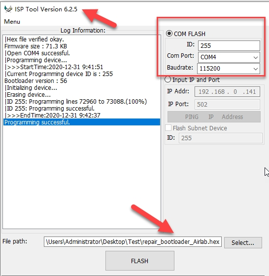
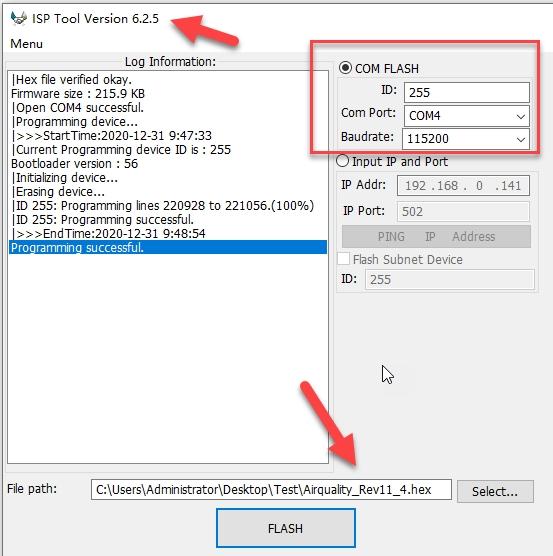
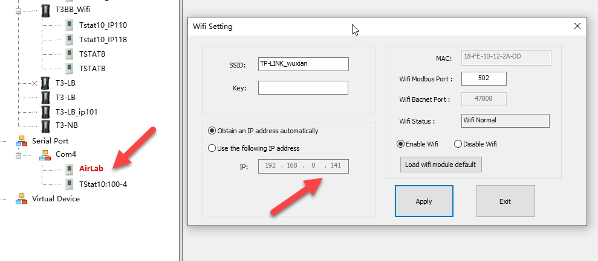

Airlab is a T3 variant with its own bootloader path. Doing it by hand is the recovery route when the normal update will not run.

The update of Airlab bootloader is non-mandatory, so we hope you can do the following manually。

Step 1 . Use ISP Tool to select the repair_bootloader_airlab.hex in the attachment. Use RS485 port ,Select the corresponding ID and baudrate. After this step is updated, the device's screen will always be in a double-flash state.

Step 2 . Select the latest version of Airlab firmware, version 11.4, as attached

Also use RS485 to update the firmware airquality_rev11_4.hex

When the update is complete, the device is in normal working mode.

Step 3 . Using the T3000 software, you can know the device's Wifi IP Address

Then we can use this IP address to update the required firmware

