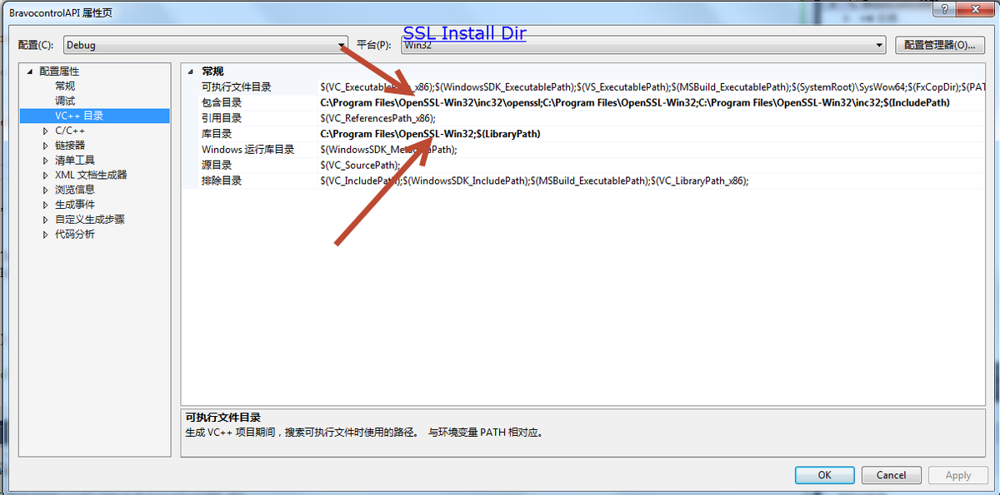
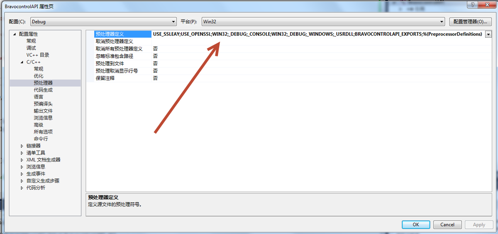
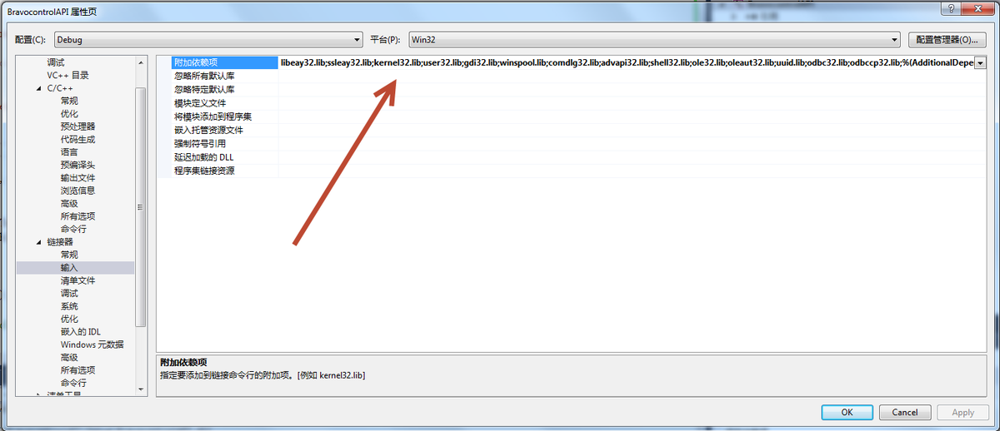

The Bravo Controls API is a separate project in the repository, built and pointed at a running T3000. The sources are in `broveControls_API` beside the solution.

Download SSL Win32 from website and install it ;

https://slproweb.com/

Project configuration

Change the pre define

USE_SSLEAY;USE_OPENSSL;WIN32;_DEBUG;_CONSOLE;WIN32;_DEBUG;_WINDOWS;_USRDLL;BRAVOCONTROLAPI_EXPORTS;%(PreprocessorDefinitions)

Change the additional libiary

libeay32.lib;ssleay32.lib;kernel32.lib;user32.lib;gdi32.lib;winspool.lib;comdlg32.lib;advapi32.lib;shell32.lib;ole32.lib;oleaut32.lib;uuid.lib;odbc32.lib;odbccp32.lib;%(AdditionalDependencies)

