The build and the installer are one job here: compile the solution, then assemble the setup that ships it. The screens are in the order the process runs.

Compile T3000

1. Download the repo from github to your local working folder.

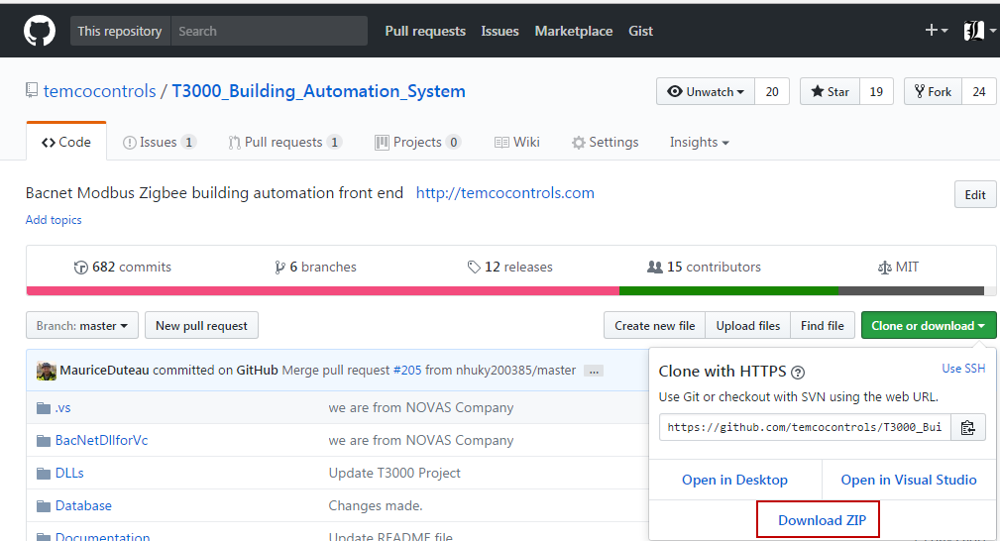

While cloning the repository of T3000, make sure to get the submodules too. On a command line, here is how to do it:

git clone --recurse-submodules <T3000 URL>

This would get the T3000_CrossPlatform project as a submodule of T3000_Building_Automation_System project.

Whenever you update your local repository, make sure to update the submodules too.

git pull --recurse-submodules

Note: You can download the git command line client for windows from

https://git-scm.com/downloads

If you plan to download the zip file, the submodule won’t be included in the download. To cleanly compile the T3000 solution, you need to bring T3000_CrossPlatform project also in the folder where you extracted T3000_Building_Automation_System project. For this go to the T3000_Crossplatform project and download the zip. Extract this zip inside T3000_Building_Automation_System so that it comes as a child to this folder:

T3000_Building_Automation_System

├───T3000_CrossPlatform

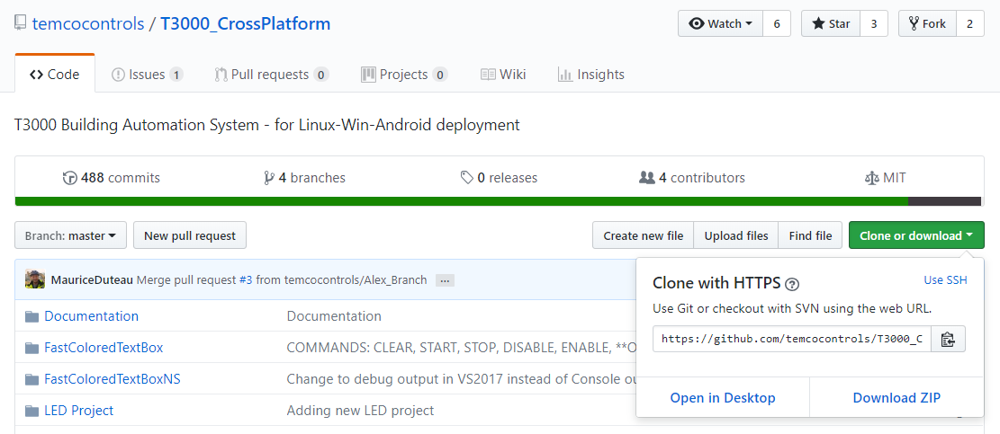

Note: We went by a submodule approach because the ProgramEditor project under T3000 solution requires FastColoredTextBox, T3000Grammer and PRGReaderLibrary projects in T3000_CrossPlatform project.

Install Microsoft Visual Studio VS2010 and VS2015.

1. OpenT3000Project , using VS2015

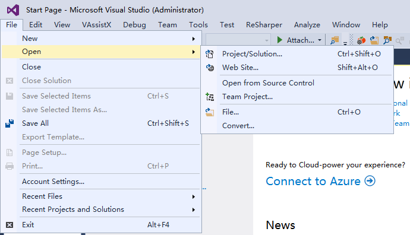

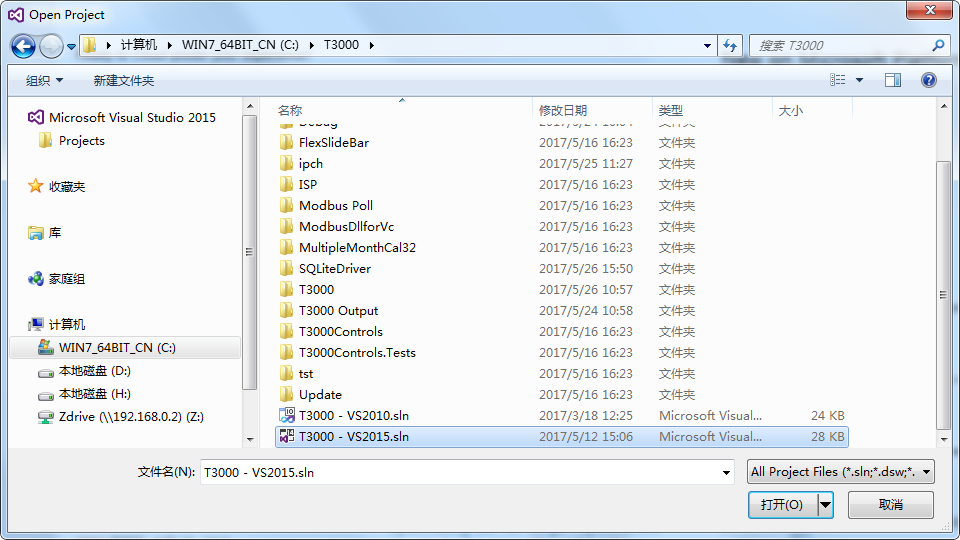

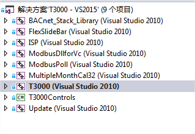

Make sure all these project are using Visual Studio VS2010 . VS2015 not completely compatible with VS2010.Many codes were completed by the old compiler.

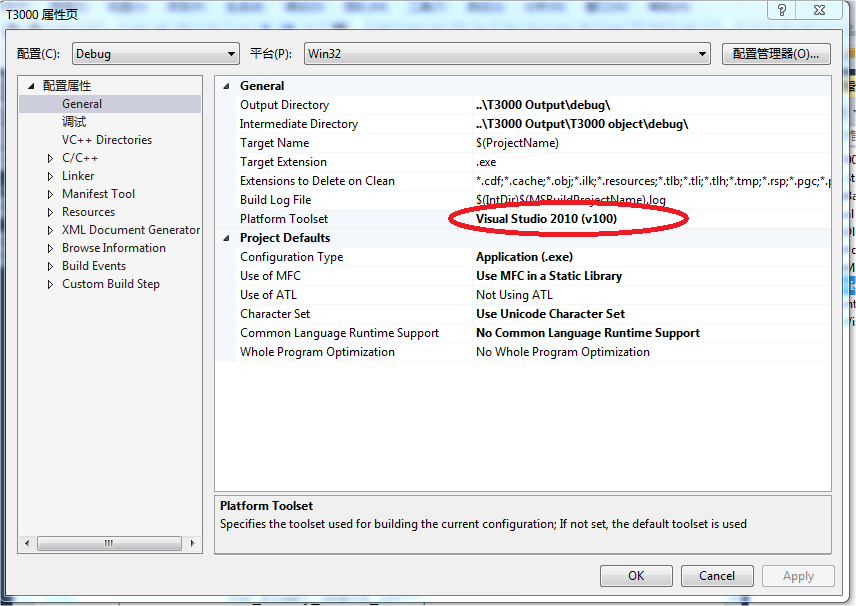

We specify that we will create a Win32 application which can run on both 32 and 64bit Windows installations.

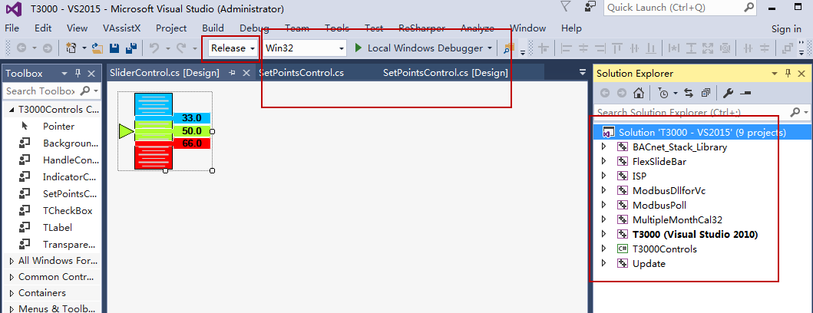

2. Compile T3000

Two Modes ,one is debug ,one is Release .

The platform ,please select Win32 OR x86

The build will rebuild the following items in this order:

BACnet_Stack_Library

FlexSlideBar

ModbusDllforVc

MultipleMonthCal32

T3000Controls

ISP

ModbusPoll

Update

You can select all project to compile .

Notes:

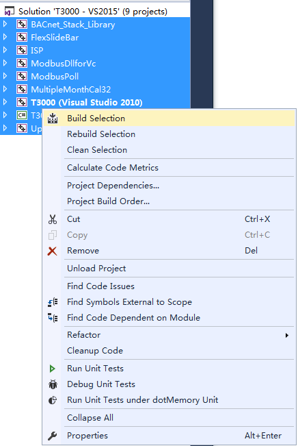

You can rebuild all the project or just parts which you know have changed.

To find your latest release .

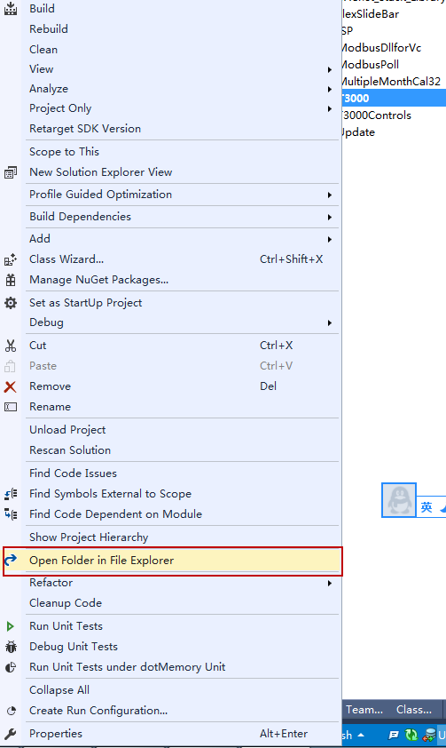

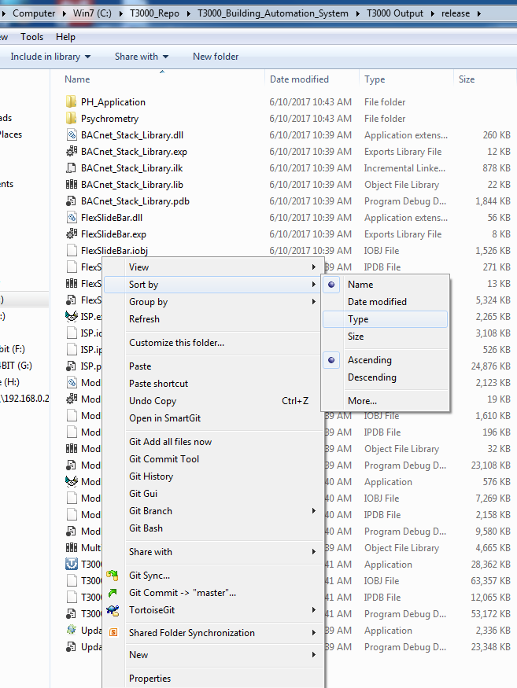

These files should be copied to the Installshield folder on your local machine. Installshield will only look to its local folder for files to be combined into the MSI install file, so this step is necessary.

These are the files which the build will produce, EXE and some DLL’s.

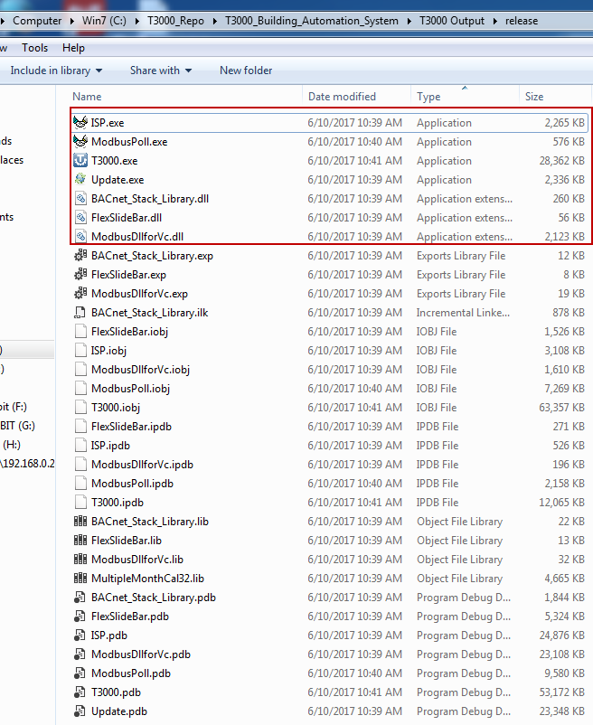

Copy these file to T3000InstallShield , and then replace the old files.

Using the same way to compile Psychrometric Tool && PH_Application

Add these two separate applications as part of the solution, not separate applications like it is now.

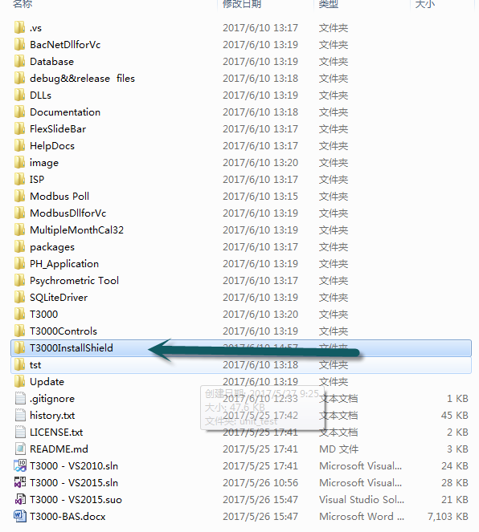

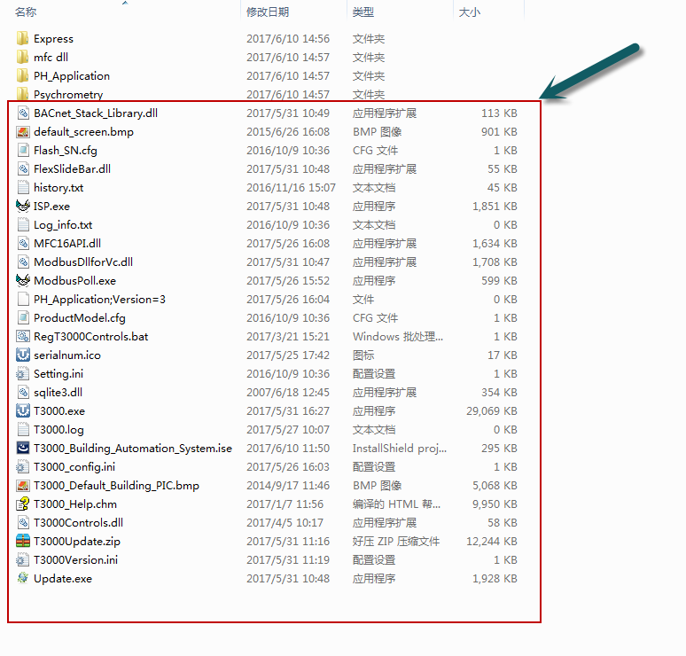

2.How to make an MSI for T3000

Download Installshield2019 ,and install it.

This MSI will include all the proejcts, T3000 as well as the separate Psychrometric and PH applications.

1. double click installshield project file

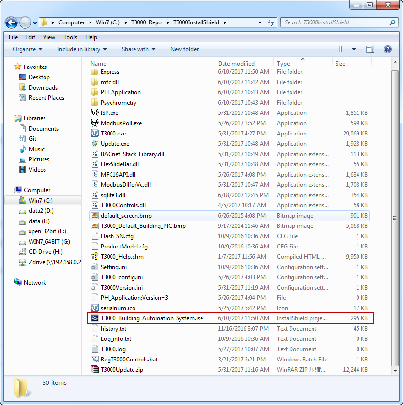

2. InstallSheild showing

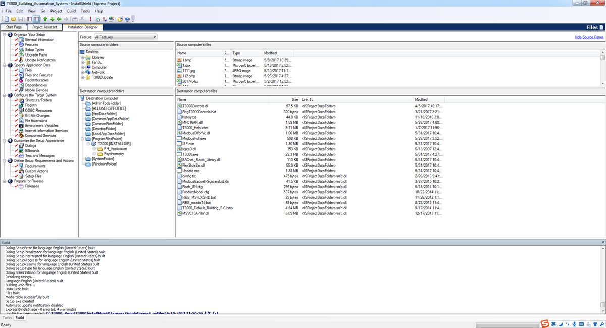

2.Click on the “General Information’ tab, then on the ‘Prooduct Code” cell to generate a GUID which is a code for the application.

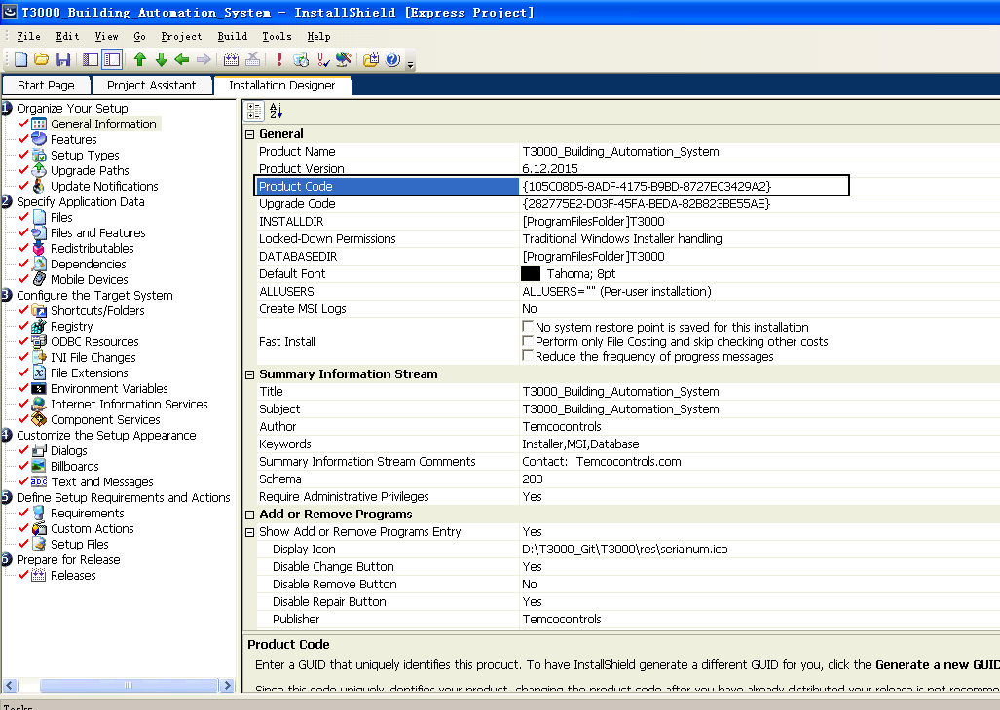

3. Click on the Prepare for release tab, ‘Releases’ itms which generates another GUID, these are just codes which are automatically generated.

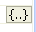

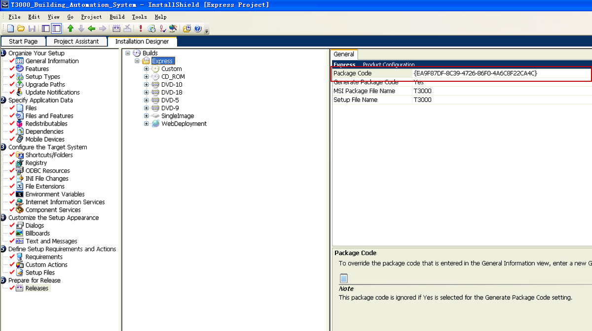

4.Sleect what type of image to generate, in our case SingleImage

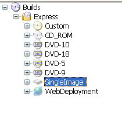

5. Build

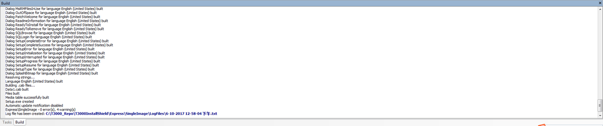

6.Open the setup exe file

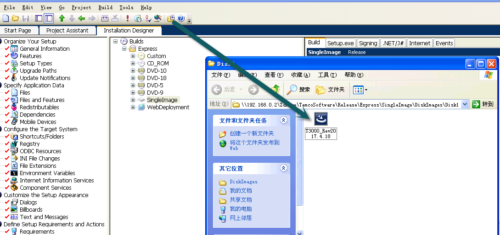

For generating the smaller EXE for updates from within T3000, just copy these files to the a zip file and load the following files to the temco FTP folder.

The files can be found in the T3000 output folder, only the DLL and exe files need to be sent there.

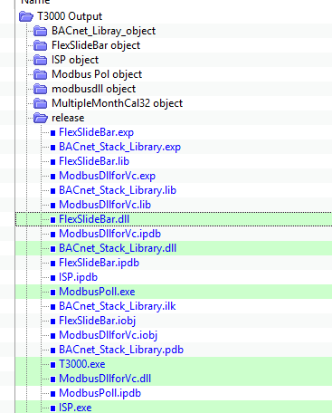

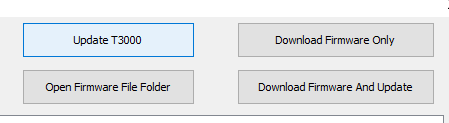
