The steps to get a working build out of the repository: what to install, which solution to open, and what a clean build looks like when it has worked.

Temco Software for development

Build all the projects in solution

Right click on T3000 project and set as startup project

Install t3000 on pc (some missing packages will be installed on pc)

some libcrypto-1_1.dll and libssl-1_1.dll will be missing paste them in (T3000 Output/debug) folder

go to main folder and search here for the files

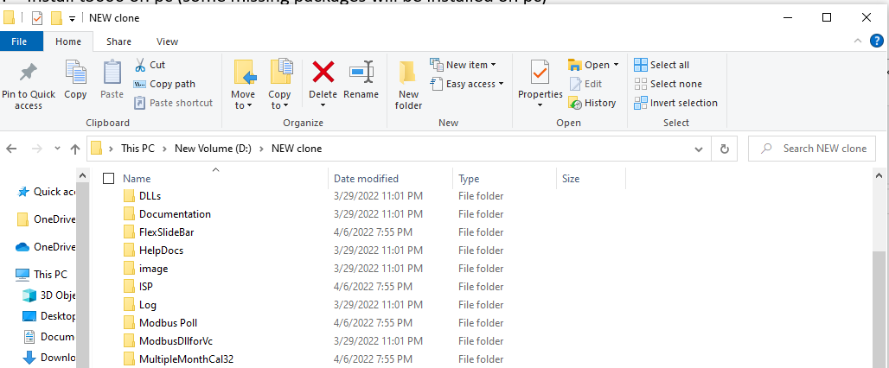

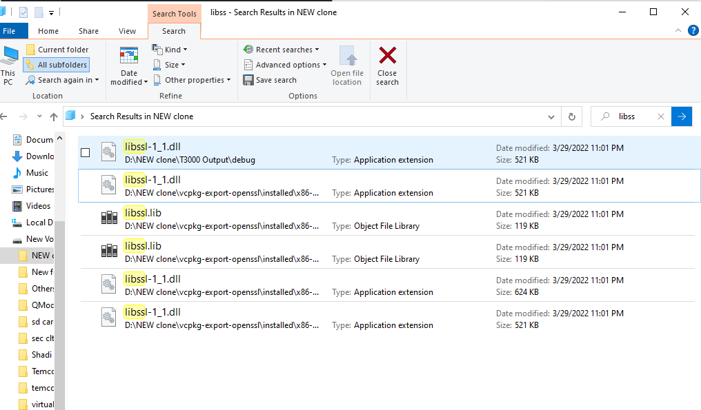

After completion its shown like that2nd step

debug assortion failed C++ mg=fc/occcont.cpp may occur that can be due to flexslideBar project rebuild it after T3000 installation

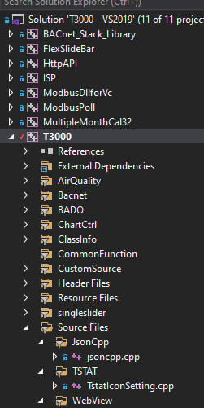

Run as administrator the solution to build all projects.

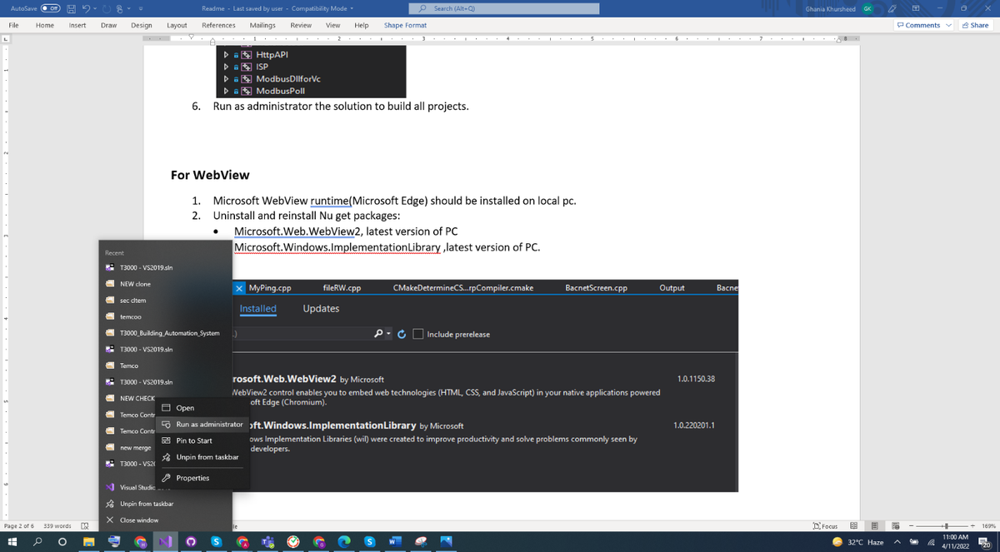

Select hereRight click here

For WebView

Microsoft WebView runtime(Microsoft Edge) should be installed on local pc.

Uninstall and reinstall Nu get packages:

Microsoft.Web.WebView2, latest version of PC

Microsoft.Windows.ImplementationLibrary ,latest version of PC.

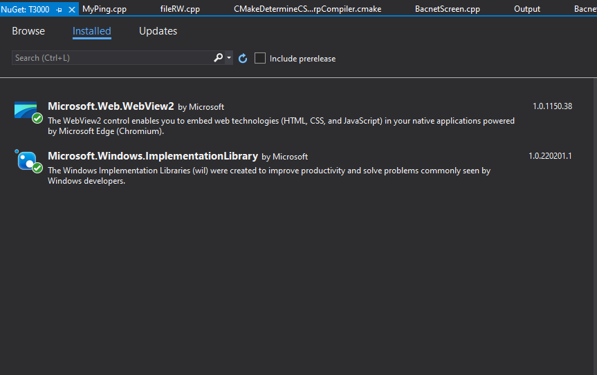

On Aqeeb Branch

Right click on main project file, go to the properties and uncheck read only option, then select apply to folders, subfolders and files and then okay.

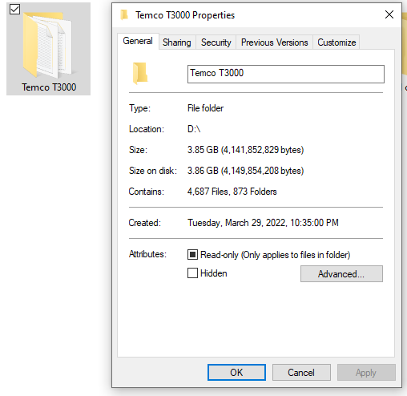

Uncheck hereRight click here

To access the property pages, choose T3000 > jsoncpp.cpp> Properties from the main menu, go to C/C++, on drop down menu go to precompiled header and set not using pre-compiled header

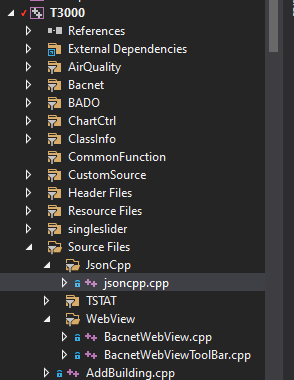

Right click here

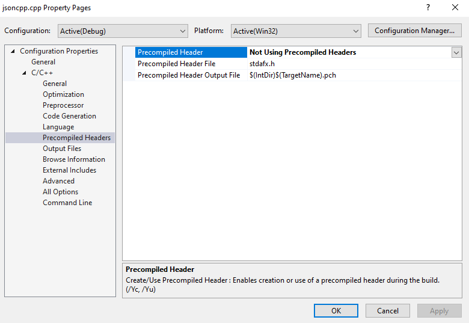

To access the property pages, choose T3000 > WebView>BacnetWebView.cpp> Properties from the main menu, go to C/C++, on drop down menu go to precompiled header and set not using pre-compiled header

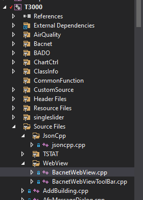

Right click here

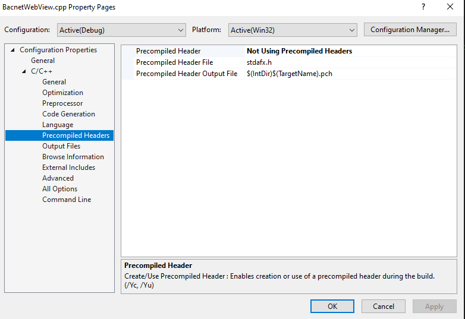

Copy and paste T3000.exe from T3000 folder to T3000 Output>debug

Search WebView2Loader.dll then copy and paste it into T3000 Output>debug

To access the property pages, choose T3000 right-click on the file and choose Properties., go to Prepocessor, on drop down menu go to General and click on Additional Include Directories and give this directory given below:WIN32;_WINDOWS;_DEBUG;SOLUTION_DIR=R"($(SolutionDir))";%(PreprocessorDefinitions)

Right click here

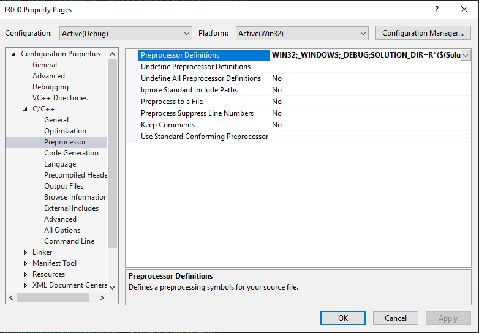

Include here

To access the property pages, choose T3000>source files>Web View>Bacnet WebView.cpp, right-click on the file and choose Properties., go to C/C++, on drop down menu go to General and click on Additional Include Directories and give this directory given below:

$(MSBuildThisFileDirectory)..\..\include\;Json-cpp\include\;%(AdditionalIncludeDirectories)

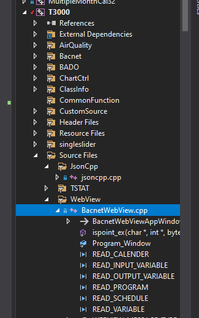

Right click here

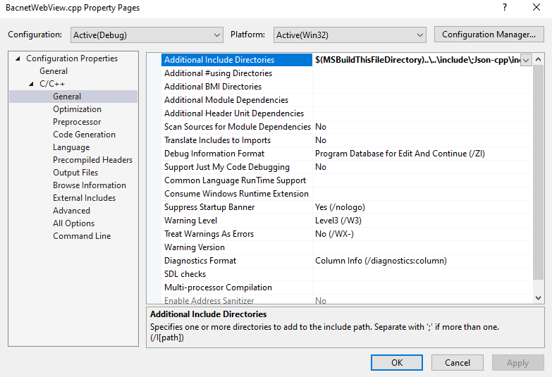

Include here
