How the team works in the repository: branches, the merge that lands a change, and the commands used when the graphical client is not the right tool.

Basic Instructions of github

KEY POINTS

Create and use a repository

Start and manage a new branch

Make changes to a file and push them to GitHub as commits

Open and merge a pull request

Step 1. Create a Repository

A repository is usually used to organize a single project. Repositories can contain folders and files, images, videos, spreadsheets, and data sets – anything your project needs. We recommend including a README, or a file with information about your project. GitHub makes it easy to add one at the same time you create your new repository. It also offers other common options such as a license file.

Your hello-world repository can be a place where you store ideas, resources, or even share and discuss things with others.

To create a new repository

In the upper right corner, next to your avatar or identicon, click and then select New repository.

Name your repository hello-world.

Write a short description.

Select Initialize this repository with a README.

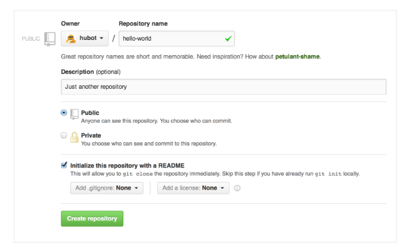

Click Create repository.

Step 2. Create a Branch

Branching is the way to work on different versions of a repository at one time.

By default your repository has one branch named master which is considered to be the definitive branch. We use branches to experiment and make edits before committing them to master.

When you create a branch off the master branch, you’re making a copy, or snapshot, of master as it was at that point in time. If someone else made changes to the master branch while you were working on your branch, you could pull in those updates.

This diagram shows:

The master branch

A new branch called feature (because we’re doing ‘feature work’ on this branch)

The journey that feature takes before it’s merged into master

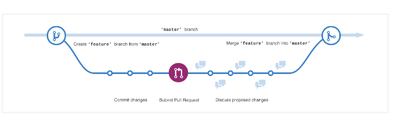

Have you ever saved different versions of a file? Something like:

story.txt

story-joe-edit.txt

story-joe-edit-reviewed.txt

Branches accomplish similar goals in GitHub repositories.

Here at GitHub, our developers, writers, and designers use branches for keeping bug fixes and feature work separate from our master (production) branch. When a change is ready, they merge their branch into master.

To create a new branch

Go to your new repository hello-world.

Click the drop down at the top of the file list that says branch: master.

Type a branch name, readme-edits, into the new branch text box.

Select the blue Create branch box or hit “Enter” on your keyboard.

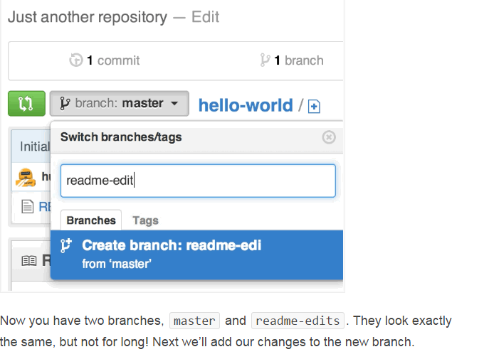

Step 3. Make and commit changes

Bravo! Now, you’re on the code view for your readme-edits branch, which is a copy of master. Let’s make some edits.

On GitHub, saved changes are called commits. Each commit has an associated commit message, which is a description explaining why a particular change was made. Commit messages capture the history of your changes, so other contributors can understand what you’ve done and why.

Make and commit changes

Click the README.md file.

Click the pencil icon in the upper right corner of the file view to edit.

In the editor, write a bit about yourself.

Write a commit message that describes your changes.

Click Commit changes button.

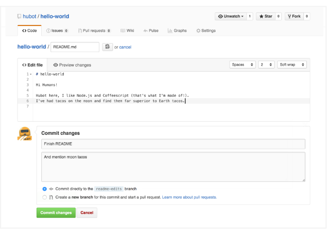

These changes will be made to just the README file on your readme-editsbranch, so now this branch contains content that’s different from master.

Step 4. Open a Pull Request

Nice edits! Now that you have changes in a branch off of master, you can open a pull request.

Pull Requests are the heart of collaboration on GitHub. When you open a pull request, you’re proposing your changes and requesting that someone review and pull in your contribution and merge them into their branch. Pull requests show diffs, or differences, of the content from both branches. The changes, additions, and subtractions are shown in green and red.

As soon as you make a commit, you can open a pull request and start a discussion, even before the code is finished.

By using GitHub’s @mention system in your pull request message, you can ask for feedback from specific people or teams, whether they’re down the hall or 10 time zones away.

You can even open pull requests in your own repository and merge them yourself. It’s a great way to learn the GitHub Flow before working on larger projects.

Open a Pull Request for changes to the README

Click on the image for a larger version

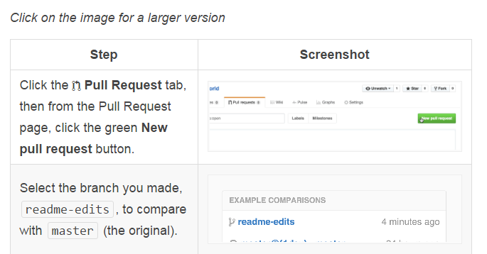

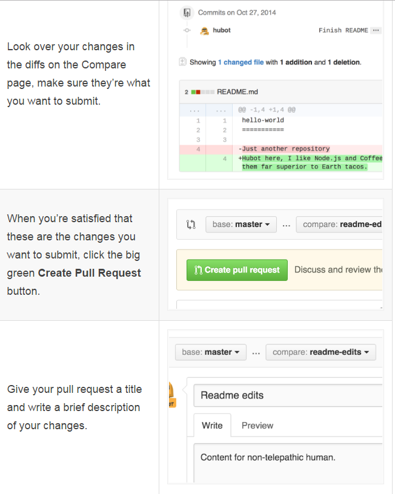

When you’re done with your message, click Create pull request!

Tip: You can use emoji and drag and drop images and gifs onto comments and Pull Requests.

Step 5. Merge your Pull Request

In this final step, it’s time to bring your changes together – merging your readme-edits branch into the master branch.

Click the green Merge pull request button to merge the changes into master.

Click Confirm merge.

Go ahead and delete the branch, since its changes have been incorporated, with the Delete branch button in the purple box.

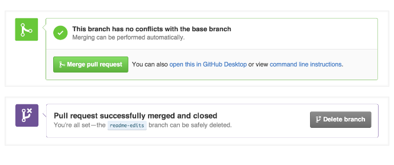

The GitHub Flow

GitHub Flow is a lightweight, branch-based workflow that supports teams and projects where deployments are made regularly. This guide explains how and why GitHub Flow works.

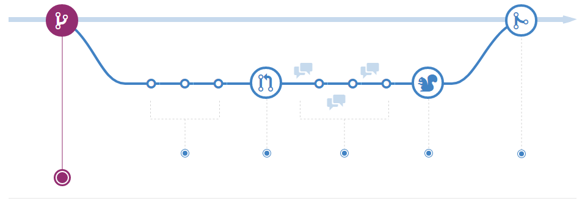

Create a branch

When you're working on a project, you're going to have a bunch of different features or ideas in progress at any given time – some of which are ready to go, and others which are not. Branching exists to help you manage this workflow.

When you create a branch in your project, you're creating an environment where you can try out new ideas. Changes you make on a branch don't affect the master branch, so you're free to experiment and commit changes, safe in the knowledge that your branch won't be merged until it's ready to be reviewed by someone you're collaborating with.

ProTip

Branching is a core concept in Git, and the entire GitHub Flow is based upon it. There's only one rule: anything in the master branch is always deployable.

Because of this, it's extremely important that your new branch is created off of master when working on a feature or a fix. Your branch name should be descriptive (e.g., refactor-authentication, user-content-cache-key, make-retina-avatars), so that others can see what is being worked on.

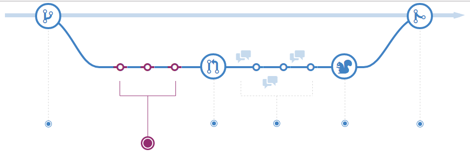

Add commits

Once your branch has been created, it's time to start making changes. Whenever you add, edit, or delete a file, you're making a commit, and adding them to your branch. This process of adding commits keeps track of your progress as you work on a feature branch.

Commits also create a transparent history of your work that others can follow to understand what you've done and why. Each commit has an associated commit message, which is a description explaining why a particular change was made. Furthermore, each commit is considered a separate unit of change. This lets you roll back changes if a bug is found, or if you decide to head in a different direction.

ProTip

Commit messages are important, especially since Git tracks your changes and then displays them as commits once they're pushed to the server. By writing clear commit messages, you can make it easier for other people to follow along and provide feedback.

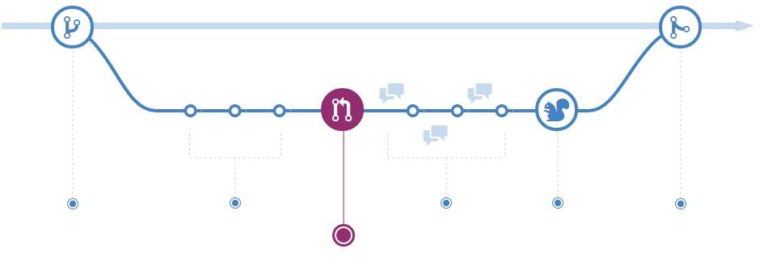

Open a Pull Request

Pull Requests initiate discussion about your commits. Because they're tightly integrated with the underlying Git repository, anyone can see exactly what changes would be merged if they accept your request.

You can open a Pull Request at any point during the development process: when you have little or no code but want to share some screenshots or general ideas, when you're stuck and need help or advice, or when you're ready for someone to review your work. By using GitHub's @mention system in your Pull Request message, you can ask for feedback from specific people or teams, whether they're down the hall or ten time zones away.

ProTip

Pull Requests are useful for contributing to open source projects and for managing changes to shared repositories. If you're using a Fork & Pull Model, Pull Requests provide a way to notify project maintainers about the changes you'd like them to consider. If you're using a Shared Repository Model, Pull Requests help start code review and conversation about proposed changes before they're merged into the master branch.

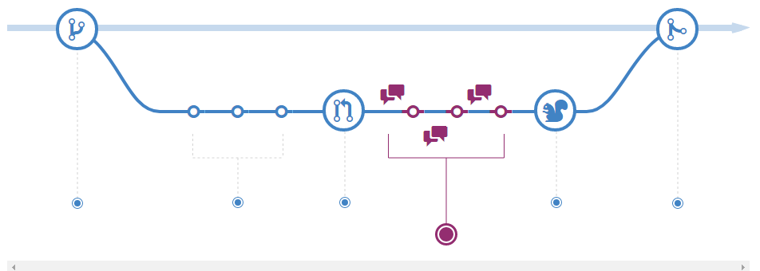

Discuss and review your code

Once a Pull Request has been opened, the person or team reviewing your changes may have questions or comments. Perhaps the coding style doesn't match project guidelines, the change is missing unit tests, or maybe everything looks great and props are in order. Pull Requests are designed to encourage and capture this type of conversation.

You can also continue to push to your branch in light of discussion and feedback about your commits. If someone comments that you forgot to do something or if there is a bug in the code, you can fix it in your branch and push up the change. GitHub will show your new commits and any additional feedback you may receive in the unified Pull Request view.

ProTip

Pull Request comments are written in Markdown, so you can embed images and emoji, use pre-formatted text blocks, and other lightweight formatting.

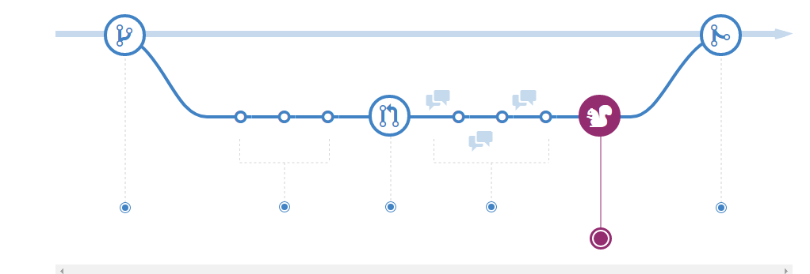

Deploy

Once your pull request has been reviewed and the branch passes your tests, you can deploy your changes to verify them in production. If your branch causes issues, you can roll it back by deploying the existing master into production.

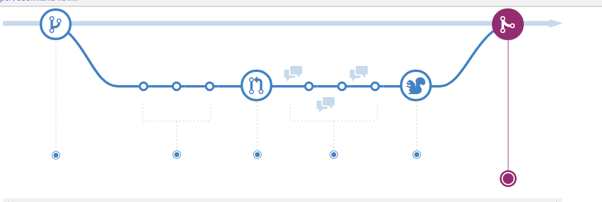

Merge

Now that your changes have been verified in production, it is time to merge your code into the master branch.

Once merged, Pull Requests preserve a record of the historical changes to your code. Because they're searchable, they let anyone go back in time to understand why and how a decision was made.

ProTip

By incorporating certain keywords into the text of your Pull Request, you can associate issues with code. When your Pull Request is merged, the related issues are also closed. For example, entering the phrase Closes #32 would close issue number 32 in the repository. For more information, check out our help article.
