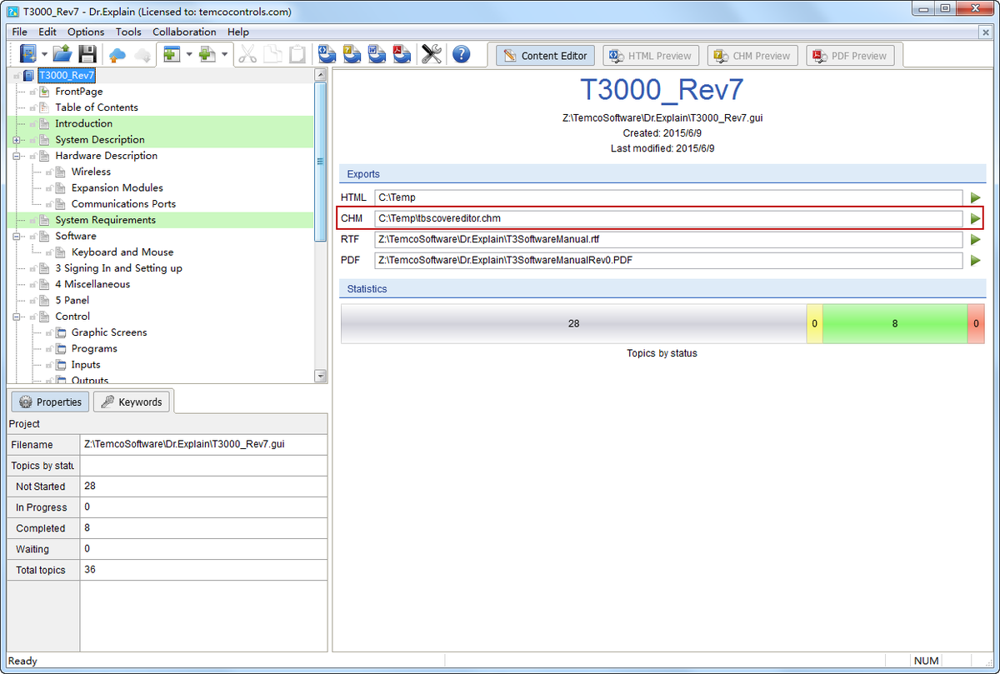
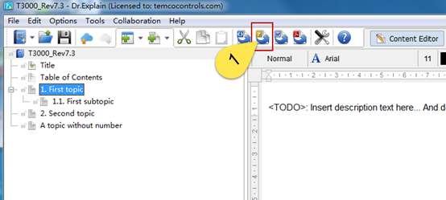
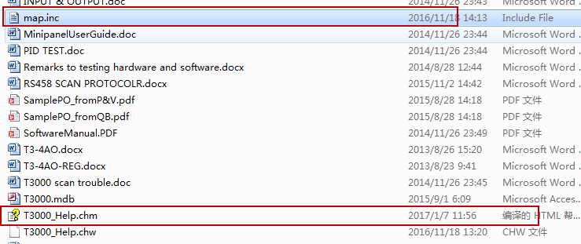
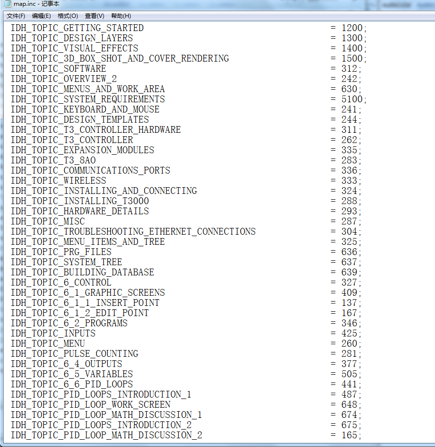
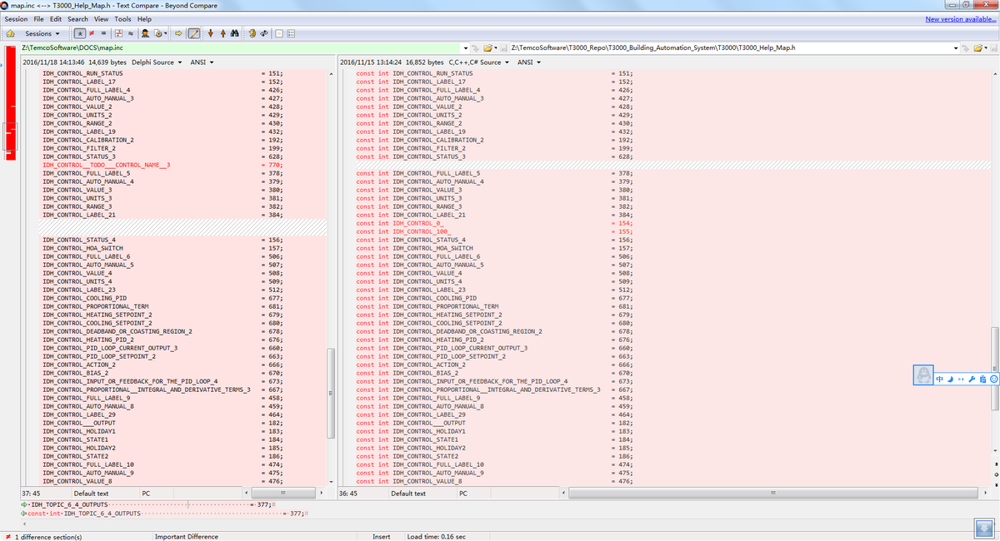
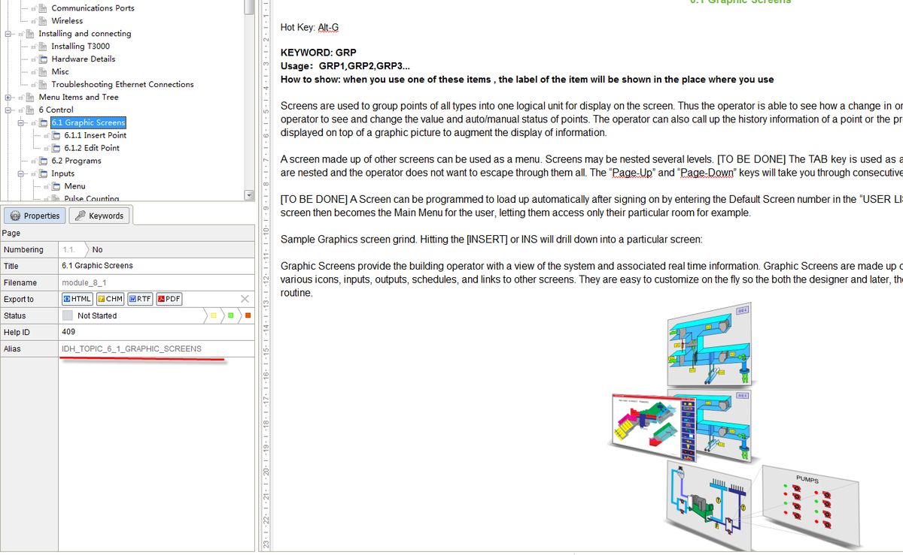
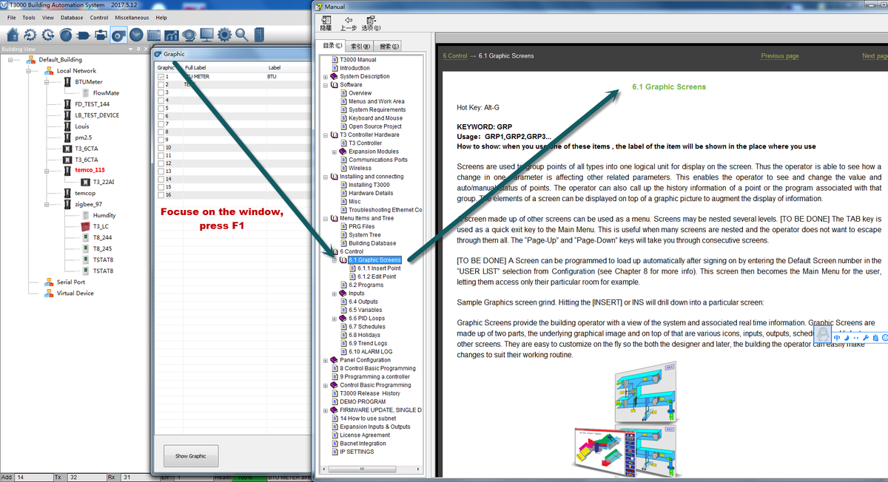
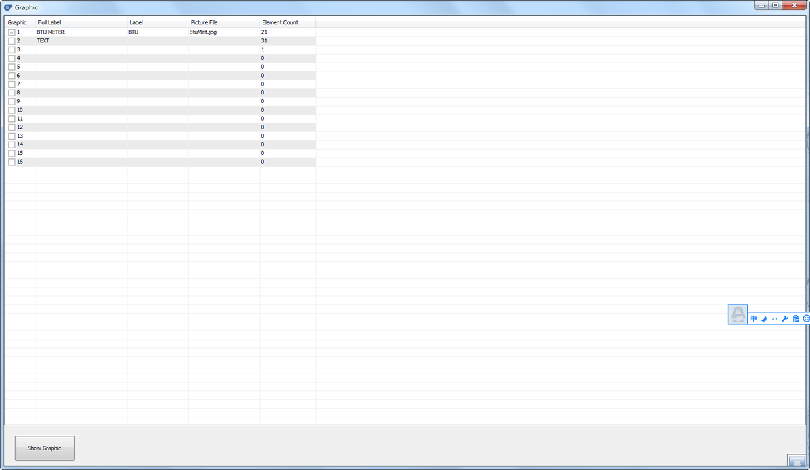

The F1 help is a compiled HTML Help file built from topics, a contents tree and a map of context ids. This is how a topic is written and how the app is pointed at the result.

Help File Documentation:

The help file for T3000 is generated using a help authoring tool called Dr. Explain. This document explains how to use the tool and link the help to T3000 software.

Installation

First install Dr.Explain on your PC:

1. Download the latest installation package from the Dr.Explain website: http://www.drexplain.com/download/ and save it to your computer.

2. Extract setup.exe from the downloaded archive. Use WinZip or another archiving utility.

3. Run setup.exe and follow the instructions. If you plan to create PDF files with Dr.Explain then you need to agree to install Java Runtime Environment. You don't need to uninstall the previous version.

4. Run Dr.Explain once the installation is finished.

By default, Dr.Explain is installed to C:\Program Files\DrExplain on 32-bit operating systems and to C:\Program Files (x86)\DrExplain on 64-bit ones.

Run Dr.Explain

Open the latest T3000 help file .

Z:\TemcoSoftware\Dr.Explain

Click the button showing at tab (1) ,it will generate a file named “map.inc”

These files have to be manually copied to the ‘Installshield’ folder which is here at the Temco office:

Z:\TemcoSoftware\T3000_Repo\T3000_Building_Automation_System\T3000InstallShield

This way, when the new MSI file is generated, it will also contain the updated help files.

2.How to link T3000 to help file

Copy and paste the contents of map.inc into the file called T3000_Help_MAP.h

Replace the old content ,using the latest code .

and then adding the const int before key string

The ID numbers are generated automatically. You can change the name and the ID number in dr Explan: TBD: Show a real example from the T3000 software.

Add a function of a Window

TBD: Show the actual window here please. Screen shot.

For example //Add the code .

BOOL CBacnetGraphic::OnHelpInfo(HELPINFO* pHelpInfo)

{

hWnd = ::HtmlHelp((HWND)pHelpInfo->hItemHandle, theApp.m_szHelpFile,

HH_HELP_CONTEXT, IDH_TOPIC_6_1_GRAPHIC_SCREENS);

return CDialogEx::OnHelpInfo(pHelpInfo);

}

If user press F1 ,T3000 software will go to find the page ,according to the ID of IDH_TOPIC_6_1_GRAPHIC_SCREENS
