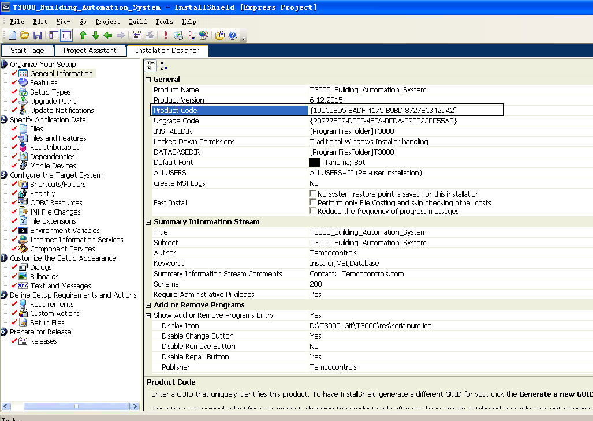
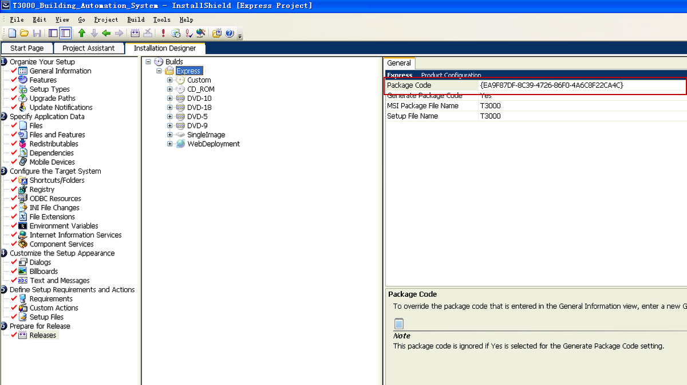
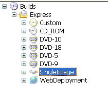
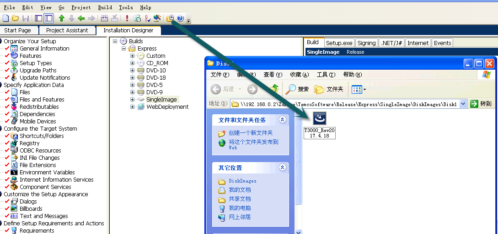

What the installer project carries, and the settings that have to be right before a build is shipped to a customer.

1.双击打开

\\192.168.0.2\Zdrive\TemcoSoftware\Release\T3000_Building_Automation_System

2.点击随机生成一个GUID

3. 点击随机生成一个GUID

4.选择SingleImage

5.Build

6.

