Replacing the editor inside the shell is a merge, not a copy: the screenshots show the files and the order the change goes in.

Run VS as Administrtor

Compile “ProgramEditor”

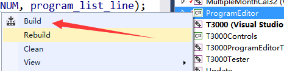

Add a Dialog for new editor

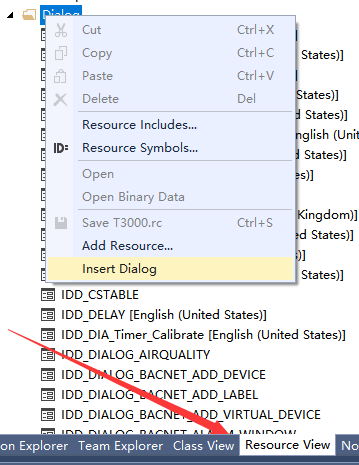

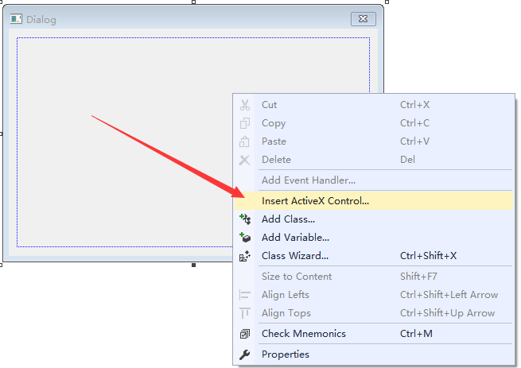

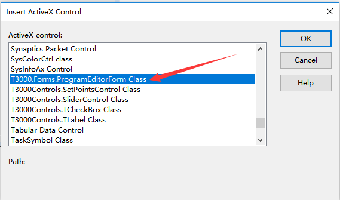

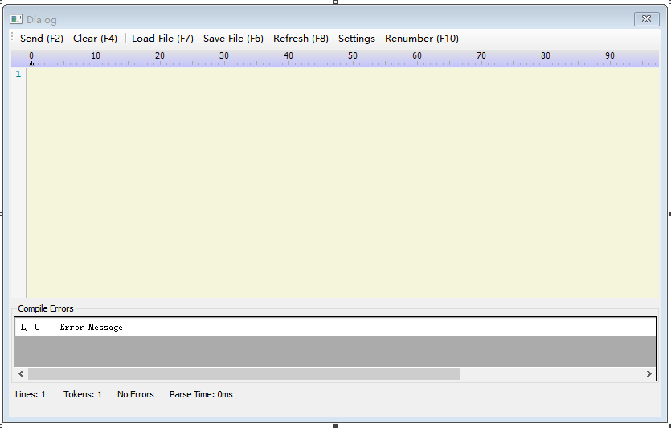

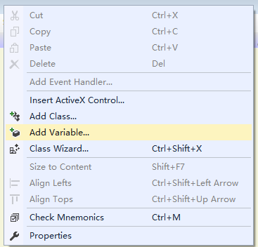

Add the programeeditor class .

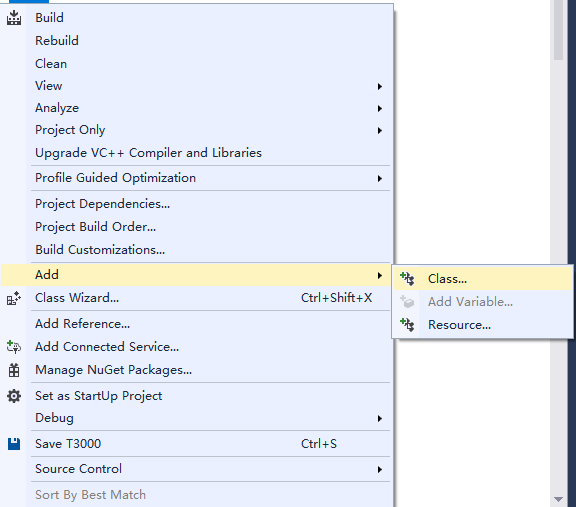

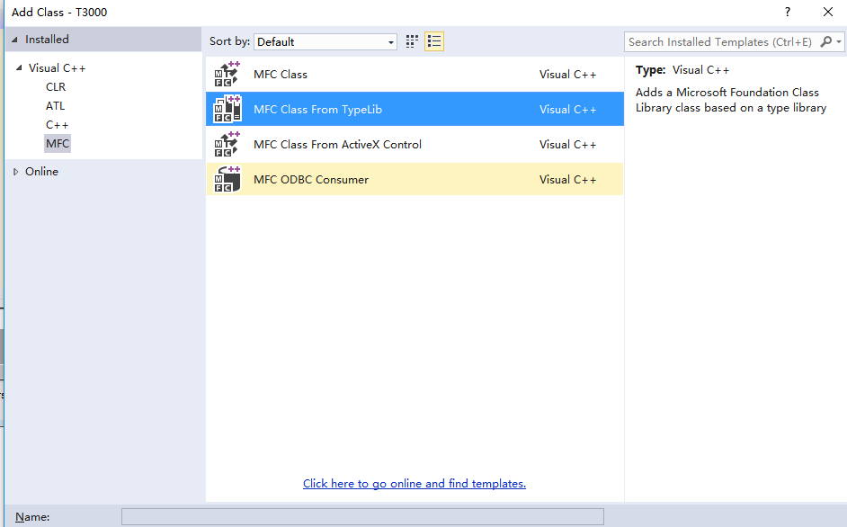

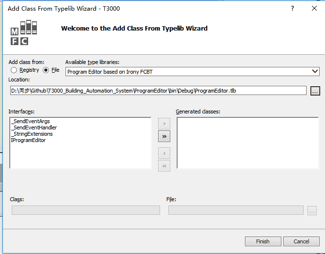

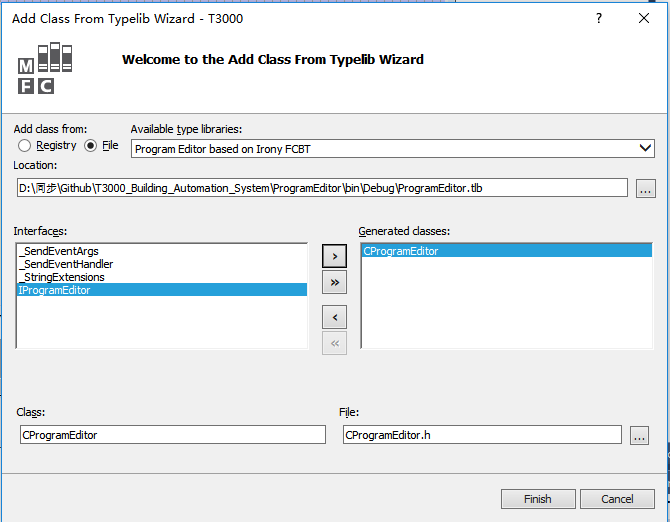

Add a variable

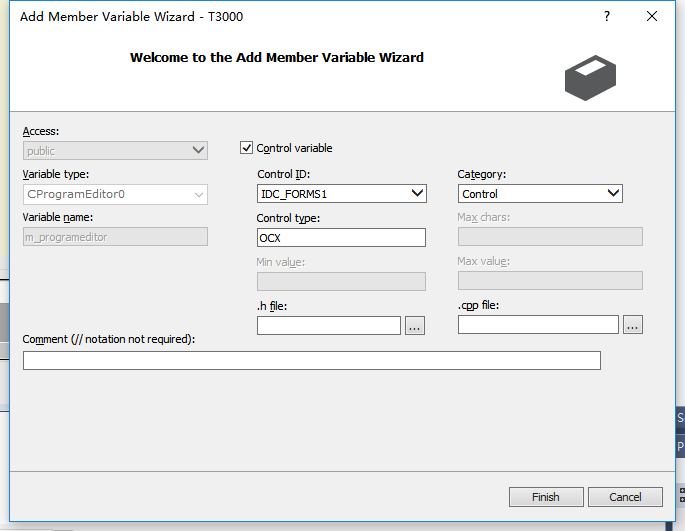

add a variable for the program editor

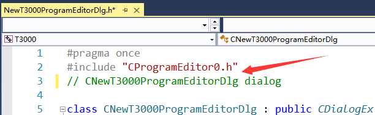

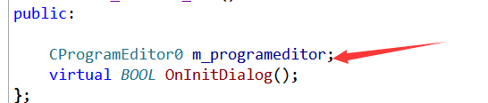

Call the put_code() function ,you can set the code string into the editor.

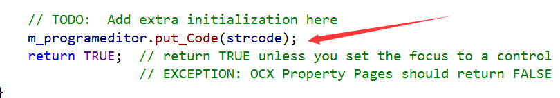

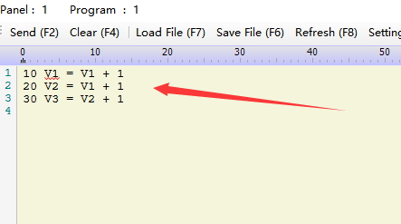
