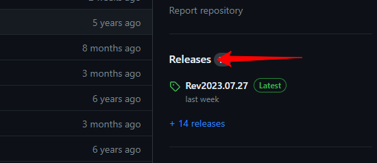
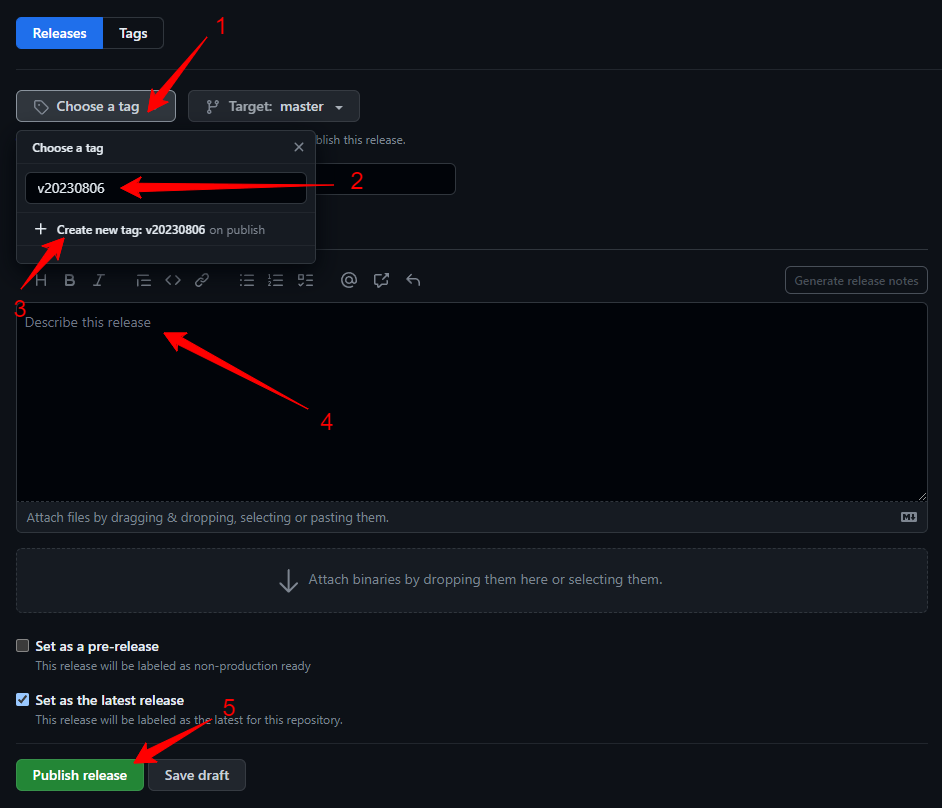

Turning a build into a published release: the tag, the assets that go with it, and what a customer downloads.

How to create a new release in github:

1- Go to the github repository and click release:

https://github.com/temcocontrols/T3000_Building_Automation_System

2- Click Draft a new release

3- fill the version number as the tag name in the usual format ( we don't need the "v" letter but the github action will clean it so don't worry about it ) and fill the release title and description ( release notes ) and then click "Publish release"

That is it, the github action will take care of everything ( it need about ten minutes to finish ), the version will auto updated in the ProductPath.ini file and the Update zip file will auto replaced in the ftp folder
