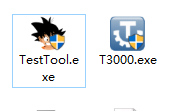
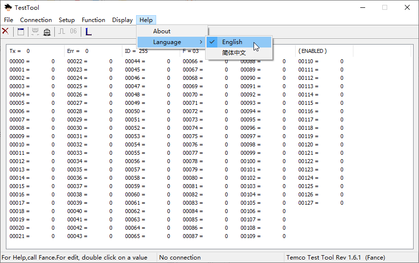
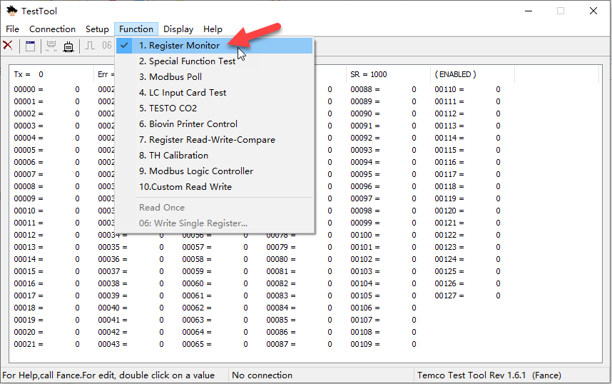
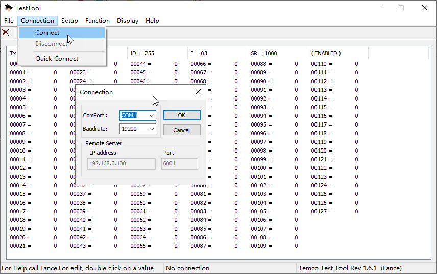
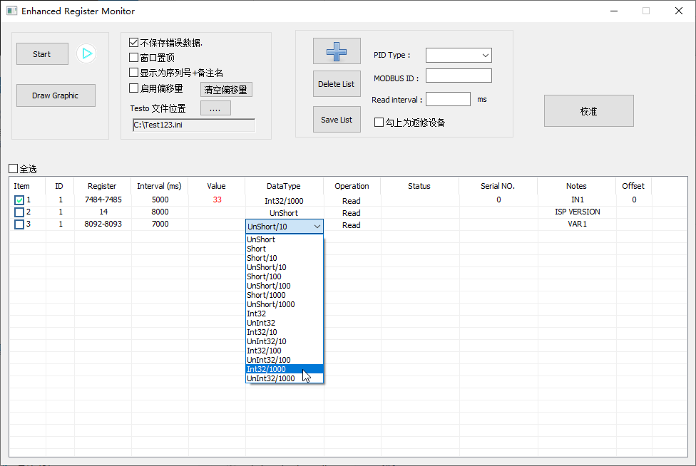
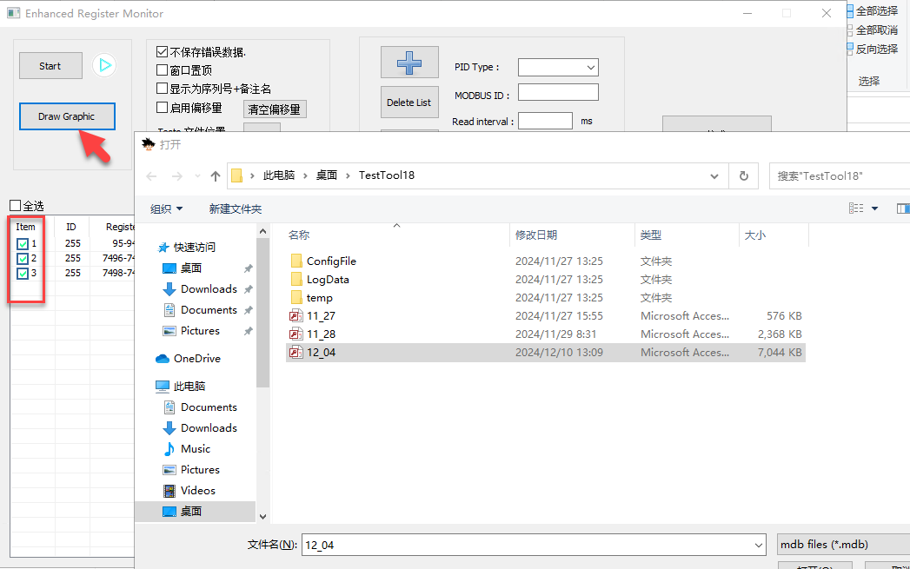
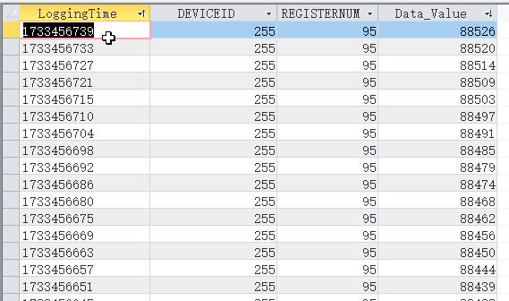
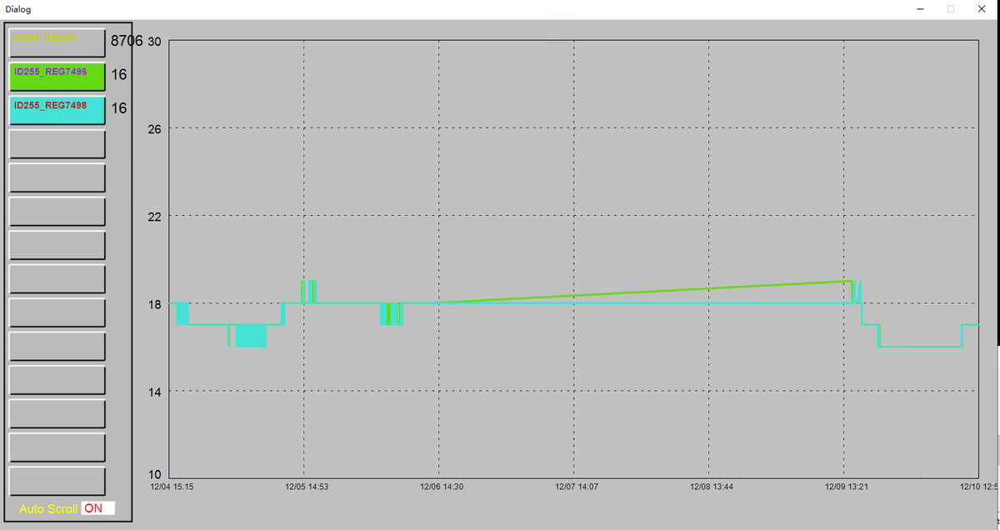

Capturing a session of live point values so that a fault which has already passed can still be looked at.

Download TestTool.exe

Please Update your T3000 software to fix this bugs .

Help->Check for updates ->Update T3000 .

The T3000.exe directory will contain the latest version of TestTool.exe

https://temcocontrols.com/ftp/software/20T3000Update.zip

You can also download it directly from here and extract it to any directory

Select Function 1. Register Monitor

Connect your device

Fill in the Modbus ID, register, sampling time, data type that you want to monitor

Click the "+" sign to add a line

Input 1 value = (Reg7484 * 65536 + Reg7485) / 1000

If it is a combination of two registers, please fill in "Register" with something like 7484-7485, or use the register number if it is a single register.

Click start to start recording

When the recording ends, an access database is generated in the TestTool.exe directory with the current date. Click Draw Graphic to select the database to draw the image

Select the row that you want to draw

You can also open *.mdb directly to see the results

