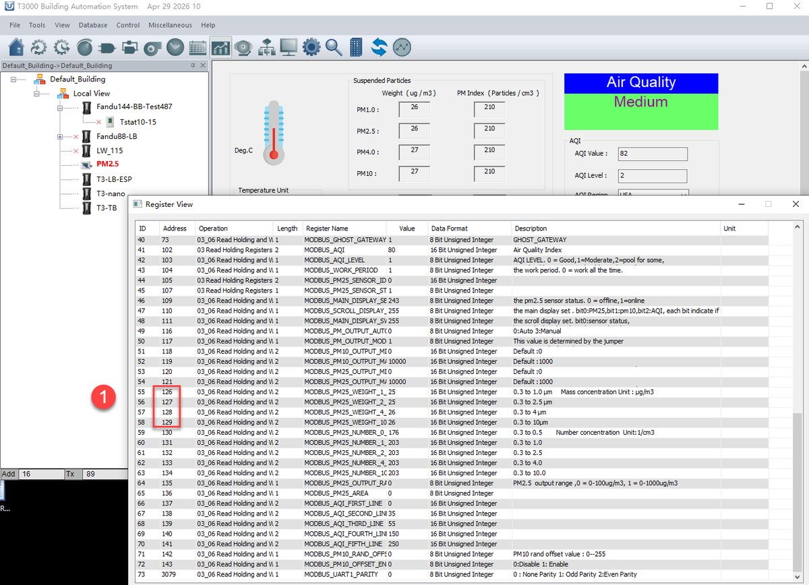
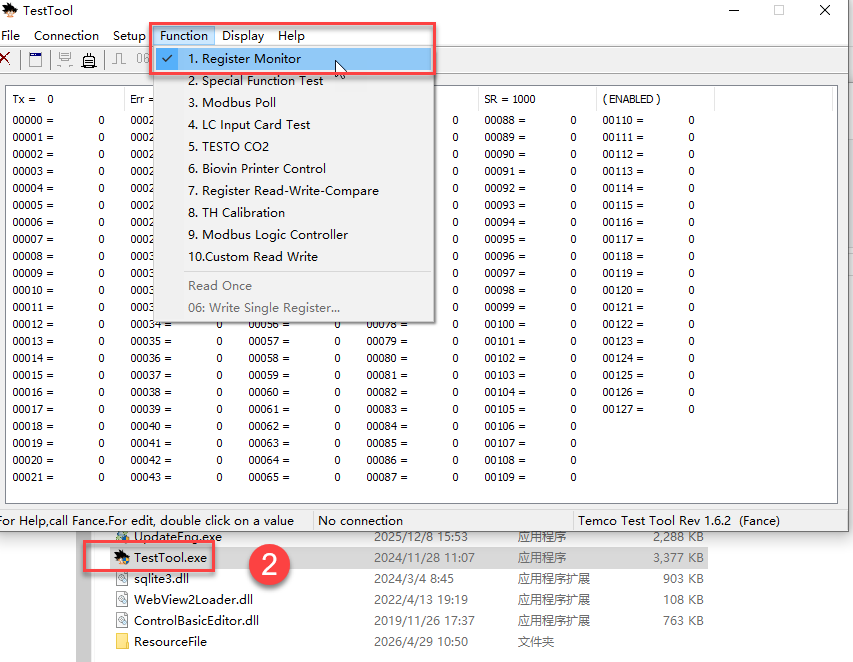
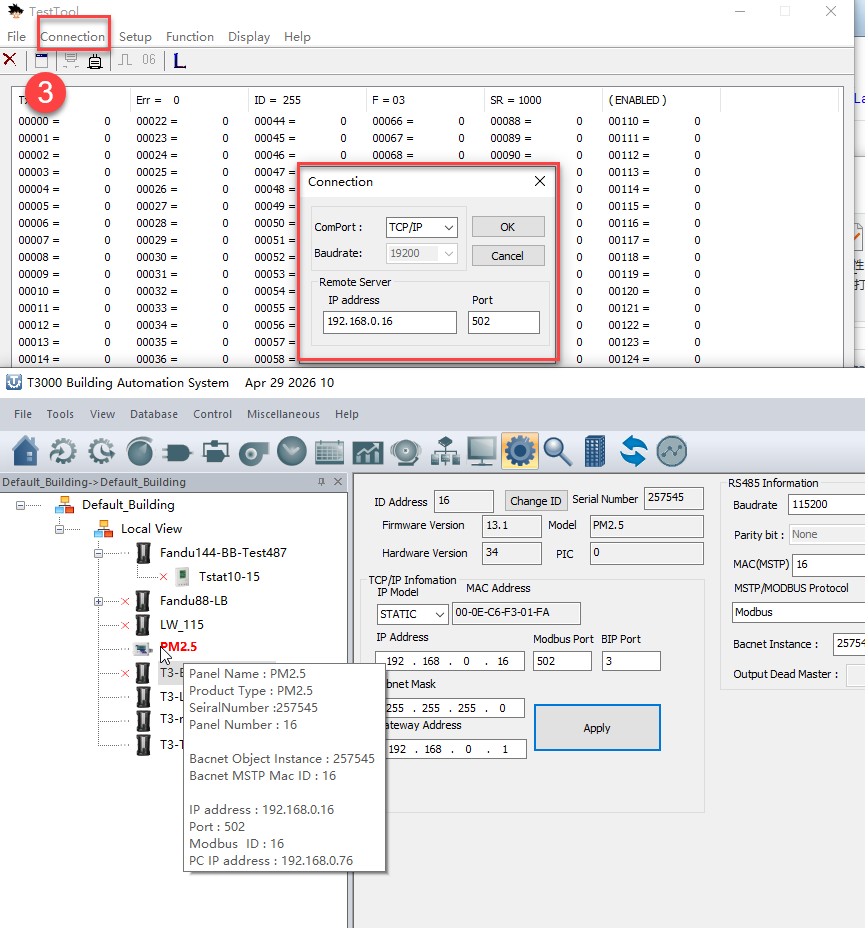
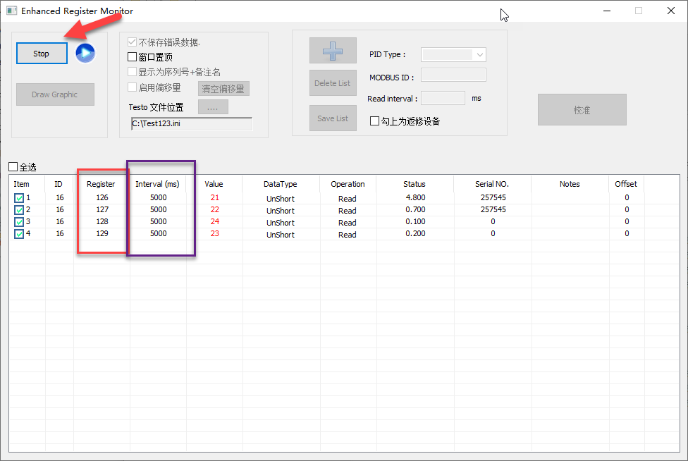
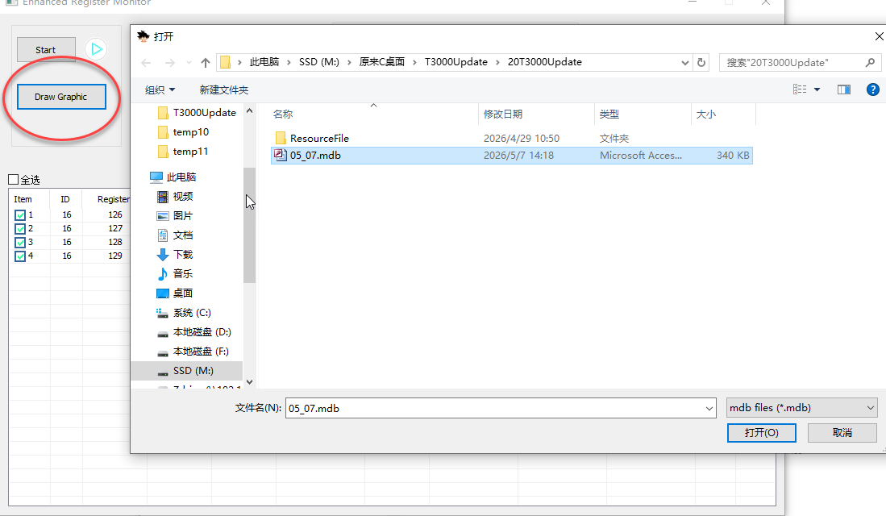
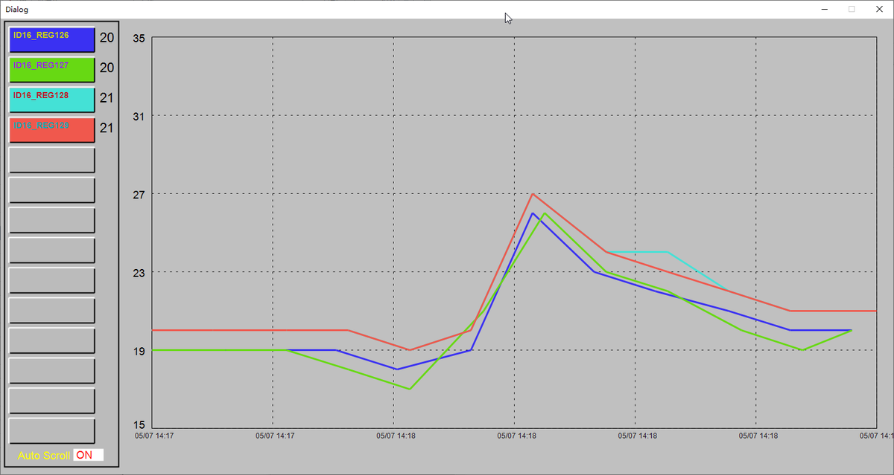
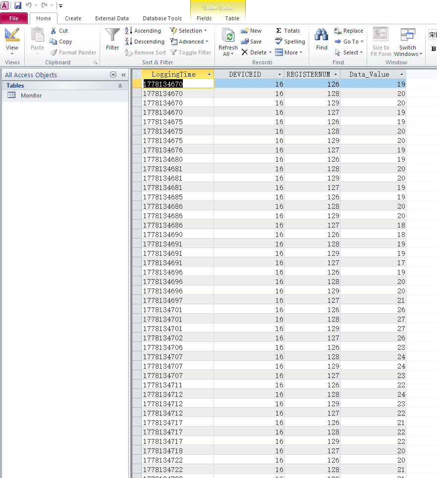

Reading a controller’s trend logs from the test tool rather than from the T3000 screens, which is how a fault is confirmed against raw history.

T3 Controller Manual Data Logging Guide

Since the firmware does not support most of the functions on the menu, the T3000 software cannot automatically generate the Trendlog view like products such as the T3-BB. Our newly developed T3-3IIC supports this set of functions. In this case, I can only guide you on how to manually record data using the Test Tool.

In Tab 1 of the Tool-Register viewer, confirm the registers you want to sample. For example, registers 126, 127, 128, and 129 correspond to PM2.5 values.

Open the TestTool located in the T3000 folder, then select 1.Register Monitor under Function.

Select the device IP address or COM port in Connection.

(Note: If using a COM port, please close the T3000 software first)

Enter the target registers and set the sampling interval time, then click the button to start sampling.

After finishing sampling, you can manually load the data to generate the view. You can also manually open the database file (Windows Office is required to open it normally).

