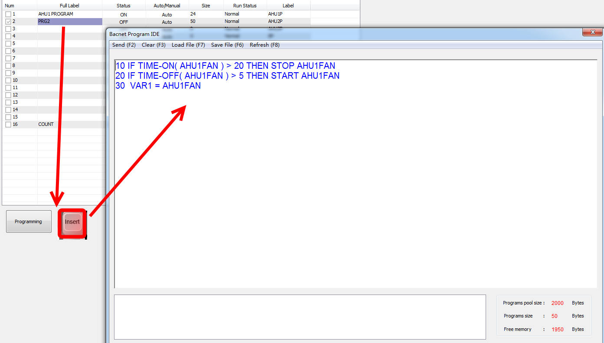
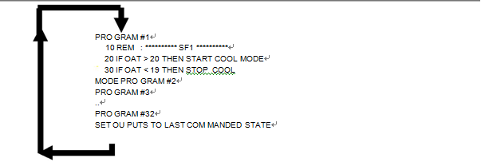

Control Basic is the language used in the T3000 Building Automation System to implement the user defined logic of the controllers. These Control Basic programs live and run in the controllers to manage the environment in the building. The basic language has been around a long time so it may sound a bit 'dated' to be using this but its easy for newcomers to learn and there are many extensions on the root language to make the programming of controls applications easy. The programs read like a sequence of operations, a couple simple examples follow:

Here's a quick program to turn a fan on and off based on a schedule:

IF SCHEDULE1 THEN START FAN101 ELSE STOP FAN101

And here's a simple program to open an on/off type valve to heat a room for example.

IF TEMP101 < SETPOINT THEN OPEN VALVE101

IF TEMP101 > SETPOINT + 0.5 THEN CLOSE VALVE101

If you have a modulating valve things are also easy using the built in PID objects:

VALVE101 = PID1

The English like structure makes it easy for non programmers to follow along and debug. The following chapter describes the Control Basic language along with some examples.

## 8.1 THE CONTROL BASIC EDITOR

To get to the program editor, hit the Hot-Key combination ALT-P, or maneuver in the menu system to CONTROL, PROGRAMS and the table of programs appears as shown below:

This table lists all the programs in a particular T3000 panel, the size of each program, and a 20 and 8 character description of each program, similar to the naming conventions of INPUTS and OUTPUTS. To see a particular program, use the arrow keys to maneuver the cursor onto one of the records, and press the “INS” key. A full screen editor should pop- up and depend
ing on what is in the particular program, you should see a listing of that program, or a blank screen if there is no example file loaded.

To enter a line, type a line number followed by a simple “Statement” as shown:

10 START OUT1

Program lines are checked for errors when the “F2" command is given to send the current program. The editor screen has a Help Bar along the top and bottom row of the screen to remind you of the special function keys. When you hit F2, the current program is checked for errors. If the check was successful, the T3000 will begin executing the current program. If errors are found, messages will appear in the Error Window at the bottom of the screen, and the T3000 continues executing whatever program was last successfully sent.

Cursor movement within the editor is accomplished using the arrow keys on the key pad. If the program is longer than a single screen, the program will scroll in the editor window.

The special function keys which are active during the editing of basic programs are as follows:

<table>
  <tr><td>“Ins”</td><td>The Insert key which causes a pop- up window to appear showing detailed information</td></tr>
  <tr><td>on any INPUT, OUTPUT or VARABLE in the program. This is very useful</td></tr>
  <tr><td>for debugging programs. The pop-up window can be used to toggle the item</td></tr>
  <tr><td>On or Off, or to manually set the outdoor air temperature to 35 Deg C for example</td></tr>
  <tr><td>“Del”</td><td>The Delete key deletes the character at the current cursor position.</td></tr>
  <tr><td>“End”</td><td>The End key moves the cursor to the end of the line in which it is in.</td></tr>
  <tr><td>“Esc”</td><td>Exits the current editing session, prompting you to send the program if changes</td></tr>
  <tr><td>have been made.</td></tr>
  <tr><td>“PgUp”</td><td>The PageUp keystroke scrolls the editor window one screen upwards.</td></tr>
  <tr><td>“PgDn”</td><td>The PageDown keystroke scrolls the editor window one screen downwards.</td></tr>
  <tr><td>CTRL-L</td><td>Highlights the current line for copying or deleting.</td></tr>
  <tr><td>CTRL-U</td><td>Un-selects the currently selected block.</td></tr>
  <tr><td>CTRL-D</td><td>Deletes the currently selected block.</td></tr>
  <tr><td>CTRL-Y</td><td>Deletes a line at the current cursor position, regardless of whether the line is</td></tr>
  <tr><td>highlighted or not.</td></tr>
  <tr><td>CTRL-O</td><td>Undoes the last block or line delete.</td></tr>
  <tr><td>CTRL-C</td><td>Copies the currently highlighted block.</td></tr>
</table>

<table>
  <tr><td>CTRL-F</td><td>Searches the current program for a specified string. The default search string is</td></tr>
  <tr><td>taken from the current cursor position, or a new one can be typed in by the user.</td></tr>
  <tr><td>CTRL-N</td><td>Searches for the next occurrence of the same string previously searched for the</td></tr>
  <tr><td>FIND command (CTRL-F).</td></tr>
  <tr><td>CTRL-R</td><td>Searches for all occurrences of a specified string and re places them with a second</td></tr>
  <tr><td>string. The replace command does not prompt on each substitution. The</td></tr>
  <tr><td>default search string is taken from the current cursor position, but a new one</td></tr>
  <tr><td>can be typed in by the user.</td></tr>
  <tr><td>CTRL-E</td><td>Re-numbers the entire program in increments of 10. Use this command to</td></tr>
  <tr><td>make space between two lines for a new line.</td></tr>
  <tr><td>F2</td><td>Checks the current program for errors and sends it to be executed if there are</td></tr>
  <tr><td>no errors. If there are errors, the old program continues executing (if there was</td></tr>
  <tr><td>one) and the user is able to continue editing.</td></tr>
  <tr><td>F3</td><td>Clears the current editor buffer. If there was a program executing in the T3000,</td></tr>
  <tr><td>that program is cleared as well. The user is prompted before al lowing the cur-</td></tr>
  <tr><td>rent program to be cleared.</td></tr>
  <tr><td>F4</td><td>Prints the current program on the printer.</td></tr>
  <tr><td>F5</td><td>Loads a BASIC file from the hard disk. Works in conjunction with the F6 command</td></tr>
  <tr><td>to allow the user to transfer Basic programs from old projects, other panels ,</td></tr>
  <tr><td>and different versions by using the Save and Load commands. Basic files</td></tr>
  <tr><td>are saved in text format with the .BAS ex tension. The directory used by the file</td></tr>
  <tr><td>Operations is determined in the CONFIGURATION, SETUP, FILEPATH screen.</td></tr>
  <tr><td>F6</td><td>The Save command allows the user to save Basic files in a text format on the</td></tr>
  <tr><td>hard disk. Operates in conjunction with the LOAD command above.</td></tr>
</table>

## 10.2 CONTROL BASIC EXAMPLE

Control Basic program as used by the T3000 system is essentially the same as any other Basic program, a sample of which is shown below:

10 REM *** START / STOP ***

20 DA LARM AHU7- FRZ , 60 , AHU7 FREEZE STAT ALARM 30 DA LARM AHU7- FS , 300 , AHU7 FIL TER PRESS HIGH

40 REM **** DE CIDE IF HEAT ING MODE IN FORCE ****

50 IF AHU7- HV 1 THEN AHU7- HM = 1 ELSE AHU7- HM = 0

60 IF DM-7 OR PC-7 OR WU-7 THEN START AHU7-S/S ELSE STOP AHU7-S/S 70 REM *** MIXED AIR DAMPER ***

80 REM ** FREE COOL MODE **

90 IF OAT AHU7- RTS - 2.5 THEN START AHU7- FCM

100 IF OAT AHU7- RTS - 1 THEN STOP AHU7- FCM 110 AHU7- MAD = MAX( AHU7- AIR , 1- CON1 )

120 IF NOT AHU7- FCM THEN AHU7- MAD = AHU7- AIR

130 IF AHU7- HV 1 THEN AHU7- MAD = AHU7- AIR

140 IF OAT 10 THEN AHU7- MAD = MIN( AHU7- MAD , TIME- ON( AHU7-S ) )

150 IF NOT AHU7-S THEN AHU7- MAD = 0

160 AHU7- DSP = MAX( 12 , MIN( OCCT-7 , 24 ) )

170 IF NOT AHU7-S/S THEN AHU7- DSP = AHU7- MAT

180 REM *** HEAT ING CON TROL ***

190 AHU7- HV = 1- CON2

200 IF AHU7- SAT 30 THEN AHU7- HV = 0

210 IF AHU7- RTS OCCT-7 THEN AHU7- HV = 0

220 IF NOT AHU7-S THEN AHU7- HV = 0

230 IF AHU7- FRZ THEN AHU7- HV = 100

240 AHU7- HSP = AHU7- DSP - 0.5

250 IF NOT AHU7-S/S THEN AHU7- HSP = AHU7- SAT

260 REM *** COOL ING CON TROL ***

270 AHU7- CSP = AHU7- DSP + 0.5

280 IF NOT AHU7-S/S THEN AHU7- CSP = AHU7- SAT

290 AHU7- CV = 1- CON3

295 IF AHU7- RTS OCCT-7 + 1 THEN GOTO 330

300 IF AHU7- FCM AND AHU7- MAD 90 THEN AHU7- CV = 0

330 IF AHU7- SAT 10 THEN AHU7- CV = 0

340 IF NOT AHU7-S THEN AHU7- CV = 0

Control Basic programs have line numbers for each new program statement. Each statement, command, and operator is separated from the next item by a space. Program execution starts at the top-most line and barring any GOTO

statements in the program, follows on through each line in the program.

## 10.3 PROGRAM FLOW

There are some special mechanisms employed by the T3000 operating system to protect the pumps and fans, and control them efficiently. Understanding the program flow in a T3000 system will help understand how to better program a real time system and will also make your programs easier to follow.

For the most part, program logic in the T3000 panel follows through from the top of the program to the last line in sequential order. Since Basic supports the GOTO command, but program execution can actually take any path that you desire, but GOTO statements can cause a program to be difficult to follow.

Although an OUTPUT can appear many times in a program, with some lines commanding the output to go on, and other lines telling the output to go off, the output is not actually switched until all the lines in a particular panel are evaluated. This mechanism gives lines appearing at the end of the program veto power over earlier lines. Safety program statements such as
emergency shutdown
appear at the end of a program to be sure the shut down logic over rides
all other possible logic. A useful consequence of this mechanism is that a particular output can appear many times in a program, breaking up the logic amongst several simple program statements.

When the last line is processed, the T3000 system automatically begins execution from the start of the program again. There is no need for a RETURN statement as in other Basic dialects as the return is implied in a T3000 program. Each program can be thought of as a treadmill on which the T3000 keeps on running continuously churning through the code and adjusting the outputs based on the program logic. The example below shows the logic flow for the T3000 system:

Good programming practice will dictate that a particular output is programmed in only one program. If the program for a particular system is so large that it must be broken up, the program would be broken along logical boundaries so that each output only appears in one program. Future trouble shooting sessions will be simplified if each output is programmed in only one program.

## 10.4 CONTROL BASIC COMPONENTS

This section lists the components used in Basic program. Following this list is a detailed list of all the program commands and functions. Most of the items are explained with a short ex ample on how to use the command.

The following is a list of the fundamental components of a Basic program:

REAL NUMBERS . .
Ordinary numbers.

DAYS . . . . . . .
The 7 days of the week.

DATES . . . . . .
The calendar date.

TIMES . . . . . . .
Time in HH:MM:SS format.

VARIABLES . . . .
The T3000 soft ware sup ports a large table of Variables or mem
ory locations which can be used for setpoints, accumulators, modes and other useful bits of information pertinent to the particular application.

OPERATORS
. . .
Mathematical operators such as the greater than( >), less than (
&lt;), and equals ( =) symbols.

COMMANDS . . . .
Specifies an action word in programming language such as the
START command in the following example:

IF IN1 > 20 THEN START OUT1

FUNCTIONS . . . .
Functions are built in routines which return a value. For instance
MAX(T1, T2, T3... ) in the example shown will return the larger of the items enclosed in brackets.

VAR1 = MAX( IN1 , IN2 , IN3 )

EXPRESSIONS. . . . Notation that has a value. Usually a combination of above elements.

The complete list of Control Basic components:

<table>
  <tr><td><strong>STATEMENT</strong></td><td><strong>TYPE</strong></td><td><strong>DESCRIPTONSUMMARY</strong></td></tr>
  <tr><td>NUMBERS</td><td>DATA</td><td>Real numbers are handled by the T3000 in full floating point for mat</td></tr>
  <tr><td>DAYS</td><td>DATA</td><td>Days are evaluated as an integer from 0 for sun day to 6 for saturday</td></tr>
  <tr><td>DATES</td><td>DATA</td><td>Dates are handled internally by the T3000 as a number from 1 to 365</td></tr>
  <tr><td>TIMES</td><td>DATA</td><td>Times are handled internally as hours, but can be typed HH:MM:SS in a program</td></tr>
  <tr><td>VARIABLES</td><td>DATA</td><td>Variables are handled internally as real numbers with full floating point notation</td></tr>
  <tr><td>NOT</td><td>OPERATOR</td><td>Evaluates to TRUE if the opposite is true. IF NOT HOT evaluates to true when COLD</td></tr>
  <tr><td>^</td><td>OPERATOR</td><td>Exponent, raises a number to a power as in 2^2 = 4</td></tr>
  <tr><td>* / \ MOD</td><td>OPERATOR</td><td>Multiplication, division, integer portion of a division, remained of a division</td></tr>
  <tr><td>+ -</td><td>OPERATOR</td><td>Addition and subtraction</td></tr>
  <tr><td>&lt; &gt; ... etc</td><td>OPERATOR</td><td>Less than, greater than, and other combinations.</td></tr>
</table>

<table>
  <tr><td>AND</td><td>LOGIC</td><td>Logical AND, both conditions must be TRUE for the expression to evaluate to TRUE</td></tr>
  <tr><td>OR</td><td>LOGIC</td><td>Logical OR, if either expression is TRUE the result is TRUE</td></tr>
  <tr><td>XOR</td><td>LOGIC</td><td>Logical Exclusive OR, evalutates to TRUE if the two expressions are different</td></tr>
  <tr><td>ABS</td><td>FUNCTION</td><td>Absolute Value, returns the positive equivalent of a negative or positive number</td></tr>
  <tr><td>ALARM</td><td>COMMAND</td><td>Causes an alarm, has built in hysterisis to avoid multiple alarms from the same event</td></tr>
  <tr><td>ALARM-AT</td><td>COMMAND</td><td>Selects which panel will annunciate alarms, default is ALL panels</td></tr>
  <tr><td>AVG</td><td>FUNCTION</td><td>Average of all numbers enclosed in the brackets following this command</td></tr>
  <tr><td>CALL</td><td>COMMAND</td><td>Calls an other program which functions as a sub routine, takes arguments</td></tr>
  <tr><td>CLEAR</td><td>COMMAND</td><td>Clears all the local variables in a given program</td></tr>
  <tr><td>CLOSE</td><td>COMMAND</td><td>Sets a variable or out put to 0, same as STOP but is more intuitive in some cases</td></tr>
  <tr><td>CONPROP</td><td>FUNCTION</td><td>Allows a Basic program to up date the proportional term in a particular PID controller</td></tr>
  <tr><td>CONRATE</td><td>FUNCTION</td><td>Allows a Basic program to up date the derivative term in a particular PID controller</td></tr>
  <tr><td>CONRESET</td><td>FUNCTION</td><td>Allows a Basic program to up date the integral term in a particular PID controller</td></tr>
  <tr><td>DALARM</td><td>COMMAND</td><td>Delayed alarm, allows generation of alarms if a condition is true for a certain time</td></tr>
  <tr><td>DECLARE</td><td>COMMAND</td><td>First line of a sub routine to accept the list of arguments from a CALL statement</td></tr>
  <tr><td>DISABLE</td><td>COMMAND</td><td>Same as STOP or CLOSE, sets an item to 0</td></tr>
  <tr><td>DOM</td><td>FUNCTION</td><td>Day of month, returns the day of the month, starting with 1 on the first of the month</td></tr>
  <tr><td>DOW</td><td>FUNCTION</td><td>Day of week, returns a number from 0 to 6 starting with Sun day as zero</td></tr>
  <tr><td>DOY</td><td>FUNCTION</td><td>Day of the year, starting with Jan1 as 1</td></tr>
  <tr><td>ENABLE</td><td>COMMAND</td><td>Same as START or OPEN, sets the value of an item to 1.</td></tr>
  <tr><td>END</td><td>COMMAND</td><td>Ends execution of a program, T3000 assumes and end at the end of each program</td></tr>
  <tr><td>FOR</td><td>COMMAND</td><td>Loop control statement, FOR A =1 TO 10 ....PRO GRAM LINES.....NEXT A</td></tr>
  <tr><td>GOSUB</td><td>COMMAND</td><td>Branches to sub routine, executes program till next RE TURN statement, and loops back</td></tr>
  <tr><td>GOTO</td><td>COMMAND</td><td>Unconditionally branches program execution to an other line</td></tr>
  <tr><td>HANGUP</td><td>COMMAND</td><td>Ends a phone call in progress</td></tr>
  <tr><td>IF</td><td>COMMAND</td><td>Logical decision, IF HEAT MODE THEN START OUT1</td></tr>
  <tr><td>IF+</td><td>COMMAND</td><td>Executes the program line only once when the condition goes from FALSE to TRUE</td></tr>
  <tr><td>IF-</td><td>COMMAND</td><td>Opposite of IF+, executes the line only when a condition be comes FALSE</td></tr>
  <tr><td>INT</td><td>FUNCTION</td><td>Returns the integer part of an expression</td></tr>
  <tr><td>INTERVAL</td><td>FUNCTION</td><td>IF INTERVAL(0:01:00) executes the following programming once every minute</td></tr>
  <tr><td>LET</td><td>COMMAND</td><td>Assignment operator, LET B = 20, has the same effect as B = 20</td></tr>
  <tr><td>LN</td><td>FUNCTION</td><td>Natural logarithm of the argument</td></tr>
  <tr><td>LN-1</td><td>FUNCTION</td><td>In verse logarithm of the argument</td></tr>
  <tr><td>MAX</td><td>FUNCTION</td><td>Maximum of a list of arguments enclosed in brackets following the statement</td></tr>
  <tr><td>MIN</td><td>FUNCTION</td><td>Minimum of a list of arguments enclosed in brackets following the statement</td></tr>
  <tr><td>NEXT</td><td>COMMAND</td><td>Used in conjunction with the FOR statement to increment the loop counter</td></tr>
  <tr><td>ON</td><td>COMMAND</td><td>ON VAR1 GOTO 100 , 200 , 300 , controls program path depending on VAR1</td></tr>
  <tr><td>ON-ALARM</td><td>COMMAND</td><td>Evaluates to TRUE when ever there is an alarm in the system.</td></tr>
  <tr><td>ON-ERROR</td><td>COMMAND</td><td>Used with PHONE, REMOTE- GET, REMOTE- SET, and RUN- SYSTEM</td></tr>
  <tr><td>OPEN</td><td>COMMAND</td><td>Sets an item to 1, OPEN OUT1 is the same as START OUT1</td></tr>
  <tr><td>PHONE</td><td>COMMAND</td><td>Phones a number, allows T3000 to dial with a modem for numeric paging</td></tr>
  <tr><td>POWER -LOSS</td><td>FUNCTION</td><td>Looks for loss of power, 1 the first time the function is evaluated, o afterwards</td></tr>
  <tr><td>PRINT</td><td>COMMAND</td><td>Print strings at a printer connected to the panel</td></tr>
  <tr><td>PRINT- AT</td><td>COMMAND</td><td>Print strings at a printer connected to an other panel on the net work</td></tr>
  <tr><td>REM</td><td>COMMAND</td><td>Remark, used to add comments to a program</td></tr>
  <tr><td>REMOTE- GET</td><td>COMMAND</td><td>10 REMOTE- GET VAR1 = 2IN1, gets a reading from an other site via modem</td></tr>
  <tr><td>REMOTE-SET</td><td>COMMAND</td><td>Sets a variable at a remote site via modem.</td></tr>
  <tr><td>RE TURN</td><td>COMMAND</td><td>Causes program execution to return from a sub routine</td></tr>
  <tr><td>RUN-MACRO</td><td>COMMAND</td><td>Causes a macro command or series of key strokes to be run</td></tr>
  <tr><td>SCANS</td><td>FUNCTION</td><td>The number of scans a panel is per forming in one second</td></tr>
  <tr><td>SET-PRINTER</td><td>COMMAND</td><td>Tells a T3000 system there is a printer at a particular panel</td></tr>
  <tr><td>SQR</td><td>FUNCTION</td><td>Returns the square root of the argument</td></tr>
  <tr><td>START</td><td>COMMAND</td><td>Sets the value of an items to 1, same as OUT1 = 1 or OPEN OUT1</td></tr>
  <tr><td>STATUS</td><td>FUNCTION</td><td>Status of a panel on the net work, 0 = No Comm, 1 =OK, 2 = no program</td></tr>
  <tr><td>STOP</td><td>COMMAND</td><td>Sets the value of an items to 0, same as OUT1 = 0 or CLOSE OUT1</td></tr>
  <tr><td>TBL</td><td>FUNCTION</td><td>Looks up a value in a table</td></tr>
  <tr><td>TIME</td><td>FUNCTION</td><td>Finds the cur rent time</td></tr>
</table>

<table>
  <tr><td>TIME-OFF</td><td>FUNCTION</td><td>Finds the time variable has been false</td></tr>
  <tr><td>TIME-ON</td><td>FUNCTION</td><td>Finds the time variable has been true</td></tr>
  <tr><td>WAIT</td><td>COMMAND</td><td>Pauses program execution</td></tr>
  <tr><td>WR-ON</td><td>FUNCTION</td><td>Finds when a weekly routine is set to come on</td></tr>
  <tr><td>WR-OFF</td><td>FUNCTION</td><td>Finds when a weekly routine is set to go off</td></tr>
  <tr><td>UNACK</td><td>FUNCTION</td><td>Determines if there are unacknowledged alarms in system</td></tr>
  <tr><td>USER-A</td><td>FUNCTION</td><td>Finds the user logged on to the local port</td></tr>
  <tr><td>USER-B</td><td>FUNCTION</td><td>Finds the user logged on to the remote port</td></tr>
</table>

The following sections list the components of a Basic program, along with some examples and descriptions on how they operate.

In this section the various components are listed alphabetically. The explanation of each term consists of 3 parts:

1. Purpose . . . . . Explains when the function is used.

2. Format . . . . . Shows how the function is used.

3. Example . . . . Gives a practical application.
