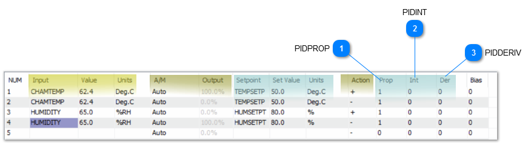
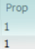
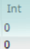
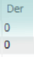

The PIDPROP, PIDRESET and PIDRATE statements allow you to change the PID terms in a control basic program. These commands will be useful for a program which adjusts the PID parameters on the fly such as for a self tuning PID.

A quick summary of the PID terms from the
PID controller discussio
n are shown here for reference:

The proportional term can be thought of as the “rigidity” of the PID loop and its response to a deviation from setpoint. A large value will make the valve or damper lazy while a small term will be more hyper active.

The Integral term accumulates error over time and adds it to the PID loop calculation. A large value for the I term will make the PID more active and a small I term will make the PID loop lazier.

The derivative term allows the PID loop to compensate for a rapidly changing process, if the temperature is quickly approaching setpoint then the D term will increase and slow down the PID response. For common HVAC processes this is left at zero.

<table>
  <tr><td><strong>PIDPROP</strong>Purpose: A user defined program can adjust the proportional term of the PID control loops. Format: PIDPROP(PID# , value )Range of the value: 0 TO 4000Description: PID# is the PID loop you wish to change and value is the new proportional term to be set. PIDPROP returns the value that is currently entered into the PID loop proportional term. Example: 10 A = PIDPROP( 1 , 2.3 * SAT * FACTOR )</td></tr>
</table>

<table>
  <tr><td><strong>PIDINT</strong>Purpose: Enable user programs to change the PID loop integral setting. Format: PIDINT(pid# , value )Range of the Value: 0 to 255Description: pid# is the PID loop you wish to change and value is the new integral value you want to set for this loop. PIDINT returns the current value that is entered into the PID loop Integral term. Example:10 A = PIDINT( 1 , 0.85 )</td></tr>
</table>

<table>
  <tr><td><strong>PIDDERIV</strong>Purpose: Allows programs to change the PID loop derivative setting. Description:PID# is the loop you wish to change the derivative value on, value is the new setting. Format: PIDDERIV(pid# , value )Range for the value: 0 to 2.00PIDDERIV returns the value that is entered into the PID loop derivative setting. Example: 10 IF ABS( SAT - SAS ) &lt; 0.5 THEN A = PIDDERIV( 5 , 50 ) ELSE A = PIDDERIV( 5 , 0 )</td></tr>
</table>
