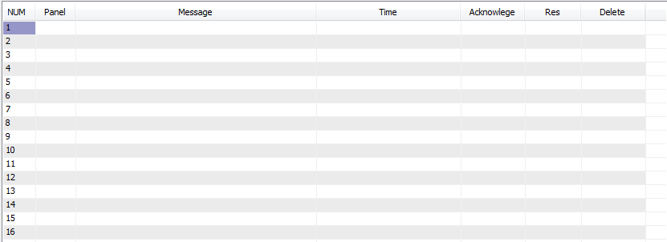

Alarms announce problem conditions in the system. They are generated by the ALARM and DALARM statements in Programs. The ALARM statement generates analog alarms and the DA LARM statement generates an alarm only if the condition persists for more than a defined period of time. These statements allow for a custom alarm message which can contain a maximum of 69 characters. When an alarm occurs, the alarm message can be sent to the printer along with the panel number from which the alarm originated, as well as the date and time through a control basic program. A red alarm box will blink at the top right of the screen, and will be removed only until all the alarms are deleted.

The event of an alarm restoring (going out of alarm condition) or being acknowledged is printed with the time of their occurrence. When an alarm is both acknowledged and restored it disappears from the system. The “Alarm Log” selection from the Data Menu shows all the alarms currently in the system with the corresponding panel (Pan). It is from this selection that alarms are acknowledged (ACK), restored (RES), or deleted (DEL). The time at which an alarm occurred can be seen right next to every alarm message.

To acknowledge an alarm, go to the ALARM LOG and move to the “Ack” column and press ENTER. Restoring. And deleting an alarm is done in the same manner. Alarms can be cleared from the system at the “DEL” column.

If there is any alarm in the system that is neither acknowledged or restored, the beeper in the PC is activated. The beeping can be stopped by acknowledging the alarm or by pressing Ctrl-A. Alarms can be directed to specific panels with the ALARM- AT statement. The default is to alarm all panels.

For information on the programming of ALARM and DALARM statements see
Chapter 10
.
