CONTROL

The T3000 software presents the operator with a number of work screens for configuring the points needed to interact with the T3000 control panels. These work areas include screens for ”INPUTS”, “OUPUTS”, “SCHEDULES” and “VARIABLES” to name a few. The behavior of the controller is defined in these work screens and the information is stored in the 'program' file for the controller. This chapter explains each of the various tables.

The Control Menu as displayed:

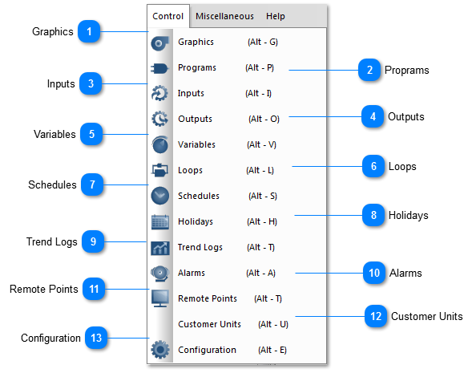

<table>
  <tr><td><strong>Graphics</strong>&lt;TODO&gt;: Insert description text here...</td></tr>
</table>

<table>
  <tr><td><strong>Proprams</strong>&lt;TODO&gt;: Insert description text here...</td></tr>
</table>

<table>
  <tr><td><strong>Inputs</strong>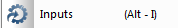&lt;TODO&gt;: Insert description text here...</td></tr>
</table>

<table>
  <tr><td><strong>Outputs</strong>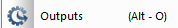&lt;TODO&gt;: Insert description text here...</td></tr>
</table>

<table>
  <tr><td><strong>Variables</strong>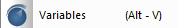&lt;TODO&gt;: Insert description text here...</td></tr>
</table>

<table>
  <tr><td><strong>Loops</strong>&lt;TODO&gt;: Insert description text here...</td></tr>
</table>

<table>
  <tr><td><strong>Schedules</strong>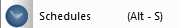&lt;TODO&gt;: Insert description text here...</td></tr>
</table>

<table>
  <tr><td><strong>Holidays</strong>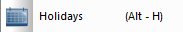&lt;TODO&gt;: Insert description text here...</td></tr>
</table>

<table>
  <tr><td><strong>Trend Logs</strong>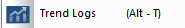&lt;TODO&gt;: Insert description text here...</td></tr>
</table>

<table>
  <tr><td><strong>Alarms</strong>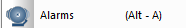&lt;TODO&gt;: Insert description text here...</td></tr>
</table>

<table>
  <tr><td><strong>Remote Points</strong>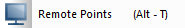&lt;TODO&gt;: Insert description text here...</td></tr>
</table>

<table>
  <tr><td><strong>Customer Units</strong>&lt;TODO&gt;: Insert description text here...</td></tr>
</table>

<table>
  <tr><td>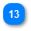<strong>Configuration</strong>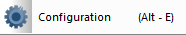&lt;TODO&gt;: Insert description text here...</td></tr>
</table>
