Hot Key: Alt-G

KEYWORD: GRP

Usage
：
GRP1
,
GRP2,GRP3...

How to show: when you use one of these items , the label of the item will be shown in the place where you use

Screens are used to group points of all types into one logical unit for display on the screen. Thus the operator is able to see how a change in one parameter is affecting other related parameters. This enables the operator to see and change the value and auto/manual status of points. The operator can also call up the history information of a point or the program associated with that group. The elements of a screen can be displayed on top of a graphic picture to augment the display of information.

A screen made up of other screens can be used as a menu. Screens may be nested several levels. [TO BE DONE] The TAB key is used as a quick exit key to the Main Menu. This is useful when many screens are nested and the operator does not want to escape through them all. The “Page-Up” and “Page-Down” keys will take you through consecutive screens.

[TO BE DONE] A Screen can be programmed to load up automatically after signing on by entering the Default Screen number in the “USER LIST” selection from Configuration (see Chapter 8 for more info). This screen then becomes the Main Menu for the user, letting them access only their particular room for example.

Sample Graphics screen grind. Hitting the [INSERT] or INS will drill down into a particular screen:

Graphic Screens provide the building operator with a view of the system and associated real time information. Graphic Screens are made up of two parts, the underlying graphical image and on top of that are various icons, inputs, outputs, schedules, and links to other screens. They are easy to customize on the fly so the both the designer and later, the building the operator can easily make changes to suit their working routine.

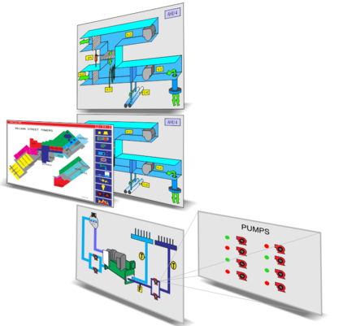

Graphical Screens can be nested so that the operator can drill down to more detailed screens. A large building will typically have an overall floorplan with hot spots leading to each of the zones. Then for major systems there will be icons leading to the chiller room, boiler room and air handlers. The screens can contain links to screens from other controllers which allows you to build up large nested systems for campus size projects. The screens are saved on each of the controllers locally, a change made to one display will immediately be available to other users logging in from elsewhere so there are no syncing delays or conflicts to deal with.

The TAB key is used as a fast exit key to the Main Menu, this is a handy trick to get back to the home position quickly. The “Page-Up” and “Page-Down” keys bypass the nested menu system and bring up the next higher or lower numbered screen respectively. Hitting the ESC key pulls up the previous screen, regardless of whether the user arrived there by clicking on icons in the nested menu system or by using the “Page-Up” and “Page-Down” keys.

[TBD]
A graphical screen can be associated with a particular user when they log on, this screen then becomes that users Main Menu. See the USER LIST section of this manual.

A sample 'Graphical Screens' work area is shown below. Each of the rows in this grid refer to one screen and each controller can host up to sixteen screens [TB: increase to 32]. The first row in this example contains the details for the first screen 'Air handling unit 1', the second line is for screen number two and so on.

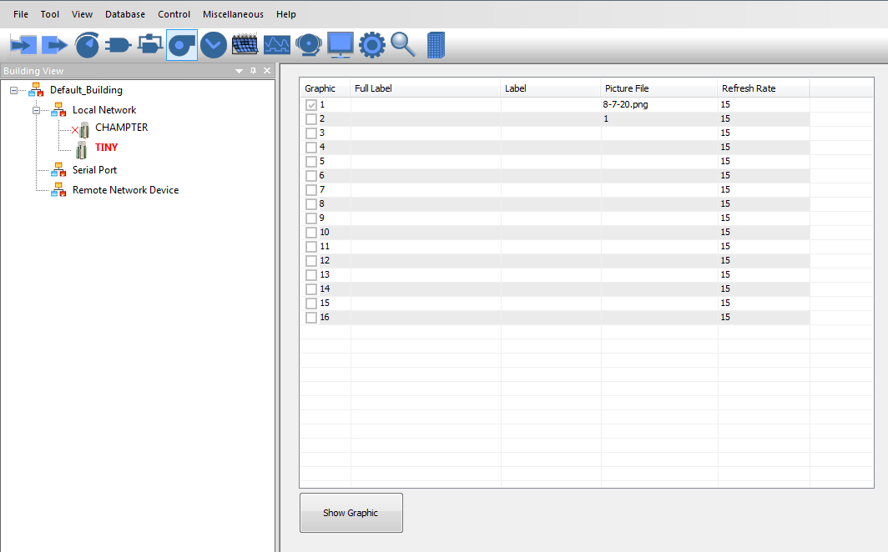

Screens setup fields:

a) Full_label. . . . .
A 20 character descriptor.

b) Label . . . . . .
An 8 character label.

[TO BE DONE] Typing this label into the command line let's you jump to this screen quickly, faster than using the mouse.

c) Picture file . . . . .The name of a graphic file to be splashed on the screen first, the underlay for this particular display.

Note: the name of picture must be less than 10 chars, otherwise ,T3000 only get 10 chars as the name of the file

To program or view an individual Screen press “Ins” while highlighting that row. The graphic display pops up, you can add or remove items from the display by hitting the insert key again. and then set how the item will display, such as showing the the short or long label text along with the value, the value only, color and icons.

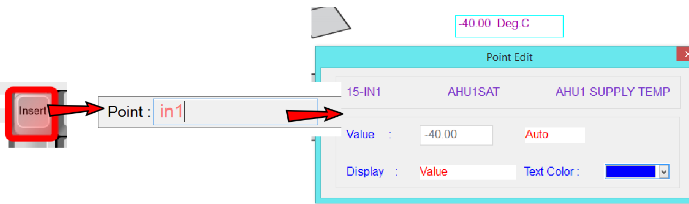

[TO BE DONE]
The work menu reappears if the cursor is moved to the top line of the display. If a graphic is loaded and you are using a mouse, the work menu appears when the mouse is moved to the top of the screen.

The Graphic display can contain up to 46 individual elements on a single screen. These elements can be any combination of the following:

a) Points (GRPS, PRGS, INS, OUTS, VARS, CONS, WRS, ARS, AYS).

b) Custom menus (i.e. MENU#2).

c) [TO BE DONE] Command to run the System Program (i.e. MACRO#1).

d) [TO BE DONE] Any of 50 keywords in Chapter 4.

e) [TO BE DONE] TEXT File - use Text keyword.

f) [TO BE DONE] Command to operating system, same as running the command from keyword.

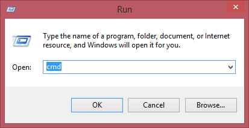

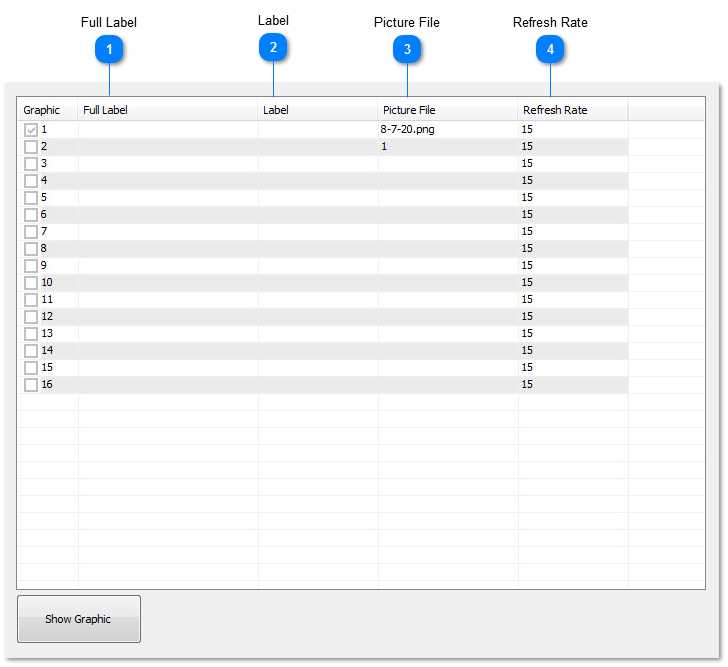

<table>
  <tr><td><strong>Full Label</strong>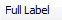A unique twenty character descriptor used to identify the graphic display throughout the system.</td></tr>
</table>

<table>
  <tr><td><strong>Label</strong>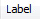A unique eight character descriptor to be used anytime this screen is referred to in the system. Use this name to identify it when placing elements on another display. In the image below we're currently adding items for screen 1 which is for AHU1 and we decide we'd like to add a link from here to jump to AHU2 whcih is screen number2. Just hit the insert key and type AHU2, the short hand name for screen number 2. We could also accomplish the same thing by typing the direct reference GRP2 as well. Once an item has a short hand name you can use either the direct reference or the shorthand name interchangeably. 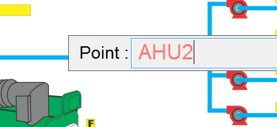[TBD] Jump to this graphic display from the command line.</td></tr>
</table>

<table>
  <tr><td><strong>Picture File</strong>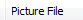This is the file name for the image file which will be pulled up from the local hard disk as the underlay for this graphic display. It can be a jpeg, bmp or png file. Click on this column and you are presented with a browser box to select the image file from your hard disk. 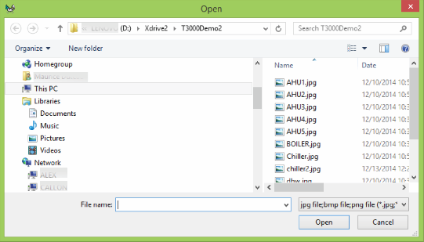If the file is moved or renamed the software may not be able to locate the image file so a basic white display is presented with the data overlaid in the usual positions. [TBD] Store the image file on the SD disk of the controller so that users logging in from other locations can download the image automatically.</td></tr>
</table>

<table>
  <tr><td><strong>Refresh Rate</strong>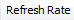Refresh rate is the interval which T3000 will update the screen with new data from the controller. The default setting is 15 seconds which is fine for most situations. Whenever a parameter is changed the screen will also be updated immediately in the background. There are cases, such as with a slow GSM connection when you would want to set this value to a longer period. Setting a fast refresh rate can generate a lot of network traffic. [TBD] The operator can also hit a hot key [F7] to manually refresh the data on command.</td></tr>
</table>
