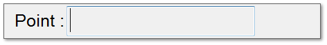

DEALING WITH ELEMENTS ON A SCREEN

When an element in a screen is selected with the ENTER keystroke or the equivalent on the mouse buttons, the system response is as follows for each type:

<table>
  <tr><td><strong>SCREENS .</strong></td><td><strong> (GRP)</strong></td><td><strong>. . . . . Calls that group.</strong></td></tr>
  <tr><td>PROGRAM</td><td>(PRG)</td><td>. . . . . Enters control basic.</td></tr>
  <tr><td><strong>INPUT. . . . . . . . . . . . . </strong></td><td><strong> (IN)</strong></td><td><strong>Pop-up Menu.</strong></td></tr>
  <tr><td><strong>OUTPUT . . . . . . . . . </strong></td><td><strong> (OUT) .</strong></td><td><strong>Pop-up Menu.</strong></td></tr>
  <tr><td><strong>VARIABLE . . . . . . . </strong></td><td><strong> (VAR)</strong></td><td><strong>Pop-up Menu.</strong></td></tr>
  <tr><td>WEEKLY ROUTINE. . .</td><td>(WR)</td><td>Pop-up Menu.</td></tr>
  <tr><td>ANNUAL ROUTINE . .</td><td>(AR)</td><td>Pop-up Menu.</td></tr>
</table>
<table>
  <tr><td>ANALOG MONITOR . .</td><td>(AMON).</td><td>Displays monitor data menu.</td></tr>
  <tr><td>DIGITAL MONITOR . . . .</td><td>(DMON) .</td><td>Displays monitor data menu.</td></tr>
  <tr><td>ARRAYS . . . . . . . . .</td><td>(AY) .</td><td>Displays array data.</td></tr>
  <tr><td>ARRAY ELEMENT . . .</td><td>(AY1[?])..</td><td>Edit value.</td></tr>
  <tr><td>MACRO . . . . . . . . . . . . .</td><td>.</td><td>Call Macro.</td></tr>
  <tr><td>MENU . . . . . . . . . . . . . .</td><td>.</td><td>Call Menu.</td></tr>
  <tr><td>DOS . . . . . . . . . . . . . .</td><td>.</td><td>Run DOS command.</td></tr>
  <tr><td>TEXT . . . . . . . . . . . . . .</td><td></td><td>Text window popup.</td></tr>
  <tr><td>KEYWORD . . . . . . . . . . . .</td><td>.</td><td>Do function of Keyword</td></tr>
</table>

Additionally, hitting the INS key or the equivalent mouse button on Elements will bring up the Pop-up work screen.

SCREENS NOTES:

1. If a Screen is intended to be displayed with a graphic file, but the user does not have the graphic, the points are displayed in two columns regardless of the position information.

2. No value is displayed if the point is a screen, analog monitor, array, or program.

NOTES:

GRP,IN,OUT,VAR :SUPPORTED

OTHERS :TBD
