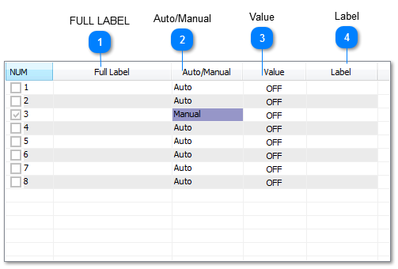
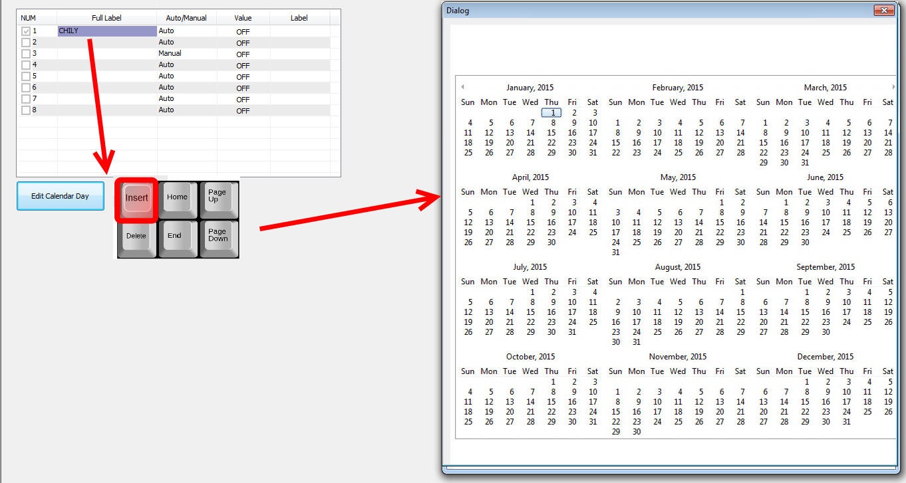
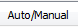
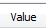
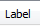

Hot Key: Alt-H

KEYWORD: AR

Usage
：
AR1
,
AR2,AR3...

How to show: when you use one of these items , the label of the item will be shown in the place where you use

Holidays are days for special action throughout the calendar year.

Sample Holidays work screen:

<table>
  <tr><td><strong>FULL LABEL</strong>A unique twenty character descriptor used to identify the item throughout the system. Used for programming, trend logging, reports and so on.</td></tr>
</table>

<table>
  <tr><td><strong>Auto/Manual</strong>Controls whether the routine is operational or not.</td></tr>
</table>

<table>
  <tr><td><strong>Value</strong>The state of the routine (ON/OFF).</td></tr>
</table>

<table>
  <tr><td><strong>Label</strong>Eight character descriptor, a unique ID used to refer to this particular item throughout the system: programming, trend logs and so on.</td></tr>
</table>

To program the times for an individual routine press the “INS” key while highlighting that point. The year is then displayed in 4 calendar format pages (use PgUp and PgDn keys to change page) with months available on each page. Work menu operations are again available. To set a day as a holiday move the cursor to the desired day and press “ENTER”.

The Annual Routines defined here are the special event over rides which appeared in the previous section which described set ting up the ON and OFF times for Weekly Routines (repeated below).

When the annual over rides are defined, they can be entered into the “OR1" and ”OR2" fields of the Weekly Routine setup area shown above, in order to let the Annual Routines override the weekly routines. In the ex ample above, we have entered “AR-1" or ”Annual Routine 1" to override the Weekly Routine defined by “WR-1" or Weekly Routine 1
