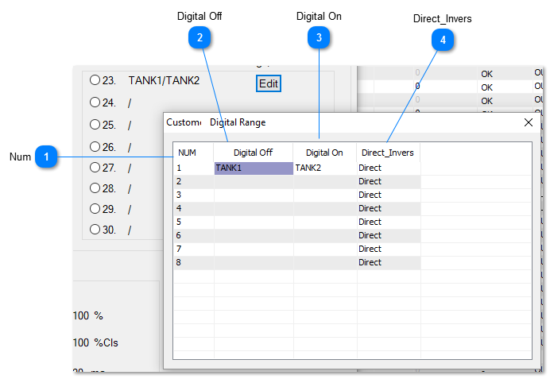
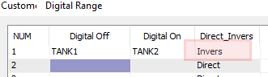
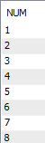
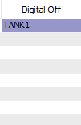
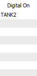
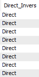

Ranges 23 thru 30 are Custom Digital Ranges, the user can edit the names of these ranges to suit the application. In the example below we have set up a range as Tank1 and Tank2 to be used to indicate which of the two tanks are being filled. The custom ranges you define here can be also used by the outputs and variables, they all share the same custom digital ranges.

To edit the custom digital ranges, click on the "Edit" button which brings up the dialog below where you can type in the name for the OFF and ON state for up to eight custom digital ranges.

In the example below we have a custom range for an item which will show TANK1 when the item is off and TANK2 when the item is on. For an input, the system will show "TANK1" when the contacts are open and 'TANK2 'when the input is shorted. In the case of the outputs, when the output is off, the value will show as TANK1 and when the output is on 'TANK2' is shown. In the case of variables, when the value is zero the word 'TANK1' will be showing in the value column and "TANK2" when the value is 1.

The direct-inverse column lets you reverse the normal logic which is useful if you want to reverse the state of the LED and control the value of the item (0 or 1) when used in programming and logging. If we set the range to inverse, everything written in the above paragraph is reversed. The LED will be on for an input when the terminal is shorted instead of open and vice versa. The value of TANK1 becomes 1 in all programming and logging, instead of zero in the direct mode.

<table>
  <tr><td><strong>Num</strong>&lt;TODO&gt;: Insert description text here...</td></tr>
</table>

<table>
  <tr><td><strong>Digital Off</strong>&lt;TODO&gt;: Insert description text here...</td></tr>
</table>

<table>
  <tr><td><strong>Digital On</strong>&lt;TODO&gt;: Insert description text here...</td></tr>
</table>

<table>
  <tr><td><strong>Direct_Invers</strong>&lt;TODO&gt;: Insert description text here...</td></tr>
</table>
