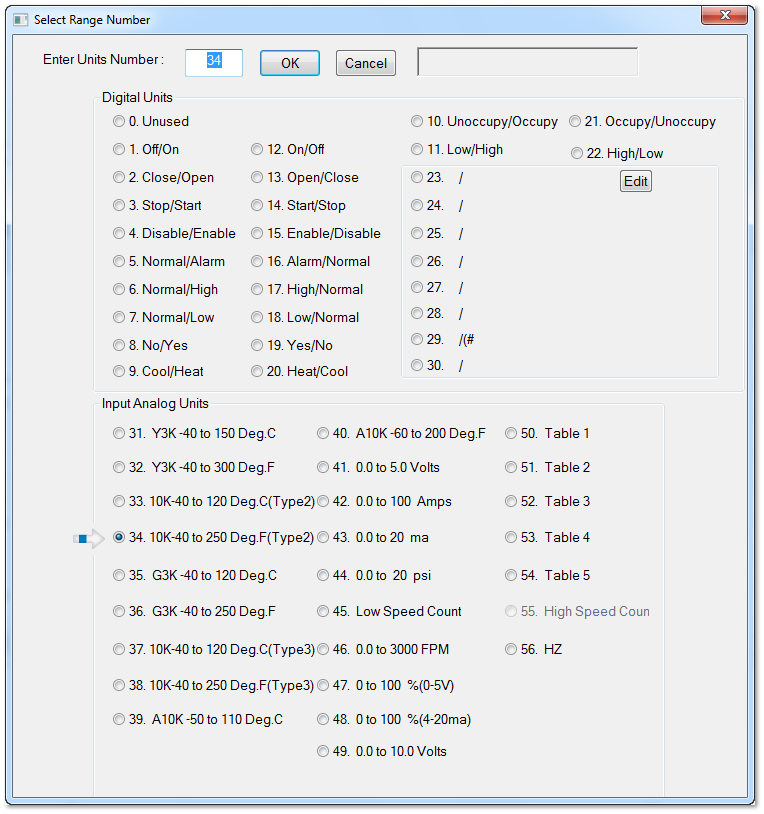

&lt;

The following analog ranges are available:

1.Y3K -40 to 150 Deg.C

2.Y3K -40 to 300 Deg.F, same as range 1 but using Degrees F.

3.10K -40 to 120 Deg.C , Type 2 thermistor.

4.10K -40 to 150 Deg.F, same as range 3 using Deg F.

5.G3K -40 to 120 Deg.C

6.G3K -40 to 250 Deg.F

7.KM10K -40 to120 Deg.C (used for Temco LCD sensor)

8.KM10K -40 to250 Deg. F

9. A10K -50 to 110 Deg. C

10. A10K -60 to 200 Deg. F

11. 0 to 5 Volts

12. 0 to 100 Amps (over 0-5 Volts)

13. 0 to 20 mA

14. 0 to 20 psi (over 0-5 Volts)

15. 0 to 2
32
counts (4,294,967,296 pulse counter)

16. 0 to 3000 FPM

17. 0 to 100 % (0-5 Volts)

18. 0 to 100 % (4 - 20 mA)

19. 0 to 255 pulse

20-24. Table1 through Table 5

25. Unused

The following digital input ranges are available. The word to the left will show when the input is zero volts or short circuit. The word on the right side of the slash will show when the input is open circuit. If the contact is reverse then you can select the number to the right of the slash.

For example: Select '
1' for the Off/On range. When the input is short circuit the word Off will show on the controller screens and logic and when the input is 3V or open circuit, the word On will show everywhere in the system. If the contacts are the inverse of this then select 12, now the word On will show when the
input is short circuit and Off will show when the input is open circuit.

<table>
  <tr><td>1/12</td><td>Off/On</td><td>2/13</td><td>Close/Open</td><td>3/14</td><td>Stop/Start</td><td>4/15</td><td>Dis/Enable</td></tr>
  <tr><td>5/16</td><td>Norm/Alarm</td><td>6/17</td><td>Norm/High</td><td>7/18</td><td>Norm/Low</td><td>8/19</td><td>No/Yes</td></tr>
  <tr><td>9/20</td><td>Cool/Heat</td><td>10/21</td><td>Un/Occupied</td><td>11/22</td><td>Low/High</td></tr>
</table>

TIP: The status LED's for each input are illuminated when there is an open circuit and off when the input is shorted. It will be most intuitive to technicians and personnel in the field if the LED is on when the equipment is on and OFF when it is actually off. You can connect to a normally closed set of contacts, and select range 1. When the relay is closed when the equipment is off and the LED will be off, when the equipment is on the relay is open and the LED goes on. You can also connect to a normally open set of contacts and select the inverted logic, ie range 12 instead of range 1. Then the inverted logic applies, the LED will be the reverse of when range 1 is selected and match the state of the equipment with a normally open set of contacts.

Note:the input card has jumpers for three jumper settings for different types of sensors. The default setting from the factory is the 'thermistors & dry contacts' setting since these are the most common signal type in the HVAC world. In this setting a 10k pullup resistor to 3V creates a weak pullup voltage for excitation for the field device . This excitation voltage is pulled down by the contacts or thermistors to generate the signal voltage to the controller.

Next is a 10V setting, this is used for 0-10V transducers such as humidity, current and C02 sensors. Then there is a 4-20 mA setting for this type of transducer. And finally, by removing the jumper altogether the field device signal goes direct to the a/d converter of the controller. The cpu handling the a/d conversions is a three volt chip therefore the maximum signal you should apply to the input is three volts. If you have a five volt signal you can select the 10V range.
