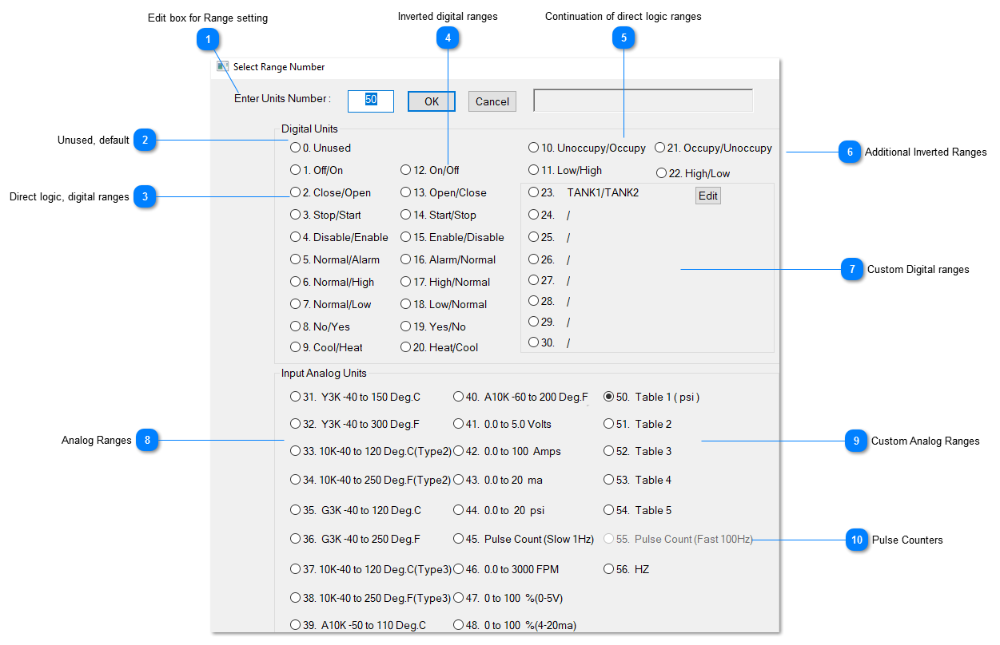

<table>
  <tr><td><strong>Edit box for Range setting</strong>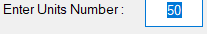Use this box to directly enter the range number from the table below, or select any of the radio buttons below to select the particular range.</td></tr>
</table>

<table>
  <tr><td><strong>Unused, default</strong>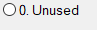</td></tr>
</table>

<table>
  <tr><td><strong>Direct logic, digital ranges</strong>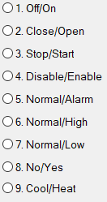</td></tr>
</table>

<table>
  <tr><td><strong>Inverted digital ranges</strong>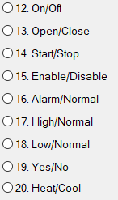</td></tr>
</table>

<table>
  <tr><td><strong>Continuation of direct logic ranges</strong>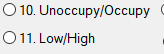</td></tr>
</table>

<table>
  <tr><td><strong>Additional Inverted Ranges</strong>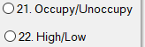</td></tr>
</table>

<table>
  <tr><td><strong>Custom Digital ranges</strong>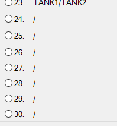</td></tr>
</table>

<table>
  <tr><td><strong>Analog Ranges</strong>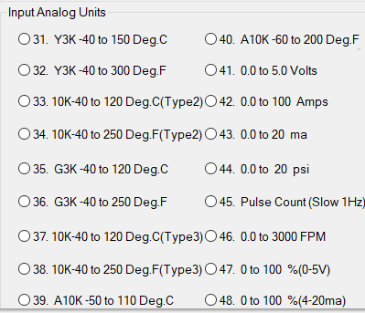</td></tr>
</table>

<table>
  <tr><td><strong>Custom Analog Ranges</strong>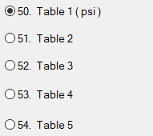&lt;TODO&gt;: Insert description text here...</td></tr>
</table>

<table>
  <tr><td><strong>Pulse Counters</strong>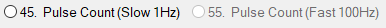&lt;TODO&gt;: Insert description text here...</td></tr>
</table>
