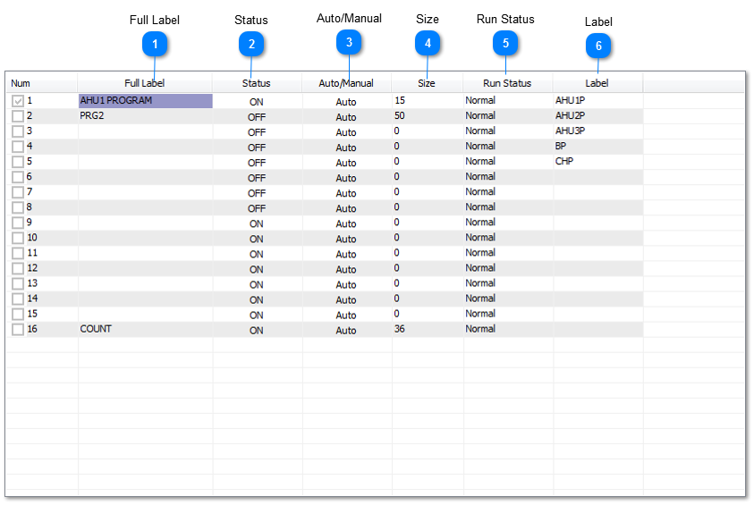
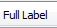
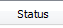
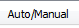
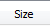
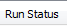
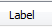
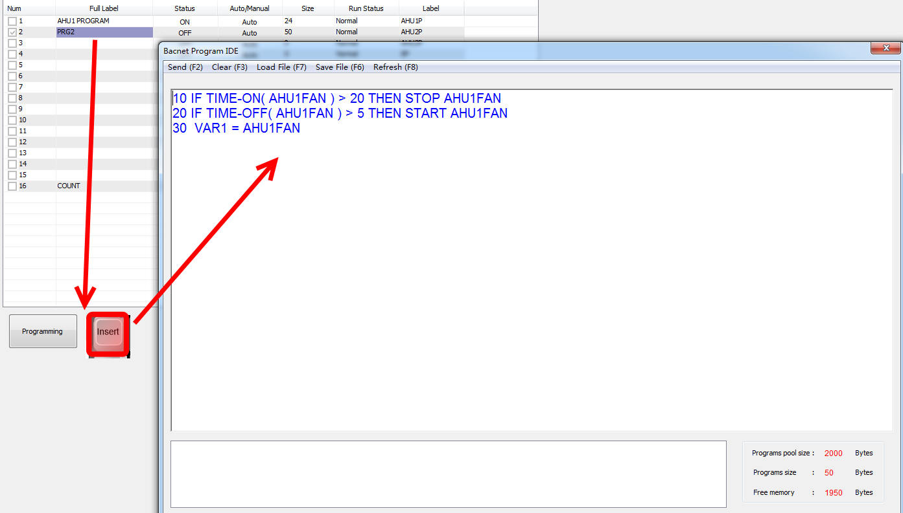

Hot Key: Alt-P

KEYWORD: PRG

Usage
：
PRG1
,
PRG2,PRG3...

How to show: when you use one of these items , the label of the item will be shown in the place where you use

Control Basic is the programming language of the T3000. To access an individual program press the “Ins” key while high lighting that program. The programming language is discussed in
Chapter 10
.

Sample Control Basic work screen:

Control Basic set-up fields:

<table>
  <tr><td><strong>Full Label</strong>A 20 character descriptor of the point.</td></tr>
</table>

<table>
  <tr><td><strong>Status</strong>Indicates whether the program is running or not (ON/OFF).</td></tr>
</table>

<table>
  <tr><td><strong>Auto/Manual</strong>In “Auto” the running of the program can be controlled by either the program timer or another program. In “Manual” the program can be stopped and started by the operator by togglingthe status field.</td></tr>
</table>

<table>
  <tr><td><strong>Size</strong>The length in bytes of the program, maxi mum size is 2500 bytes.</td></tr>
</table>

<table>
  <tr><td><strong>Run Status</strong>The time between each running of the program (mins: secs).</td></tr>
</table>

<table>
  <tr><td><strong>Label</strong>An 8 character descriptor of the point.</td></tr>
</table>

See
Chapter 10
for more information on how to program Control Basic and use the Control Basic Editor

