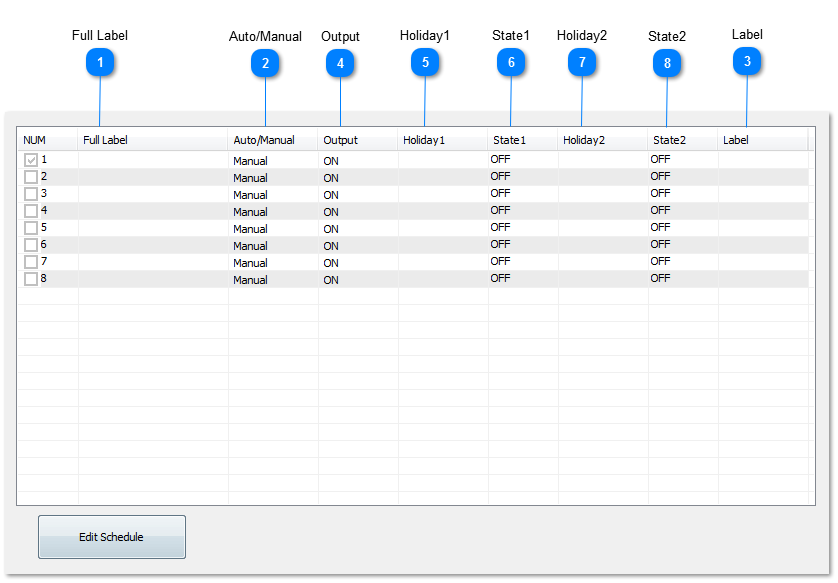
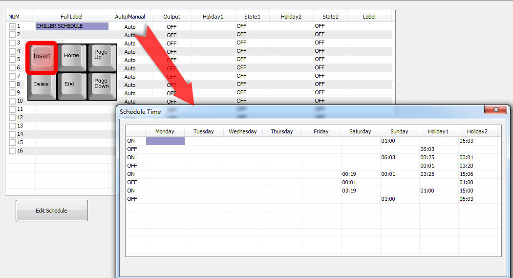
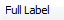
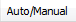
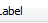
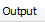
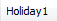
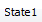
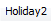
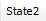

Hot Key: Alt-S

KEYWORD: WR

Usage
：
WR1
,
WR2,WR3...

How to show: when you use one of these items , the label of the item will be shown in the place where you use

Weekly Routines are essentially time clocks with 4 ON/OFF times per day of the week. The week has 9 days to allow for two over rides in addition to the weekly schedule. These are used for holiday schedules, and are are specified by the Annual Routines Menu.

Sample Input work screen:

Example for program

IF WR1 THEN START OUT1 ELSE STOP OUT1

<table>
  <tr><td>A unique twenty character descriptor used to identify the item throughout the system. Used for programming, trend logging, reports and so on.</td></tr>
</table>

<table>
  <tr><td>Controls whether the routine is operational or not</td></tr>
</table>

<table>
  <tr><td>Eight character descriptor, a unique ID used to refer to this particular item throughout the system: programming, trend logs and so on.</td></tr>
</table>

<table>
  <tr><td>The state of the routine (ON/OFF)</td></tr>
</table>

<table>
  <tr><td>When point entered here is “On”, the day will be the eighth day of the week.</td></tr>
</table>

<table>
  <tr><td>The state of Holiday1 (ON/OFF).</td></tr>
</table>

<table>
  <tr><td>When point entered here is “On”, the day will be the ninth day of the week. Note that in the case of both Holidays being on, Holiday1 is regarded.</td></tr>
</table>

<table>
  <tr><td>The state of Holiday2 (ON/OFF).</td></tr>
</table>

To program the times for an individual routine press the “Ins” key while highlighting the Weekly Routine to be set up. The 9 day week will be displayed with the standard work menu operations. The desired start and stop times are then simply entered in the appropriate fields.

Note: The times in Weekly Routines can be accessed from Control Basic using the WR- ON and WR- OFF functions. This is useful for programs that need to look ahead and see when an event is to start.

The times specified must be in increasing order throughout each day. If no time is in a day column the Weekly Routine will maintain its current value.
