Monitors are used to collect historical data for any point defined in the system regardless of their nature (either Analog or Digital). A base T3000 system can handle up to 16 separate monitors. The number of monitors avail able is dependent on the amount of memory that your system has. With enough memory the system can easily handle up to 128 monitors. Each of these separate monitors can trend up to 14 points.

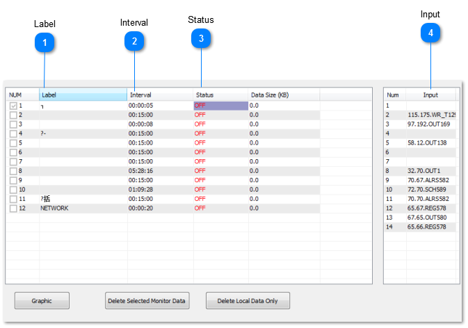

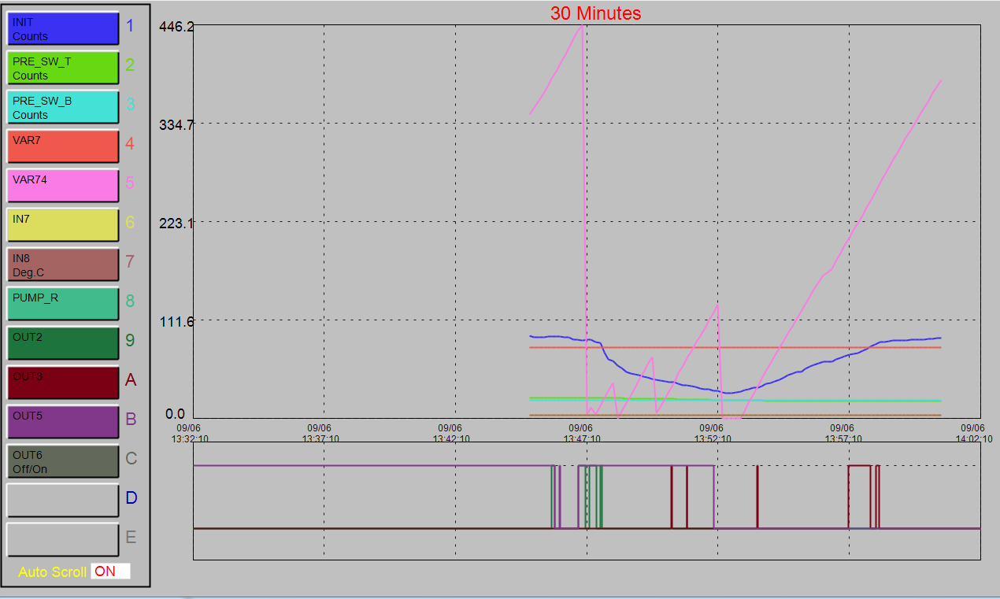

<table>
  <tr><td><strong>Label</strong>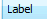An 8 character descriptor.</td></tr>
</table>

<table>
  <tr><td><strong>Interval</strong>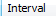The time between samples in hours : minutes : seconds</td></tr>
</table>

<table>
  <tr><td><strong>Status</strong>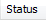“ON” indicates the monitor is running, “OFF” indicates that it is stopped.</td></tr>
</table>

<table>
  <tr><td><strong>Input</strong>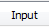The name of the points to be included on the monitor. The TAB key is used to move the cursor to this section. The TAB or ESCkey is used to return to the main monitor work screen. Up to 14 points can be monitored here per monitor. Of these 14 pointsonly 5 may be digital, i.e. On/Off or Start/Stop. If more than 5 Digital points are entered onto the monitor than a warningflashes on the screen to indicate that you have entered too many Digital points. If this hap pens the Digital points over 5 will be deleted from the monitor.</td></tr>
</table>

An Ana log Monitor can also be commanded to sample from Control Basic by set ting it to ON or OFF ( i.e. amon1 = ON ). When this occurs the monitor samples all its in puts and restarts the interval time. In using this feature it is best to stop the monitor (s = 0), and control all the sampling from Control Basic.

To access monitor data and view the graph, press the “INS” key while highlighting the desired monitor.

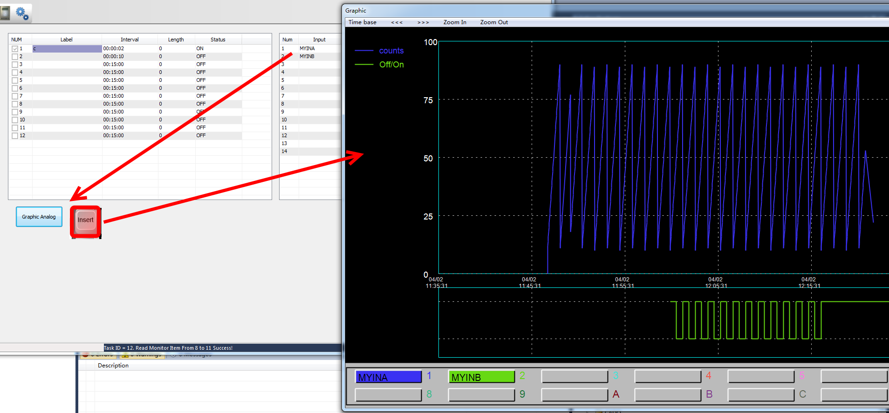

Graph Display work options:

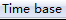
The period of time displayed on a full screen. This time base can
be altered to change the graphs perspective. For example the Time Base can be changed from hours to minutes

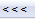
The graph can be shifted 1/2 screen left at the cur rent zoom level by clicking on the “<-” symbol at the top of the screen, or use the corresponding keyboard key.

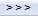
The graph can be shifted 1/2 screen right at the current zoom level by clicking on the “->” symbol at the top of the screen, or use the corresponding keyboard key

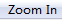
While in the graphing mode, you can “Zoom In” on the data to view the data from a closer perspective. The Zoom range must first be set below.

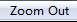
“Zoom Out” resets the monitor back one zoom level. This can only be used af ter Zoom In has been used to re store the graph to its original display mode.
