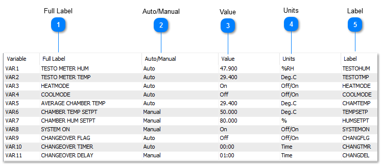
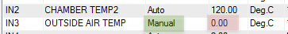
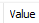
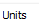
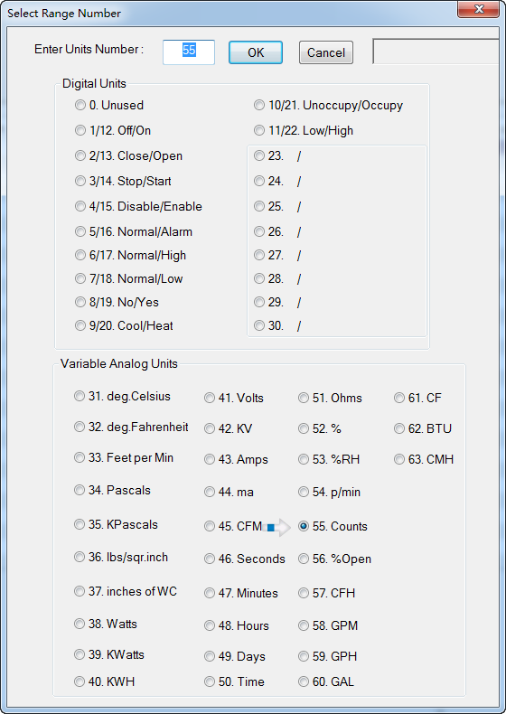

Hot Key: Alt-V

KEYWORD: VAR

Usage
： 10 IF
VAR1 > 100 THEN STOP OUT1

Variables are virtual points used to store the many parameters in a typical system such as setpoints, modes and so forth. Once the variable is created it can be referred to by the user defined name in the user programs, displays, and logs. The user can define alarms for the variables as well. The range and the engineering units can be set up from the predefined ranges and also custom ranges & units can be created. Each T3 controller can store up to 128 variables.

Sample Variables work screen:

Page 46

<table>
  <tr><td><strong>Full Label</strong>A unique twenty character descriptor used to identify the item throughout the system. Used for programming, trend logging, reports and so on.</td></tr>
</table>

<table>
  <tr><td><strong>Auto/Manual</strong>The auto/manual field has only two states: Auto and Manual. Hitting the enter key with the cursor in this field will cycle the mode from auto to manual and back. When in “Auto” the the true readings from the sensors and field devices will be shown here and update as conditions change. When in “Manual” the operator is in charge of the item, the real world sensor inputs are overridden. This feature allows the operator to temporarily take control of the input during commissioning and debugging. For example, if you want to see how the rest of the system will respond when the outdoor air temperature hits 0C / 32F you can manually command this condition. First move the cursor to the row for the outside temperature sensor, IN3 in this case. Toggle the Auto/Manual field to Manual as shown in the green cell. Then maneuver right to the red tinted 'Value' column and type in the number you wish to set for the simulation, in this case 0 Deg C. The cell will flash solid red briefly while the data is written to the controller, then back to white to show that the value was written successfully. Now the rest of the system will operate based on an outdoor temperature of 0C. When the testing is complete you must set the auto/manual field back to auto and the input will return to showing the actual outdoor temperature.</td></tr>
</table>

<table>
  <tr><td><strong>Value</strong>The current value of the variable</td></tr>
</table>

<table>
  <tr><td><strong>Units</strong> The following <strong>direct</strong> digital output ranges are available:1. Off/On2.Close/Open3.Stop/Start4. Dis/Enable5. Norm/Alarm6.Norm/High7.Norm/Low8. No/Yes9. Cool/Heat10. Un/Occupied11. Low/HighThe following <strong>inverted</strong> digital output ranges are available:12. On/Off13. Open/Close14. Start/Stop15. Enable/Dis16. Alarm/Norm17. High/Norm18. Low/Norm19. Yes/No20. Heat/Cool21. Occupied/Un22. High/LowUnits 23 thru 30 are Custom Digital Ranges.</td></tr>
  <tr><td>1. Off/On</td><td></td><td>2.</td><td>Close/Open</td><td>3.</td><td>Stop/Start</td><td>4. Dis/Enable</td></tr>
  <tr><td>5. Norm/Alarm</td><td></td><td>6.</td><td>Norm/High</td><td>7.</td><td>Norm/Low</td><td>8. No/Yes</td></tr>
  <tr><td>9. Cool/Heat</td><td></td><td>10. Un/Occupied</td><td>11. Low/High</td></tr>
  <tr><td>The following <strong>inverted</strong> digital output ranges are available:</td></tr>
  <tr><td>12. On/Off</td><td></td><td>13. Open/Close</td><td>14. Start/Stop</td><td>15. Enable/Dis</td></tr>
  <tr><td>16. Alarm/Norm</td><td>17. High/Norm</td><td>18. Low/Norm</td><td>19. Yes/No</td></tr>
  <tr><td>20. Heat/Cool</td><td></td><td>21. Occupied/Un</td><td>22. High/Low</td></tr>
  <tr><td>Units 23 thru 30 are Custom Digital Ranges.</td></tr>
</table>

<table>
  <tr><td><strong>Label</strong>Eight character descriptor, a unique ID used to refer to this particular item throughout the system during programming, creating trend logs and so on.</td></tr>
</table>
