1 .Download the configuration file called
[TBD]

2. Read the readme file .

1>you should put the image fold to the installation path to replace the image file fold.

..\Database\Buildings\Default_Building\image

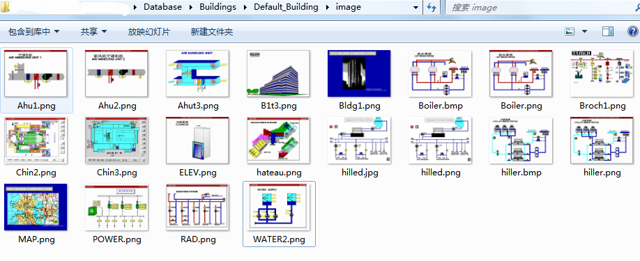

2>you should open T3000 to load the T3000DEMOSHOW.prg to your
T3 controllers
.

2.1.select your T3 controllers

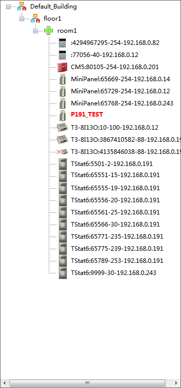

2.2.select the menu

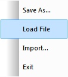

2.3.select the demo project file

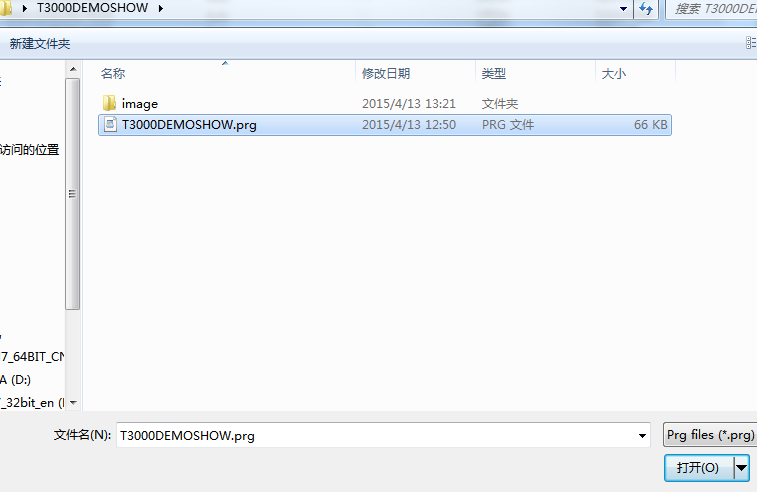

2.4.If finished ,please check these data .

Check these data [Inputs ,Outputs ,Variables, Programs, PID Loops, Graphics ,Schedules, Holidays, Trend Logs]

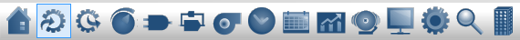

DEMO SHOW

>>>INPUTS

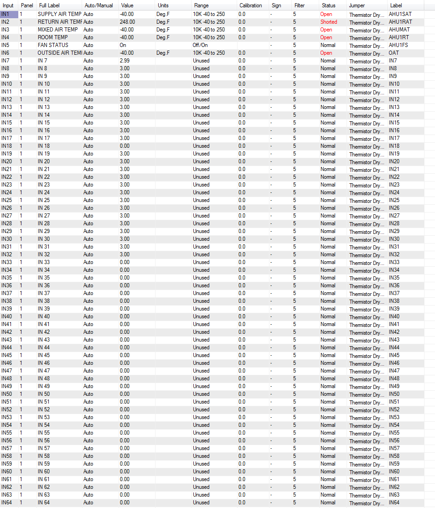

>>>OUTPUTS

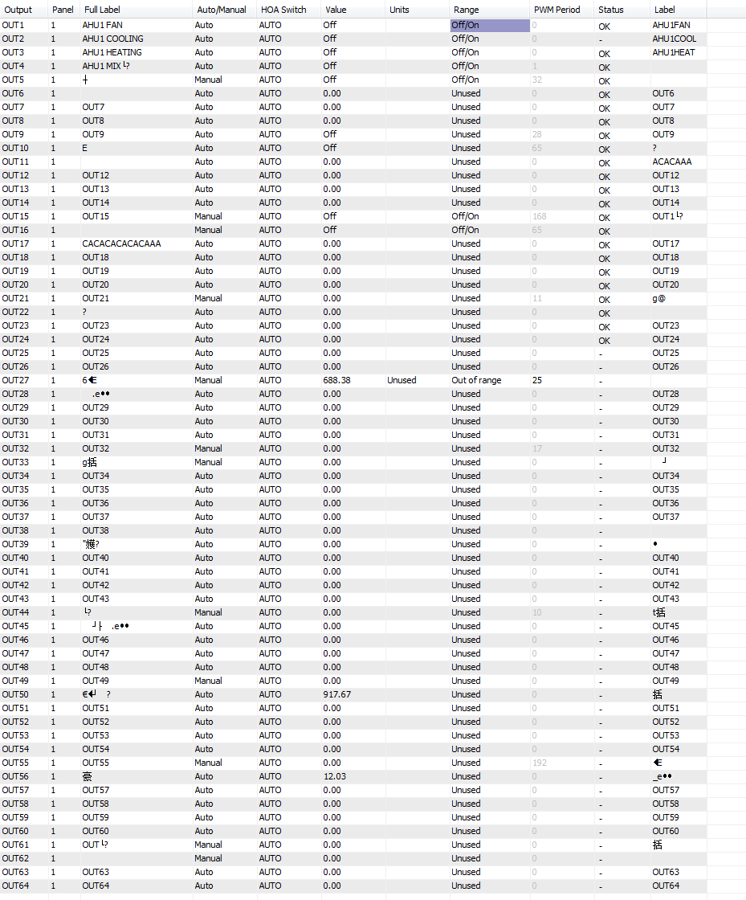

>>>VARIABLES

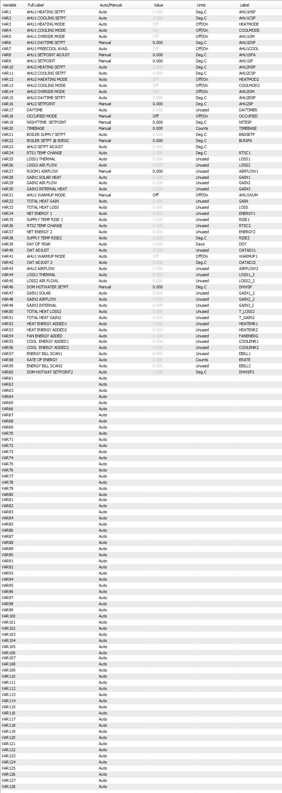

>>>Programs

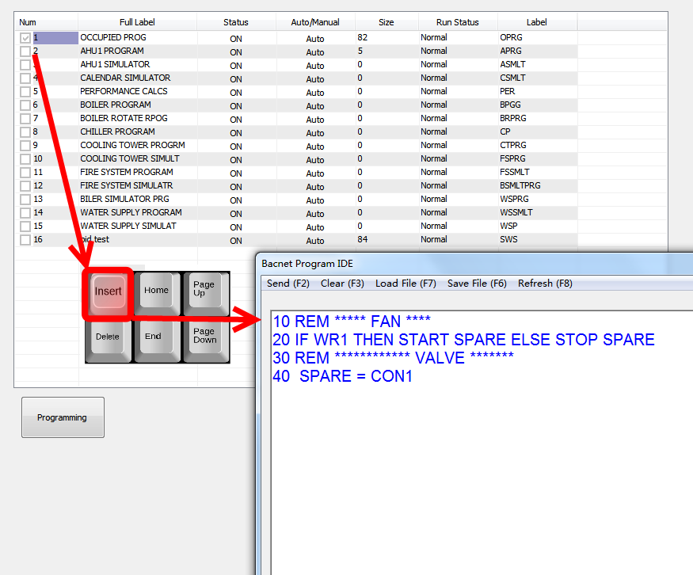

>>>PID Loops

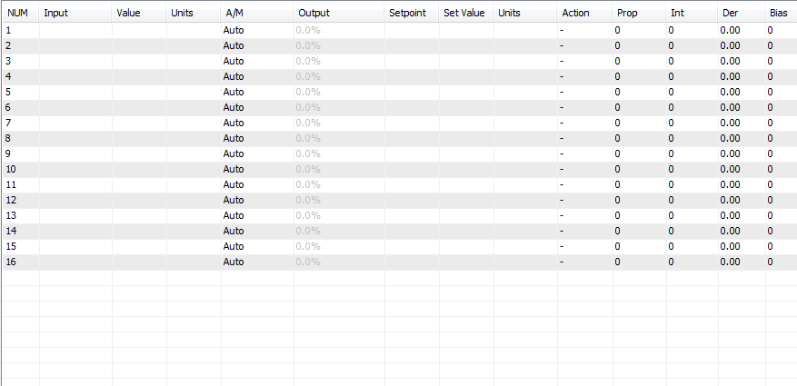

>>>Graphics

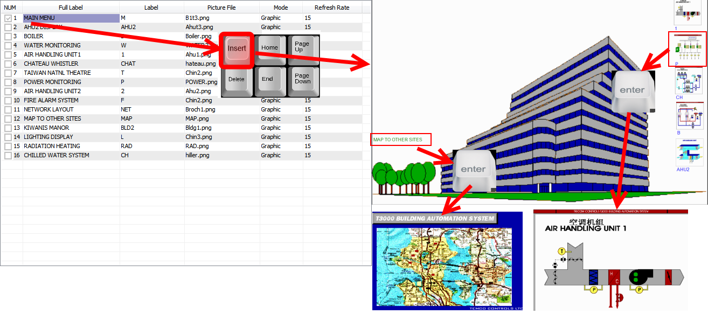
