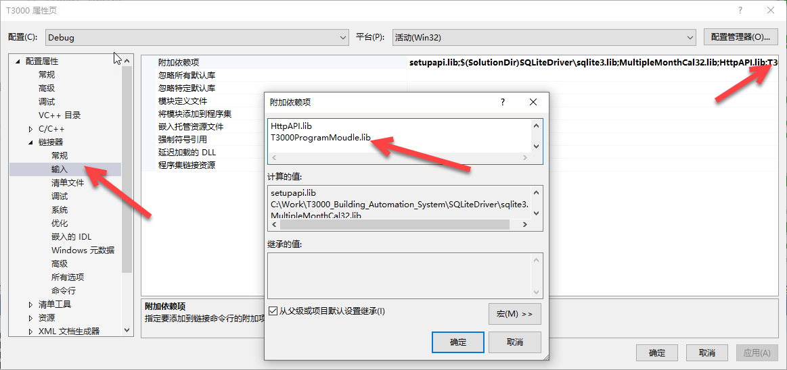
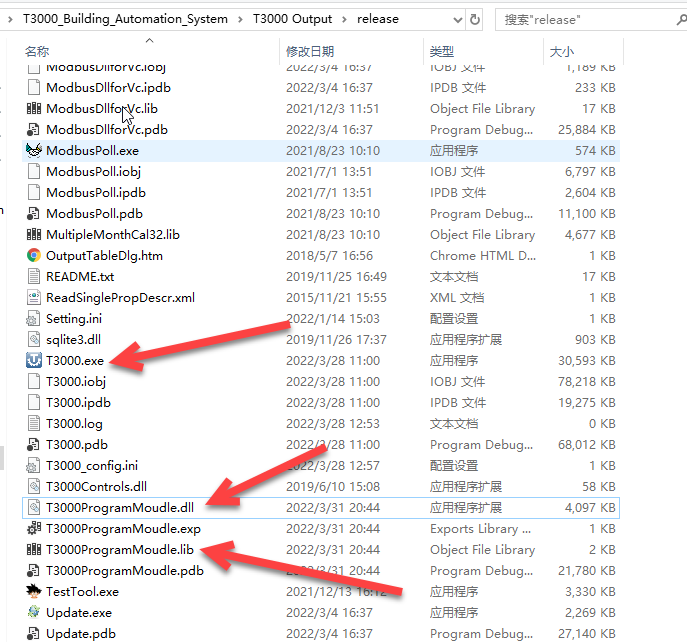

T3000 can hand a Control Basic program to another program — to encode it for storage, and to decode it back — through a small DLL that ships beside `T3000.exe`. The same DLL is referred to in Temco's sources as the *programming DLL* and as the *interpreter DLL*; it is one library, and this page covers both names.

The library lives in `T3000ProgramMoudle` and is built as `T3000ProgramMoudle.dll`, with `T3000ProgramMoudle.lib` for linking.

## Calling it from your own program

Three steps, and the first one is the one people forget.

1. **Add the import library.** In the project's properties, Linker → Input → Additional Dependencies, add `T3000ProgramMoudle.lib` — the same place `sqlite3.lib` and `HttpApi.lib` are already listed.
2. **Put the DLL where the program looks for it.** In the T3000 tree that is the run directory beside `T3000.exe`, alongside `T3000ProgramMoudle.lib`, `.exp` and `.pdb`.
3. **Include the header.** `dllmain.h` declares the two entry points; including it is what makes the calls compile.





## The two calls

Encoding turns program text into the array T3000 stores; decoding turns that array back into text. Both are `extern "C"` and exported, so the names are not mangled and can be found by any caller:

```cpp
extern "C" __declspec(dllexport) int   Encode_function(char* input_text, encode_str* encodestr);
extern "C" __declspec(dllexport) char* Decode_function(char* input_code, decode_str* decodestr);
```

Each call reports through a structure, and each structure carries the result **and** a message — which is the part that makes a failure readable rather than a return code:

```cpp
typedef struct
{
    int  errorcode;
    char encode_array[2000];    // the encoded program
    char encode_message[255];   // why it failed, if it did
} encode_str;

typedef struct
{
    int  errorcode;
    char decode_text[4000];     // the decoded program
    char decode_message[255];   // why it failed, if it did
} decode_str;
```

The arrays are fixed sizes, and that is the one limit worth designing around: an encoded program is capped at 2000 characters and a decoded one at 4000.

## A worked call

```cpp
#include "..\T3000ProgramMoudle\dllmain.h"

char test_program[] = "10 REM TEST PROGRAM \r\n20 VAR = VAR1 + 1\r\n";
char ret_value[2000] = { 0 };

encode_str Myencodestr;
int encode_ret = 0;

encode_ret = Encode_function(test_program, &Myencodestr);
if (encode_ret != -1)
{
    MessageBox(_T("Decode error!"));
}

char* decode_ret = NULL;
decode_str Mydecode_str;

decode_ret = Decode_function(Myencodestr.encode_array, &Mydecode_str);
if (decode_ret == NULL)
{
    MessageBox(_T("Decode Failed!"));
}
```

Round-tripping the same text through both calls is the fastest way to check that the DLL is the right build: the decoded text should match what was handed in, line for line.

## Status

The DOCX this page comes from is a two-page note with the same content under both file names (`HowToUseDll.docx` and `HowToUseT3000 Interpreter DLL.docx` in `T3000ProgramMoudle`), so the two topics the older help tree listed are one topic here.

## Related

- [Programming a controller](programming-a-controller.md) — writing a program from the screens.
- [Control Basic Programming](control-basic-programming-overview.md) — the language being encoded.
