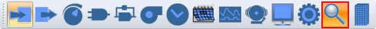
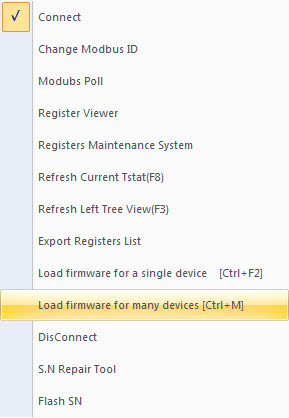
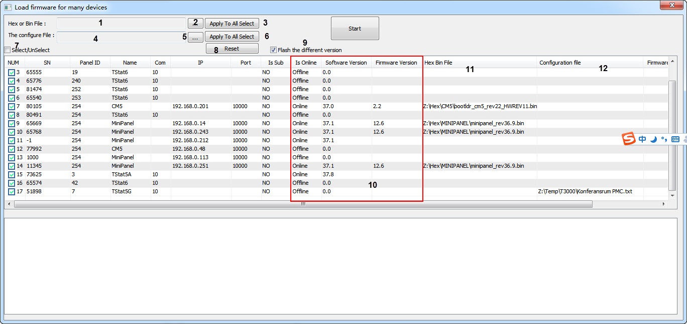

1.You must find your devices by T3000 , using "Scan"

2 “Load firmware for many devices”

<table>
  <tr><td>1</td><td>show the path of a hex or bin file</td></tr>
  <tr><td>2</td><td>click to select the path of a hex or bin file</td></tr>
  <tr><td>3</td><td>"Apply To All Select" ,the path of the hex or bin(1) will automatically fill in the column of "Hex Bin File" , matching with the column of "Name"</td></tr>
  <tr><td>4</td><td>show the path of a configuration file</td></tr>
  <tr><td>5</td><td>click to select the path of a configuration file</td></tr>
  <tr><td>6</td><td>"Apply To All Select" ,the path of the configuration file (4) will automatically fill in the column of "Configuration File" , matching with the column of "Name"</td></tr>
  <tr><td>7</td><td>Select/Unselect</td></tr>
  <tr><td>8</td><td>Reset ,to clear the column of "Hex Bin File" and the column of "Configuration File"</td></tr>
  <tr><td>9</td><td>if selected ,T3000 will compare the "Software Version" with "Firmware Version", Only if the Firmware Version is the latest, T3000 will update .</td></tr>
  <tr><td>10</td><td>When you show the window, the tree column will show the values ,automatically.</td></tr>
  <tr><td>11</td><td>show the path of a hex or bin matching with the device. clicking the blank to select the file ,the file will be checked whether the file is fit the product or not .</td></tr>
  <tr><td>12</td><td>show the path of a configuration file matching with the device. clicking the blank to select the file ,the file will be checked whether the file is fit the product or not .</td></tr>
</table>
