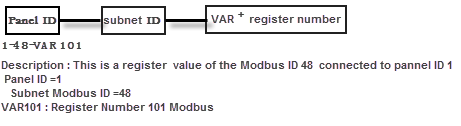

Description:

All subnets connected to MP can be used in the MP ,directly .

Format :

1-48-VAR101

Description : This is a register value of the Modbus ID 48 connected to pannel ID 1

Panel ID =1 (What's Panel ID ,please refer to
**Chapter 7**
7.1.5
)

Subnet Modbus ID =48

VAR101 : Register Number is 101

Notes : Register Number is PLC Address (Base 1). If you use Protocol Address (Base 0),

you must plus one to your current register number .

How to use in program:

EXAMPLE 1:GET THE VALUE OF THE REGISTER VALUE OF A SUBNET

10 REM *** THE VALUE OF 1-48-VAR101 ASSIGN TO VAR1 ***

20 VAR1 = 1-48-VAR101

EXAMPLE 1:SET THE VALUE OF THE REGISTER VALUE OF A SUBNET

10 REM *** VAR1 ASSIGN TO THE VALUE OF 1-48-VAR101 ***

20 1-48-VAR101 = VAR1

NOTE: When you use the register number ,you must know whether the register number can have the property of R/W.

Example show :

10 VAR1 = 1-48-VAR101

20 VAR2 = 1-48-VAR102

30 VAR3 = 1-47-VAR101

40 VAR4 = 1-47-VAR102

50 VAR5 = 1-20-VAR101

60 VAR6 = 1-20-VAR102

70 VAR7 = 1-19-VAR101

80 VAR8 = 1-19-VAR102

90 VAR9 = 1-44-VAR101

100 VAR10 = 1-44-VAR102

110 VAR11 = 1-46-VAR101

120 VAR12 = 1-46-VAR102

130 VAR13 = 1-49-VAR101

140 VAR14 = 1-49-VAR102

150 REM *** START COOLING PROCESS ***

160 IF VAR3 OR VAR5 OR VAR 7 OR VAR9 > 150 THEN START OUT1 , START OUT32

170 IF IN2 &lt;= 160 THEN START OUT4, OUT5, OUT6, OUT7, OUT8, OUT9, OUT10, OUT11, OUT12, OUT13, OUT14

180 IF IN3 >= 700 THEN START OUT2

190 IF IN3 >= 850 THEN STOP OUT32 , STOP OUT2 , STOP OUT1

200 IF IN2 &lt;= 20 THE STOP OUT32 , STOP OUT1

220 IF VAR3 = 100 THEN STOP OUT4 , STOP OUT11

230 IF VAR5 = 100 THEN STOP OUT5 , STOP OUT12

240 IF VAR7 = 100 THEN STOP OUT6 , STOP OUT13

250 IF VAR9 = 100 THEN STOP OUT7 , STOP OUT14

260 REM *** START COOLING PROCESS ROOM1 & ROOM6 ***

270 IF REM VAR1 OR VAR11 OR VAR13 > 240 THEN START OUT1 , START OUT32

280 IF IN2 &lt; 200 THEN START OUT3, OUT8, OUT9, OUT10, OUT15, OUT16

290 IF IN3 >= 700 THEN START OUT2

300 IF IN3 >= 900 THEN STOP OUT32 , THEN STOP OUT2 , STOP OUT1

310 IF IN2 &lt;= 20 THE STOP OUT32 , STOP OUT1

320 IF VAR11 > 240 THEN START OUT3 , START OUT10

330 IF VAR11 = 200 THEN STOP OUT3 , STOP OUT10

320 IF VAR11 > 240 THEN START OUT8 , START OUT15

330 IF VAR11 = 200 THEN STOP OUT8 , STOP OUT15

340 IF VAR13 > 240 THEN START OUT9 , START OUT16

350 IF VAR13 = 200 THEN STOP OUT9 , STOP OUT16

360 REM *** START HUMIDIFIER PROCESS ***

380 IF VAR2 OR VAR4 OR VAR6 OR VAR 8 OR VAR10 OR VAR12 &lt; 850 THEN START OUT2 ,START (OUT17 TO OUT23) , START (OUT10 TO OUT16)

390 IF IN3 &lt; 450 THEN START OUT1 , START OUT32

400 WHEN IN3 = 700 THEN STOP OUT1 , STOP OUT32

410 IF VAR2 OR VAR4 OR VAR6 OR VAR 8 OR VAR10 OR VAR12 > 950 THEN STOP OUT32 , OUT2
