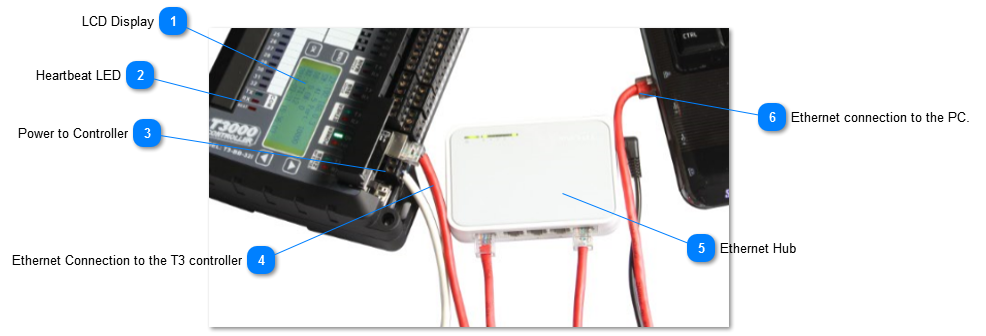
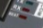
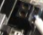
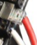
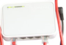
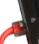

<table>
  <tr><td><strong>LCD Display</strong>The IP address will show on the display but cannot be changed from the keypad for the time being. The data and time show here along with the number of packets sent over the ethernet connection. If devices are connected to either of the RS485 ports you will see the device count and how many are currently online.</td></tr>
</table>

<table>
  <tr><td><strong>Heartbeat LED</strong> Normally this LED is beating every second to show normal operation. If the LED is off or on all the time, the unit is locked up or had a bad firmware update. In this case you can cycle power to get back into firmware update mode. For approximately ten seconds after power up the unit will be in flash update mode looking for new firmware, the heartbeat LED will be flashing with two short pulses and then a pause with the LED off, repeating every second to show during this time. See the section on <a href="../../../../../../QN/temcocontrols/temco-platform/firmware-update-single-device/firmware-update-single-device.md">updating firmware</a> to revive the controller.</td></tr>
</table>

<table>
  <tr><td><strong>Power to Controller</strong>The power supply can be any 12V to 24V supply, AC or DC with capacity of approximately 2 watts. Surge and reverse polarity protected with slow blow self resetting fuse on board.Caution: Voltages over 40V can cause damage to the controller which requires a trip to the factory for repairs.</td></tr>
</table>

<table>
  <tr><td><strong>Ethernet Connection to the T3 controller</strong>Connect the Ethernet port to the hub as shown. The RX and TX LEDS will blink to show communications activity during normal operation. If the T3000 application is operating and there is no activity on these LEDS that would indicate the IP address is not set correctly or there is a bad cable.</td></tr>
</table>

<table>
  <tr><td><strong>Ethernet Hub</strong>Ethernet hub. You can connect through the home / office lan or through a separate hub as shown. T3000 communications will not interfere with normal lan traffic.</td></tr>
</table>

<table>
  <tr><td><strong>Ethernet connection to the PC.</strong>You can connect directly to the T3 controller without a hub using either a crossover cable or the normal straight through ethernet cable. Auto MDIX whcih is available on most PCs and laptops these days will sort out which type of cable is in use and communications will flow normally.</td></tr>
</table>
