## 3.2 SETTING- UP THE T3000 SYSTEM

This section explains the general setup of a system once you are connected and logged in.

## 3.2.1 SOFTWARE SET-UP

There are several parameters which the user will enter throughout use of the system. Some of the information such as the file path to various items, the last connection used, the last IP address entered among other parameters are saved to the hard disk in order to reduce keystrokes for the operator. Some of these settings are saved in a filed named CONFIG.INI which is saved to the T3000 installation directory.

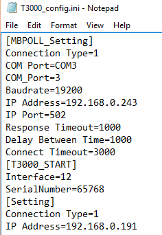

System List

The list of buildings you will connect to is stored in the 'Building Database' which is found under the 'Database' menu item.

This option is used to make calls to remote systems via the modem. It can be set up with the names and numbers of 24 remote systems. Enter the name, and modem phone number. Press Ins any where along the line to dial the remote site (the COM ports must be configured first: Chapter 8).

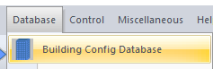

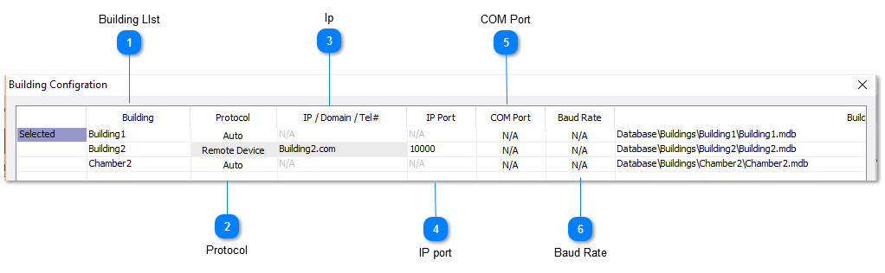

FILE PATHS

The default installation folder for T3000 is \Program Files (86)\T3000. Under the main T3000 installation folder is a \Database\ subfolder and below that is a directory for each project. The graphical floorplans and system graphics are stored in their own separate subfolder for each project called 'image'.

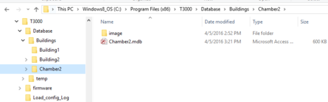

This database is a standard Microsoft Database file format which can be opened and edited in T3000 as well as other mainstream programs such as Excell, Acess, SQL, and Openoffice. The MDB format is a legacy file format originally designed for access from a single PC so work is under way to migrate this file format to an SQL format for easier multiuser sharing.

TIME AND DATE

TBD:

Time and Date is found in the Configuration work menu.

There is the option to let the time sync from an internet time server using the NTP or network time protocol, in this way the controller will never be out of sync even with daylight savings time or after prolonged power outages. Alternatively, if the controller is blocked from communicating out onto the internet it can sync locally with the PC every time someone is online with T3000. And finally, you can let the onboard clock manage the time locally with no sync to any PC or server, the local clock is accurate to a few seconds per day and has a battery backup for power outages which will keep the clock alive for two or three days.

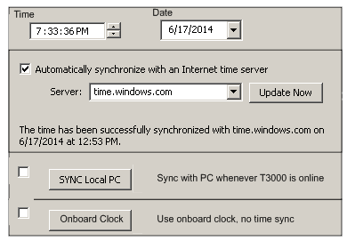

USER LIST

User List is found in the Configuration work menu.

User List provides the means for system security and individual access to the system. Each user has to Sign- On with his name and password to gain access to the system. There is space to allow for 32 different users and pass words plus their access levels. Access to different parts of the system is determined by system supervisor.

## 3.2.2 HARDWARE SETUP

The options needed to configure the T3000 hardware are all found in the CONFIGURATION pull-down work menu. Once you are done altering the hardware setup the system will ask if you wish to save the changes that you have made.

For more information on these hard ware options see the relevant sections in Chapter 8 - Configuration.

COMMUNICATION

This option allows you to set up the serial port, modem, mouse and printer in your system so all of its components can talk to each other.

MODEM CONFIGURATION

If the modem does not initialize properly when you first Sign- On then you will have to alter the default initialization string. The “Initializing String” is the command string that is sent to the modem in order to bring it to a proper working order. A default string is loaded that the system
will first try to initialize the modem with. If this fails the operator will have to edit this string with the proper commands for the modem. Consult the Owner's Manual for the modem you are installing for further information.

BOARDCONFIGURATION

Board Configuration is used to set up the T3000 Controller, Input and Output cards connected to a panel.

<table>
  <tr><td><strong>Building LIst</strong>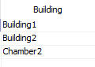&lt;TODO&gt;: Insert description text here...</td></tr>
</table>

<table>
  <tr><td><strong>Protocol</strong>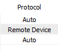</td></tr>
</table>

<table>
  <tr><td><strong>Ip</strong>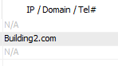&lt;TODO&gt;: Insert description text here...</td></tr>
</table>

<table>
  <tr><td><strong>IP port</strong>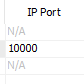&lt;TODO&gt;: Insert description text here...</td></tr>
</table>

<table>
  <tr><td><strong>COM Port</strong>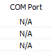&lt;TODO&gt;: Insert description text here...</td></tr>
</table>

<table>
  <tr><td><strong>Baud Rate</strong>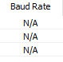&lt;TODO&gt;: Insert description text here...</td></tr>
</table>
