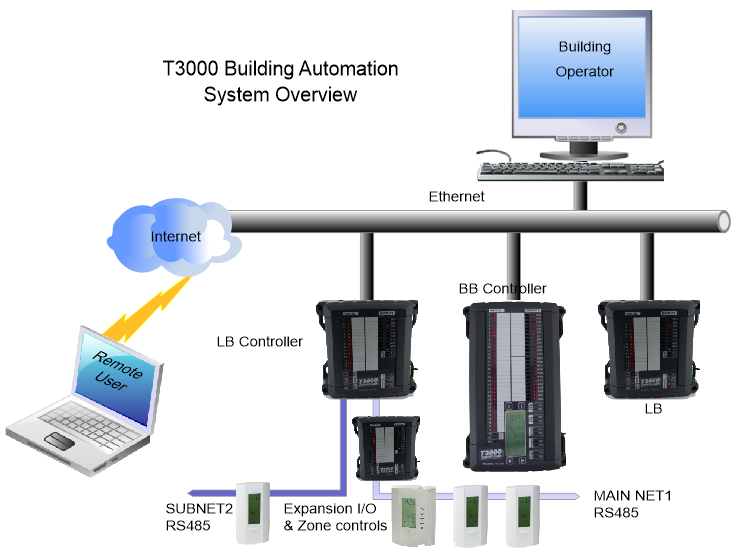
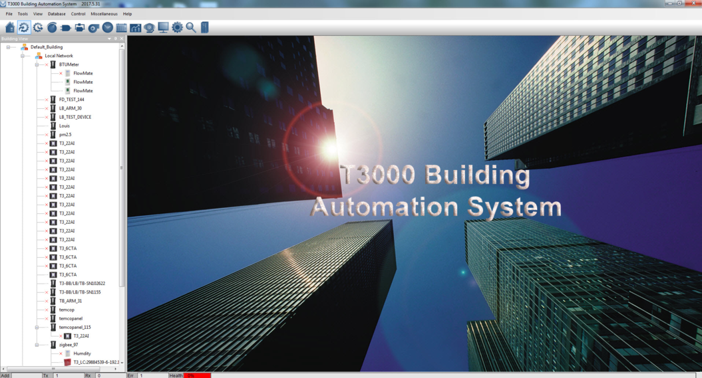

The T3000 Building automation system is a complete software and hardware solution to allow a building operator to manage and control large buildings. Equipment such as chillers, air handlers, boilers, fans, lights, pumps, dampers, valves and other mechanical equipment can be scheduled and controlled according to the user defined sequences. All the system status, temperatures and settings are displayed on custom graphics screens where the operator can proactively manage the facility. The system has powerful communications capabilities making it possible to integrate with other systems and scale to large campass style networks encompassing many buildings.

Once the operator is logged in they may access the entire system over the internet or locally from a PC inside the building. End users and tenants can also access particular zones which empowers them and reduces service calls.

Simultaneous users may access the system locally and remotely over the network. Alarms, system graphics and trend data are stored directly on the controller so there is no central server or single point of failure.

Interactive graphic displays, floor plans and custom menus make operation simple for any user. The T3000 hardware and software make it easy to configure and reconfigure the system throughout the life of the building. The system is primarily targeted at HVAC applications but is well suited to lighting, green houses and other light industrial projects. The system supports bacnet and modbus protocols which means its possible to integrate with the other systems in the building such as access control, lighting, power meters to name a few.

