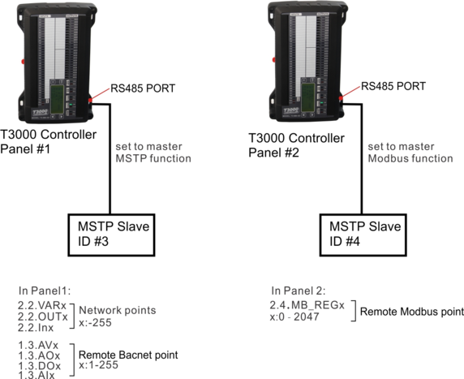

T3-serial controller (only new ARM) can support network points and remote points.

1.
Network points function

For example,there are panel 1 and 2 in network. We can use 2.2.VARx 2.2.OUTx 2.2.Inx to read or write the network ponts.Range of x is 1 to 255.

2.
Remote Bacnet points

For example,panel 1 is T3000 controller, device 3 is MSTP slave device,which is integrated in only master RS485 port, and this port is set to master MSTP function.We can use 1.3.AVx 1.3.Aix 1.3.DOx 1.3.AOx to read and write remote bacnet points.Range of x is 1 to 255.

3.
Remote Modbus points

For example,panel 2 is controller, device 4 is Modbus slave device, which is integrated in master or slave RS485 port, and this port is set to master modbus function.We can use 2.4.MB_REGx or 2.4.REGx to read and write remote modbus points. MB_REG is base 0, and REG is base1.Range of x is 0 to 2047.

