T3000 has a feature where you can operate on a T3 controller in offline mode. This is useful when you don’t have a controller on hand for demo purposes or working in the office for later deployment to a remote job site.Currently only T3 controllers are supported.Below is an explanation on how to operate on a virtual controller.

First, load into the T3 controller in offline mode as the link
http://tinyurl.com/ybaj9d3u/ExamplePRGFiles.zip
,and set T3000 to offline mode from the menu system.

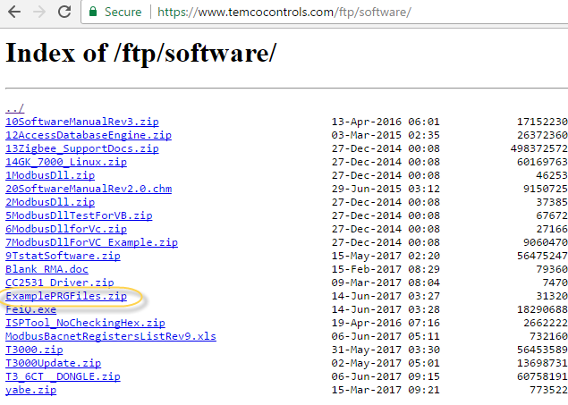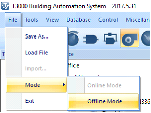

The currently selected device showing at Tab 1 will start flashing red-blue-green to signify that it is no longer online. Right click on the ‘Virtual Device’ icon at Tab 2.

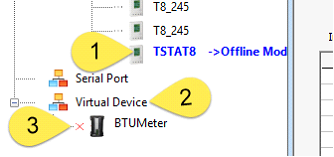

Which brings up two choices for sorting the tree and the ‘Add virtual device’ option which is what we’re interested in.

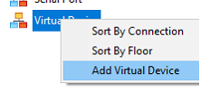

Many devices show up in the next dialog which pops up. The only working one at present is the T3 controller series, BB, LB and TB programmable controllers.

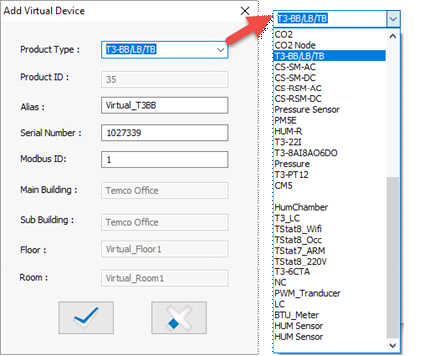

Next load an example file into the virtual controller.You will see the status of the file loading down at the bottom of the screen.

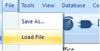
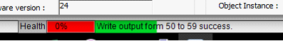

After loading the ‘prg’ file you can view the inputs, outputs, programming and so on of the virtual controller as if you were online with actual hardware.

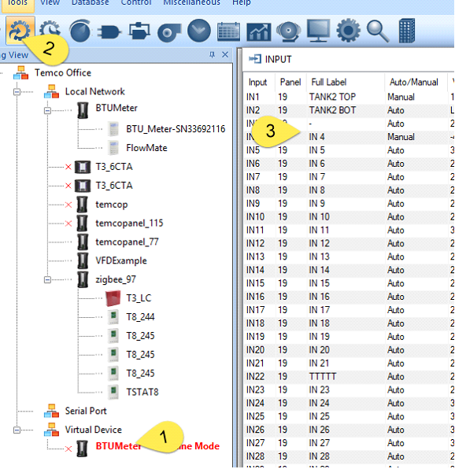

After editing you should save your changes using the File -> Save menu item and select a folder & name for the updated program. The file is stored as a ‘prg’ or program file for backup purposes, for copying to another controller or be emailed to someone. The PRG file contains all the i/o point definitions, programming, user screens and so on which a controller uses to perform its job.

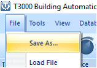

A good naming convention helps keep track of the most recent version of the file while still keeping the earlier versions on hand in case of problems.

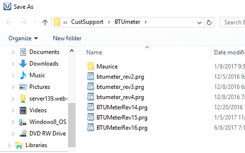

The only files which the PRG file does not contain are the graphics images which need to be copied over manually to any other PC.’s which will be accessing the system. In this example, DemoSite1 is currently the selected building. The image files are stored in the folder shown at Tab 2, in this case the folder is called C:\Program Files (x86)\T3000\Database\Buildings\DemoSite1\image. All image files for this particular site are stored in this folder. Tab 3 shows the pictures are in the ‘image’ subfolder.

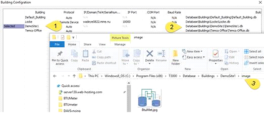

While it is possible to add a second virtual device, the system only allows you to operate on one at a time. Changes made to one virtual controller will affect the other virtual controllers. TBD: allow multiple virtual devices.

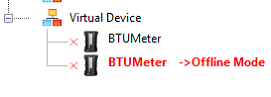
