## 7.1.1 Set your device IP address

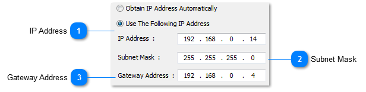

## 7.1.3 TIME & DATE

The time and date is set through this selection. This is the only time in the entire system. It is sent to all panels and also sets the internal clock in the personal computer.

You are first prompted to reset the time in hours: minutes: seconds - i.e. 14:32:34.

Next, you are prompted to reset the date by month-day-year - i.e. 10-29-95.

## 7.1.4 Device information

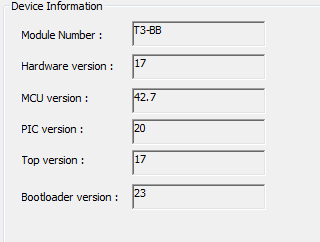

## 7.1.5 PANEL ID

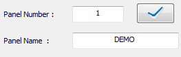

## 7.2 USER LIST

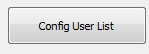

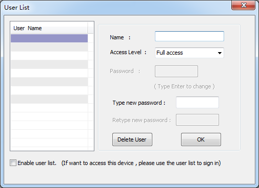

User List provides the means for system security and individual access to the system. Each user has to Sign- On with his name and give his pass word to gain access to the system. There is space to allow for 10 different users and passwords (8 for the Mini-Panel).

User List setup fields

a) Name . . . . . .
An eight character name of the user. First step for gaining system access when Signing-On.

b) Access level . . . . The system has 4 different access levels as follows:

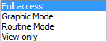

c) Default panel . . .
The default panel the user will see once log-in the system.

d) Default screen . .
The screen, the above user, first sees when signing on to the system. If the “Default screen” field is 0, then the default Work Menu is displayed after signing on. If the “Default screen” field is nonzero, that screen becomes the Main Menu for that particular operator. This can be either a text or graphic based display.

e) Password . . . .
An eight character name of the user. Second step for gaining
system access when Signing- On. If all is correct, then that user is logged on to the system according to the above parameters.

When entering your “Password” the characters entered are not echoed to the screen. The system first asks you to “Type new Pass word” and then to “Retype new Pass word”. If both passwords are the same then you will be allowed to exit the User List. The password will then have entered and retyped again correctly before you will be granted access to leave the User List. Ensure that the letters entered are CAPITAL letters.

## 8.3 Dyndns config

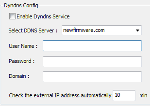

## 8.4 Device Serial Port Configuration

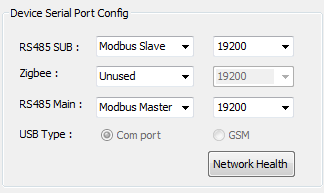

the description of these comports :

COM0:For the common UART ,Baud rate is 9600 or 19200

COM1:For the communication of zigbee

COM2:For the high speed UART ,Baud rate is less than 961200. If you want to use MSTP, you must select the COM port .

<table>
  <tr><td><strong>IP Address</strong>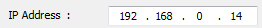&lt;TODO&gt;: Insert description text here...</td></tr>
</table>

<table>
  <tr><td><strong>Subnet Mask</strong>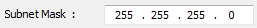&lt;TODO&gt;: Insert description text here...</td></tr>
</table>

<table>
  <tr><td><strong>Gateway Address</strong>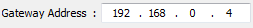&lt;TODO&gt;: Insert description text here...</td></tr>
</table>
