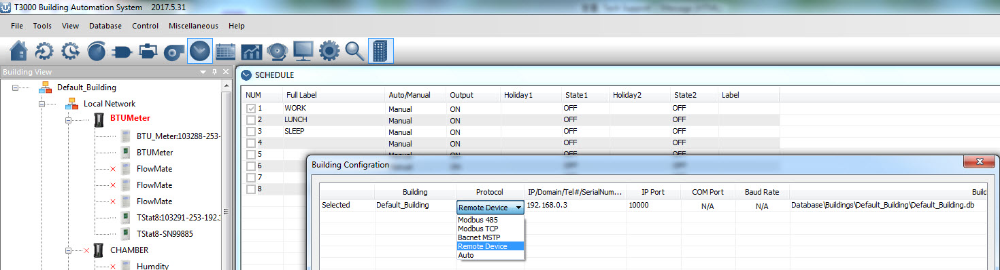
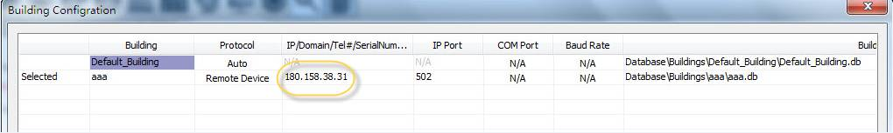
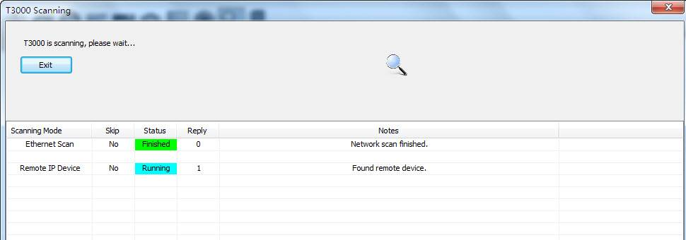
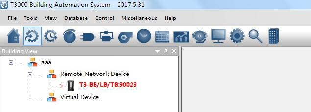

*Port Forwarding

Following are the steps for port forwarding:

Step1.
Set port forward for router:TCP 502(modbus TCP);UDP 47808(BIP port); UDP 1234(Temco private scan).

Step2.Click to show the tab as below,select “Remote Device”protocol.

Step3.It will show the tab as below, click to fil outer net IP or domain name.

Step4.Scan via T3000 software,the remote device can be connected.

