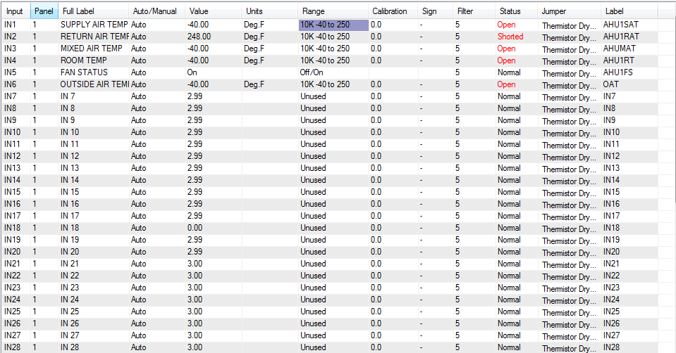
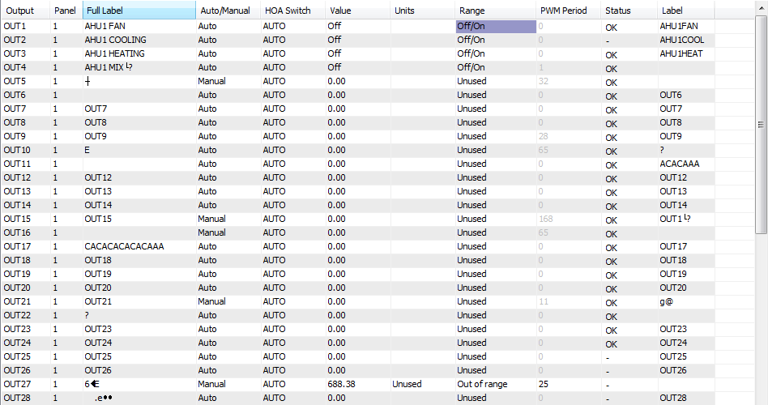
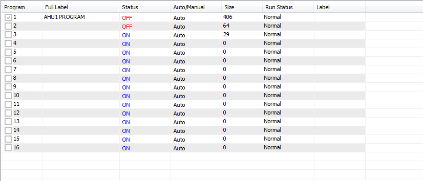
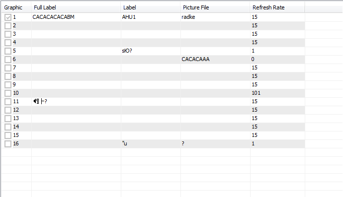

This section explains the programming steps to setup a panel for a controls application. The steps are presented here in a somewhat logical order but the system is flexible, you can complete the sections you have information on as the data comes in and finish off the other parts later. It is assumed that at this point, the T3000 has been setup as per instructions in Chapters 3 and 8.

1. The Input and Output List

List all the inputs and outputs for the system to be controlled. A spreadsheet is generally available from the original project description. If you are starting from scratch, list the equipment and for each of these work out the list of inputs and outputs. Be sure to check the sequence of operations for the system, there's often wording in the text which doesn't match up well with the drawings, those few words can be expensive words which require extra sensors and i/o for your project.

Assuming you are doing your own list, its OK to proceed as information comes in, you can always revise the list as the project proceeds. The points don't have to be in any particular sequential order but its definitely best to keep related i/o near others on the same equipment. And certainly its best to keep i/o from one air handler for example, on one controller so that if the network goes down the equipment can still operate in stand alone mode. Software can connect any i/o to other i/o in the system but its best to keep the list in logical order.

-Once the list is together its time to assign some names to the i/o for entering into the system. In the T3000 Building Automation System we can we can assign each input or output with two names, a long one which is 20 characters for showing in reports and user screens, and a shorter one which is 8 characters to be used in the programming.

- Each input and output needs to be assigned to a physical input or output point on the controller. For inputs this is easy, any input can be jumper configured to match up with most any sensor, switch, transducer or meter. For the outputs, you need to assign the analog items to one of the analog outputs. On the binary outputs to enable fans and pumps the job is a little easier, assign each of these to an output relay on the controller.

TIP: If you need more binary outputs, a spare analog output can be converted to a binary output with an external 12VC coil relay, the analog output will drive the relay to gain one extra really from an analog output. The reverse is not true though, relays are fixed as binary outputs.

- The input list should show the sensor or transducer type and jumper settings.

- For valves and dampers especially, there are many arrangements for the i/o depending on the equipment and project specs so its best to have a data sheet for the exact item. The valves will be specified as normally open or closed, gather that information from the mechanical drawings and sequence description. The output signal can be floating control, modulating or on/off, some have feedback signal as well. All this info is in the data sheets for the actuator and is important to have on hand when laying out the system.

2. Configure “System” Components

Run the T3000 software and Sign-On with your Name and Password. Setup the T3000 as per instructions in Chapters 3 and 8.

3. Program Inputs

“Inputs” are the sensors and devices which are connected into the T3000 panel so that the T3000 can be programmed to act upon. For more information on In puts see section 6.3.

Select “Inputs” from the CONTROL menu, press ALT-I, or type INS from the command line.

Enter in a description that will identify each point. Each point must be unique or the system will not accept the description. When entering the 20 character “Description” as it is known, try to be as descriptive as possible. You should also develop a consistent nomenclature for the various types of control points such as “RTS” in front of all room temperature sensors. Using this nomenclature, the room sensor in office 102 would be named “RTS OFFICE102".

Also enter the “Label” which is the eight character short hand name for the input point which will be used in the Control Basic programs. Again, each LABEL must be unique or the system will not accept the name. By using the above nomenclature, the label for the same office temperature sensor would be “RTS102 ”.

<table>
  <tr><td>Other Examples:</td></tr>
  <tr><td>Input Point</td><td></td><td>Description</td><td>Label</td></tr>
  <tr><td>Air Handling Unit 1</td><td>Supply Air Temperature</td><td>AHU1 SUPPLY AIR TEMP</td><td>AHU1.SAT</td></tr>
  <tr><td>Air Handling Unit 1</td><td>Supply Fan Status</td><td>AHU1 SUPPLY FAN STAT</td><td>AHU1.S</td></tr>
  <tr><td>Pump # 1 Radiation Loop Start/Stop</td><td>P1 RAD LOOP S/S</td><td>P1.S/S</td></tr>
</table>

Select the range:

To set the range high light the field, press ENTER, and enter the desired range number. If no standard range will work with the sensor, see the section of this manual describing the construction of a “TABLE”.

The “D” field is a simple check mark field to verify the correct operation of each sensor. Toggle the field back to normal, check for correct readings, and enter calibration values if required.

Your changes are sent to the panel automatically if you leave the current screen, but to see the effect of current changes, you must Send and then Load the Input changes.

4. Program Outputs

“Outputs” are the output signals from the T3000 sent to the fans, pumps, boilers, etc. which are connected to the T3000. Outputs can be either analog or digital. The software setting determines which mode the output will work with. The engineering units for each output can be configured to match the actual units normally associated with the device being controlled ( i.e. Stop/Start , Close/Open, or % Open, % Closed, CFM). For more information on “Out-puts” see section 5.2.

To get to the outputs screen, type ALT-O or Select “Outputs” from the CONTROL menu. Alternatively, you can type OUTS from the command line.

Just as was described for the inputs, each OUT PUT re quires a 20 character description and an 8 character label. The names should follow a naming nomenclature similar to that used for the inputs, and each name must be unique.

To set the range highlight the field, press ENTER, and enter the desired range.

Enter in the Low and High volt ages for any analog devices such as valves or dampers which operate over 2-10 VDC range rather than the normal 0-10V range.

Enter starts delays as required. This is used for digital out puts only and de lays the start of a device in minutes: seconds up to a maximum delay of 99 minutes 50 seconds. A value entered in this field superimposes a lag on all other control actions such as weekly routines or basic programs which govern this point.

If you want to increase the security level on the output, enter that level in the “S” field.

Toggle all outputs to be decommissioned. Later, as you verify their correct operation toggle the field back to normal.

When satisfied with their operation, Send and then Load the Outputs.

5. Define programming jobs based on out puts that you have to control

For example, a panel may have the following control jobs.

- Boiler Control

- Chiller Control

- Fan System 1 Control

Select “Programs” from the Control menu, or by typing PRGS from “Direct Access”. Enter in the program description and label. Each point must be unique or the system will not accept the description. When entering the description try to be as descriptive as possible.

For example: Air Handling Unit 1 Control = AHU1 PROGRAM

6. Write Individual Programs

Press the “Ins” key while highlighting the line of the de sired program, or using “Direct Access” type the program's label. As you write a program you will want to make use of 4 other point types:

- Variables - VARS

- Controllers - CONS

- Weekly Routines - WRS

- Annual Routines - ARS

Set up these points as the need for them arises. When finished writing your program, send the program by pressing “F2". This will first check the program for errors. If correct, it will send the program to the panel. If not, it will supply an error message complete with line numbers. For more information on Control Basic Programming see chapter 10.

7. Define Graphic Screens:

Graphic Screens are used to group points of all types into one logical unit for displaying on the screen. The elements of a group can be displayed over a graphic picture to augment the display of information.

Select “Graphic” from the Control menu. Enter in the name and label. Each label must be unique or the system will not accept the description. When entering the label try to be as descriptive as possible.

8. Design screens:

Press the “Ins” key while highlighting the line of the desired screen.

To display a point on the screen, move the cursor to the desired location and press the “Ins” key. A pop- up box will appear on the screen to let you specify the element to be added to the display. A second pop- up menu will appear which controls the colour and size of the element text, and several other functions associated with this element. Press the “Esc” key to exit pop- up menu. Continue to add points to display until completion. When satisfied with the display go to File and Save.

For a more detailed description on building Screens see section 6.1.

9. Define Monitors

There are two types of monitors: Ana log which trends analog points, and Digital which logs start and stop times of digital points. Both are displayed together on a single monitor from the Data pull-down menu.

Set up monitors by entering the monitor name and entering the points to be monitored. Enter the interval time between samples, and then Send. Sampling of these points will now take place. If for some reason you decide to change some aspect of a monitor, it will erase all previous data and start a new one once you send the changes to the panel. For more information on Monitors see section 7.1.

10. Save the Program

Using the “File” selection on the Program menu, “Save” the panel program. Steps 1 through 9 are sent to the panel each time that you do a “Send”. By “Saving” the program, the program is saved in your PC and is available to be down loaded back into the panel if the panel crashes or loses its program.
