This chapter explains the use of the keyboard and mouse, and describes how to move around within the T3000 menus. Some basic commands are discussed, as well as how to load T3000 software from the and how to get the system running.

Throughout this manual the following notation formats are used:

1. Words in capital letters are keywords and must be entered exactly as shown, for example, they keyword: OUT1 cannot be typed in lower case or any mixture of upper and lower case.

2. Items in square brackets [ ] are optional. (i.e. [LET] A = 10)

3. Program listings appear in a line printer font as shown:

10 IF SCHEDULE1 THEN START FAN1 ELSE STOP FAN1

## 2.1 USING THE KEYBOARD

The system is driven mainly by the keyboard to allow working in the field without a mouse as much as possible. Keyboard shortcuts also speed up many operations for experienced users. The following is a list of the important keys and their functions:

The Arrow keys,
¬,
↑
, ®, ¯.

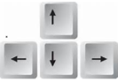

Located on the keypad to the right of the main keyboard. The cursor on the display will show which item has the focus, the Up, Down, Left, and Right arrow keys move the focus around within the various grids and menu and the programming editor.

The ENTER key,
¿
.

The enter key is an important key to become familiar with, changes are easy to make but sometimes the user can end up in edit mode inadvertently by hitting the enter key. The Enter key uses the normal convention to accept a choice in the menu system or dialog boxes. In the programming editor, the Enter key will start a new line. The behavior which will take a little getting used to is for editing items in the grid. When the user is in one of the many grid views and the focus is on the description field of an item like 'AIR HANDLING UNIT4' as shown below, hitting Enter begins the editing mode. The color of the item changes from purple to a blue indicating edit mode is now in effect. Make the changes and then hit enter again. The item will flash red briefly to show the item has been changed and data is being sent out to the controller. Finally, the cursor changes to purple again to show that the change was written successfully.

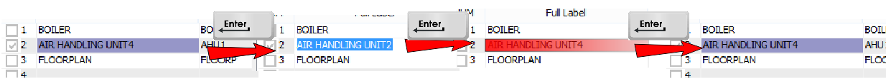

The cursor is in a text field > hit enter > blue shows we're in edit mode >enter >red shows changes are being sent to the controller > purple again means the changes are sync'd with the controller.

The Escape key, Esc.

During editing you may decide to back out of the changes, the ESC key will let you revert back before the changes are sent to the controller. In most cases this will be only a few characters of text which are changed but during editing of a basic program for example there may be several lines of code already changed in which case the system will ask you to confirm.

The TAB key.

This key will be used to move the cursor from one field to the next in many of the grids and various dialog screens within the program.

The Insert key, Ins.

This key is handled a little unconventionally like the 'Enter' key is but saves mouse clicks and helps get around the system quickly. In many of the grids such as Programs, Weekly Routines, Graphics Screens, and Trend logs there is a detail page for each of these items which pops up with the INSERT key. The example below shows the Graphics screens grid, hitting INS drills down into the air handling unit graphics detail display. Note that double clicking with the mouse also has the same action.

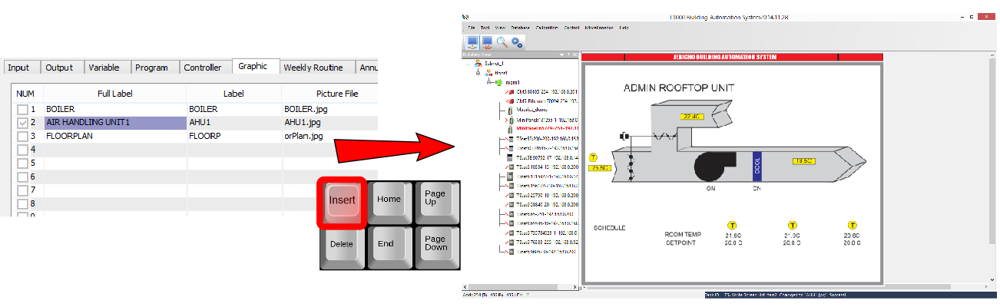

HOT KEYS

While working in the T3000 menu system you will notice a number of “Hot Keys” which can be used directly from the keyboard as well. These let the experienced operator move around the system quickly and minimize mouse clicks. The hover tool tips show up under the item also shows the hot key combo.

The following is a brief description of each of the hot keys:

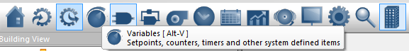

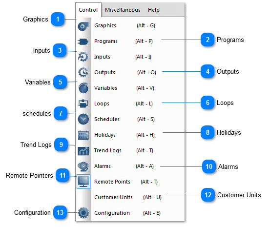

<table>
  <tr><td><strong>Graphics</strong>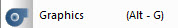Graphics show Floor plan,system diagrams,graphical diaplays,and the hot key is Alt-G.</td></tr>
</table>

<table>
  <tr><td><strong>Programs</strong>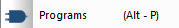Programs show System logic and sequencing,and the hot key is Alt-P.</td></tr>
</table>

<table>
  <tr><td><strong>Inputs</strong>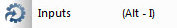Inputs show sensors and feedback points wired to the controller,and the hot key is Alt-I.</td></tr>
</table>

<table>
  <tr><td><strong>Outputs</strong>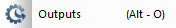Outputs show Valves,relays and actuators wired to the controller,and the hot key is Alt-O.</td></tr>
</table>

<table>
  <tr><td><strong>Variables</strong>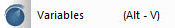Variables show setpoints,counters,timers and other system defined items,and the hot key is Alt-V.</td></tr>
</table>

<table>
  <tr><td><strong>Loops</strong>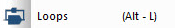PID Loops show Proportional-Integral-Derivative feedback control loops,and the hot key is Alt-L.</td></tr>
</table>

<table>
  <tr><td><strong>schedules</strong>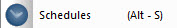Schedules show Daily on and off events for the week,and the hot key is Alt-S.</td></tr>
</table>

<table>
  <tr><td><strong>Holidays</strong>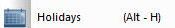Holidays show Holidays and days with special schedules during the year,and the hot key is Alt-H.</td></tr>
</table>

<table>
  <tr><td><strong>Trend Logs</strong>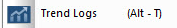Trend Logs show Graphs and historical data,and the hot key is Alt-T.</td></tr>
</table>

<table>
  <tr><td><strong>Alarms</strong>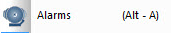Alarms show Current and past alarm events,and the hot key is Alt-A.</td></tr>
</table>

<table>
  <tr><td><strong>Remote Pointers</strong>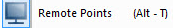Remote Points shows Network points from other nodes used by the controller,and the hot key is Alt-T.</td></tr>
</table>

<table>
  <tr><td><strong>Customer Units</strong>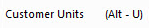The hot key of Customer Units is Alt-U.</td></tr>
</table>

<table>
  <tr><td><strong>Configuration</strong>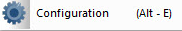Configuration show setup and advanced parameters,and the hot key is Alt-E.</td></tr>
</table>
