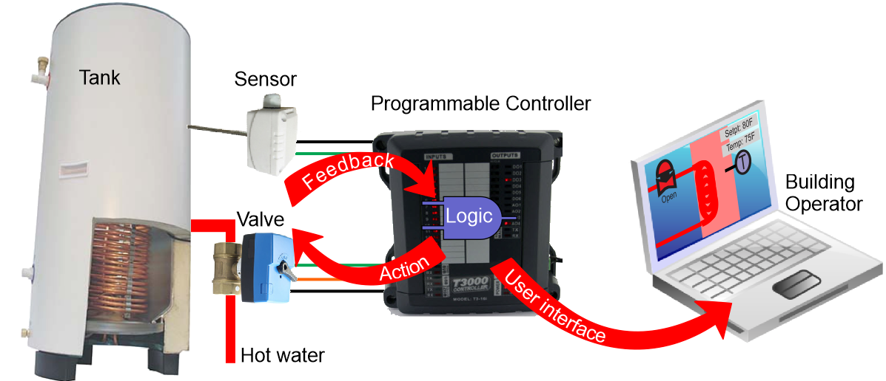
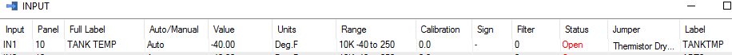
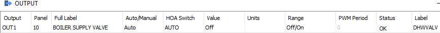
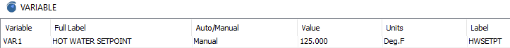
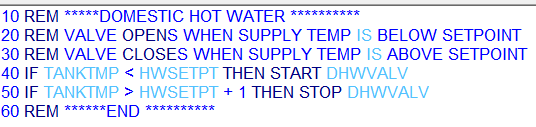
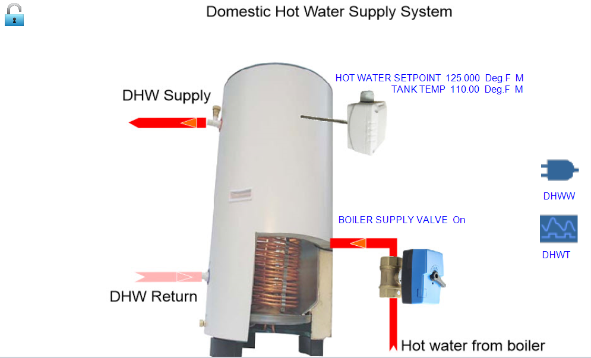
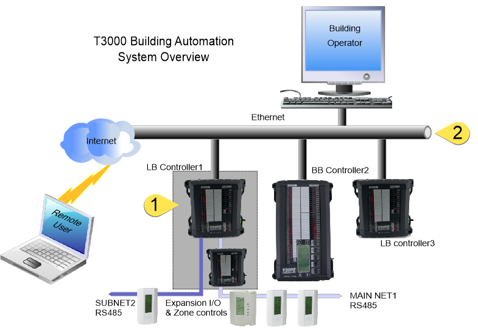
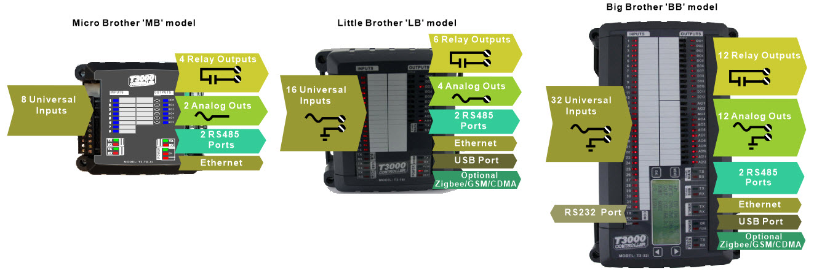

A simplified control application is shown below where the controller maintains the temperature in a hot water tank. There is a temperature sensor to sense the temperature of the tank, a valve to add heat to the tank, and the programmable controller. The PC is used initially to program the controller and can be removed once the setup is done, the system will operate stand alone. In most buildings there will be a PC in the operator's office dedicated to the system though it is not required, everything will run just as well without the PC.

The controls technician will define the inputs and outputs, create some variables for setpoints, write a program and then finally do some graphics to tie it all together for the building operators. The T3000 software has both the engineering tools for the controls techs and the day to day operator interface combined into one program.

First define the input for the temperature sensor, give it a name and define the engineering units.

Then do the same for the outputs, in this case the hot water valve which brings in hot water from the boiler.

Next create a setpoint which is the target temperature for the domestic hot water

Add some logic to open and close the valve to maintain the temperature near the setpoint.

Finally tie all the inputs, outputs and setpoints together into a graphical user interface where the building operator can manage the system. All the tools which the controls technician uses during setup, and later the building operator to manage the system are included in the T3000 software.

TYPICAL NETWORK DIAGRAM

A typical network diagram is shown here with 3 controllers connected together on an Ethernet lan. The PC connects into the lan for local operation while remote operators connect in over the internet. Zone controllers and expansion points connect to the T3-LB controller on the left over the RS485 network which is suited for longer distances and lower bandwidth connections.

The LB controller at tab1 in the diagram above is an example of a controller with expansion points. The expansion modules are normally located in the same control cabinet as the controller so that a failure in the network cable will not cause problems in the rest of the building. However the expansion bus uses regular RS485 cabling so the expansion modules can be mounted long distances, hundreds of meters away if necessary.

The main Ethernet backbone is shown at tab 2 and is made up of the usual Ethernet infrastructure of cat5 cabling, hubs and routers. The control system will normally be on a separate lan but in smaller systems its safe to combine the building automation network with the office or home lan, the communications load of a typical control system is low compared to the typical PC user.

Each of the controllers has two RS485 ports which support a subnetwork used for expansion i/o, thermostats, vav controllers and sensors. A program in the controller can refer to the subnet objects by using a PANEL + "DOT" + SUBPANEL notation. For example there is a T3 controller with the panel ID=1, and a thermostat connected on the subnetwork with ID=2. We can refer to INPUT number 3 on this thermostat by typing 1.2IN3 in our programs and so on. The controller will set up the polling of the thermostat and update the object 1.2IN3 automatically.

The controllers support logging large amounts of trend log data and system graphics directly on an microSD card. The slot can accept up to 32 gigs of storage. Additionally, units shipped after May, 2017 have a 4gb chip soldered directly onto the CPU module so these models support microSD operations without the separate microSD card in the slot.

When the PC is connected, trend log data will sync in the background from the controller to the PC. Rather than sending large amount of data over the network each time the user wants to see a trend log, the cached data from the PC is used which speeds up the viewing times. The system will also replicate the graphics and floor plans in a similar way, once an operator sets up a graphical template on a controller, a copy is sent out to the controller microSD card. Any operators logging in from other PC's new to the system will be able to see the same graphics without having to manually copy files to each of the PC's. There is no requirement to have a dedicated server running for any of the data replicating services, its all handled by the T3000 software and hardware automatically.
