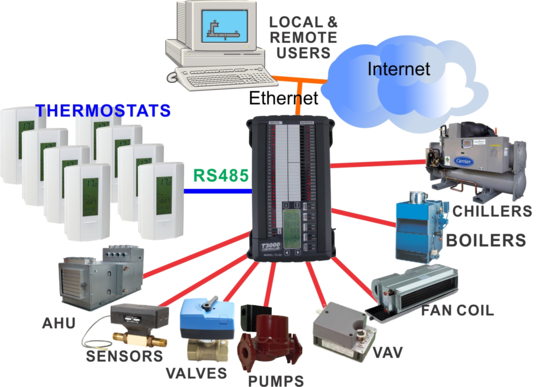

GENERAL OVERVIEW

The T3 series controllers are programmable controllers which contain all the logic for the application, hold trend log data, schedules and so on. The controller senses the building conditions using 'inputs' such as temperature sensors, switches and other sensors which in turn causes the 'outputs' on the controller to go on and off, modulate open or closed and so on. Each of these outputs is wired to pumps, fans, valves, dampers and other actuators which effect the commands from the programmable logic and keep the building in the target conditions. The controller operates stand alone, that is it doesn't need a computer or other server connected to it in order to perform the control tasks.

All the software required to set up a system and operate it on a daily basis is license free, the operators can copy the software to as many PC's as they like without paying any license or recurring cloud fees. The source code is also available on github for developers to use in their own projects.

All hardware communicates using industry standard Bacnet and Modbus protocols over Ethernet and RS485 networks.

