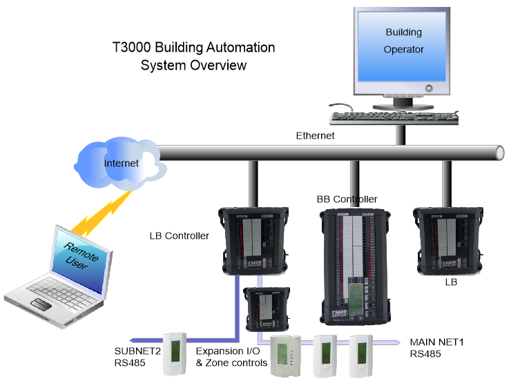
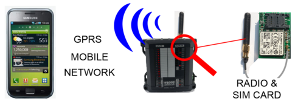
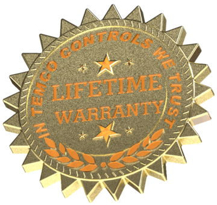

SUITED FOR BOTH LARGE & SMALL SYSTEMS

The system is equally at home in a single panel controlling a home as it is on a large building with several controllers connected over a network. Programming and managing a large system is the same as a smaller site, the operator can maneuver through the networked system in one seamless interface built from many controllers and devices which is presented as one continuous 'system'.

EASY TO USE

Once a system is installed the engineering staff can manage and evolve the system, testing out new control logic and adding new control points. The staff has all the tools on site with no license schemes to hold them back. The operator can add variables to displays, adjust programs and tweak the system in an iterative manner.

NETWORKING IS BUILT IN

Controllers are tied together over the backbone network which is standard Ethernet infrastructure. There are also two subnets on each controller for tying in thermostats and external i/o over RS485 twisted pair cabling over long distances, up to several hundred meters long. When the project is programmed and set up, the operator can refer to any point in the system by its network ID or custom user name without creating special network points, the system automatically takes care of all the lower level networking details and updates the network points automatically.

ACCESS FROM ANYWHERE

An optional GPRS radio module can plug into the controller for remote sites where there is no internet connection available. Alarms can be routed to a central dispatch office or to phones. Remote users can log in and assist the building operator with both users signed in at the same time. Anywhere you have mobile network coverage you can have remote access, use it to monitor boats or control bathroom lighting in parks for example.

FAULT TOLERANT

If a panel locks up due to a surge there is an on board watchdog which will reset the board automatically. Other panels in the system are unaffected by the outage, the latest values will be assumed for any network variables or temperatures and when the panel comes back online the data will automatically begin refreshing again. No user intervention is required for the panel to resume normal operation. All system programming is stored in non volatile flash which is automatically loaded on power up. The real time clock is backed up with a super cap that will keep the clock alive during a power outage of several days so there are no batteries to replace, ever.

FLEXIBLE WARRANTY

If a panel has a problem, send it to us and we'll do our best to fix it free of charge for the life of the system. There's no time limit to this offer. If the board cannot be repaired due to water damage or obvious wiring mistakes, or perhaps it is decades old and due for an update, just return your unit and you'll receive a healthy discount on a new one.

