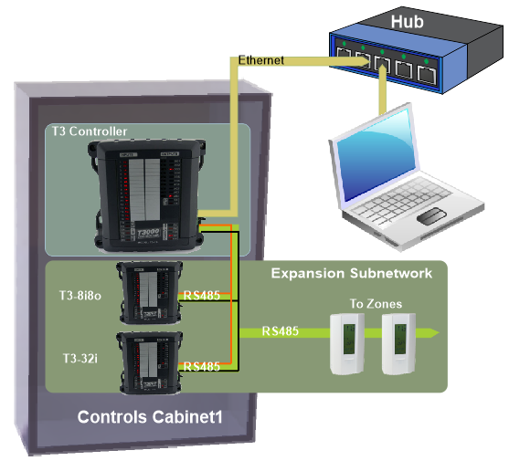
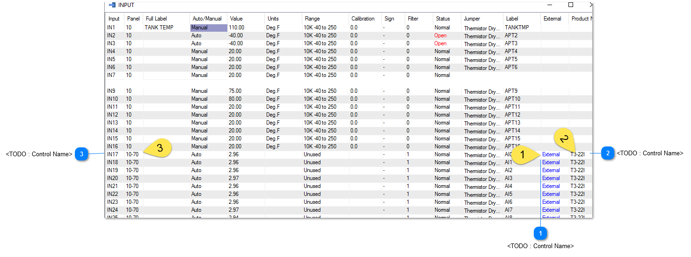
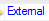
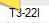
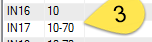

The T3 controllers can be expanded by adding input & output modules on the RS485 expansion bus. Typically the expansion I/O are located within the same cabinet as the controller but can be located remotely up to several hundreds of meters away if the application calls for it.

The maximum number of I/O points for each T3 controller is currently limited to 64 inputs and 64 outputs. You can add as many T3 controllers as you like to the system so very large systems can be built up. A typical connection arrangement is shown here with the PC connected to the T3 controller over ethernet and the expansion I/O connected to the T3 over RS485 on the RS485 subnet. In this arrangement the T3 controller treats the expansion points transparently like internal points directly on the controller itself.

Below shows the expansion inputs as seen from the T3000 front end starting at input 17 as shown by the word 'External' at Tab1. Expansion input 17 resides on a t3-22i expansion module as shown at tab2. From a programming perspective, these expansion i/o appear just like inputs and outputs of the T3 controller hardware itself. When working with these expansion points the operator only need refer to 10IN17 for example. There is no need to deal with the fact that this input is physically connected to a separate expansion module which happens to be at address ID=70 in this case, you can see the subnet ID at Tab3.

Currently, only Modbus protocol is available for the expansion points subnetwork, however all info on the Ethernet network is available in both Modbus and Bacnet protocols by defaut. The fact these are expansion points is taken care of automatically, you can work with 'bacnet object INPUT17' when using the ethernet communications.

The following sections show some of the expansion i/o modules which are integrated into the T3000 system. Its not difficult to integrate other devices to be mapped as external I/O and show up within the T3000 i/o map, so if you have a module or product that you'd like to see here let us know.

<table>
  <tr><td><strong>&lt;TODO : Control Name&gt;</strong>External shows starting at input 17.</td></tr>
</table>

<table>
  <tr><td><strong>&lt;TODO : Control Name&gt;</strong> T3-22i expansion module.</td></tr>
</table>

<table>
  <tr><td><strong>&lt;TODO : Control Name&gt;</strong> The subnet ID.</td></tr>
</table>
