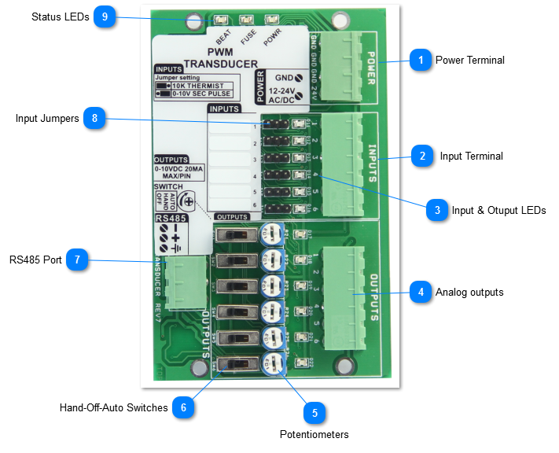
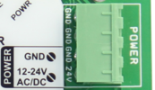
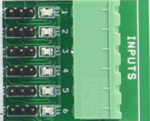
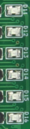
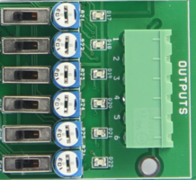
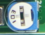
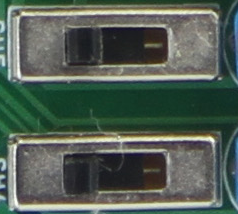
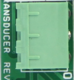
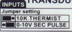
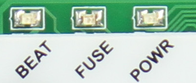

PWM

The PWM is a low cost device that is normally used to convert a pulse into a voltage signal. An RTU or other simple controller with limited resources can pulse one of its outputs to generate modulating analog voltage outputs using this module. To generate a 5V signal, the RTU will turn generate a pulse of varying duty cycle, 5 seconds on followed by up to a minute off will generate a 5V analog outut. Precision of the output voltage is up to 0.1 volts.

The inputs can also be set up as general purpose 'universal inputs' for sensing of various sensors. The inputs can be configured as dry contacts for use with switches, occupancy sensors, contactors, current sensors and popular thermistor curves, 10k type 2 and 3 and most of the typical ranges of the rest of the T3 modules.

The main difference of this low cost model to the other T3 series expansion units are:

-For measuring of 4-20ma signals, these require the addition of an external 250 ohm resistor whereas the rest of the T3 series has this on board

-This unit has physical jumpers for selecting the signal type whereas the other T3 modules select the sensor type in software.

-No enclosure, just a cabinet mount type backplate for mounting.

This device can communicate over RS485 using either bacnet or modbus protocols at baud rates up to 112k.

It has a H-O-A (hand-off-auto) override switch for each of the six outputs, as well as a potentiometer for adjusting the out voltage when the output is in manual mode. When the switch is in the hand position the corresponding output can be adjusted by potentiometer from zero to the full scale 10V. When the switch is in the off positon the output voltage is 0V. When the switch is in auto the output is set by the duty cycle of the corresponding input.

For each input there is one output, six of these input-output pairs on the board. The input signals can be 5VDC, 10VDC, and 24VAC. No jumper is required, the unit will auto detect the signal type. When using AC signals, the frequency can be anywhere in the 50 to 60Hz range. The output voltage is proportional to the duration of the pulse, with the relationship being one volt for each second duration on the pulse. FOr example, a 4 second pulse will produce an output of 4 volts, five seconds for a five volt output and so on up to the maximum of 10 seconds for 10V. The input pulse must be refreshed every 60 seconds otherwise output will fail safe to 0V and input LED for the channel will flash 4 times per second as a fault indicator. If the PWM signal is less than 1 second, output is set to 0V. It is therefore not possible to set an output voltage between zero and 1V.

Status Indicators Red LED - variable intensity to indicate output voltage, dim light indicates 1V and bright light indicates10V. Each input also has an LED which shows the status of the PWM signal or in the case of using the PWM as a general purpose i/o module, the state of the input on or off, and so on.

<table>
  <tr><td><strong>Power Terminal</strong>The power connection has 24C ac or dc supply. There are three ground terminals to provide space for grounding from various devices and power supplies, they are connected in parallel internally.</td></tr>
</table>

<table>
  <tr><td><strong> Input Terminal</strong>There are six inputs,each of which has a corresponding LED and jumper. No jumper is actually required for most PWM type applications, the unit will detect the signal type automatically. The input pulse signal must be refreshed every 60 seconds otherwise output will fail safe to 0V. When this happens the corresponding LED will flash 4 times per second as a fault indicator. If the PWM signal on-time falls to less than 1 second the output will go to 0V. When the unit is used as general purpose I/O for the T3 controller, you can select the sensor type with this jumper.</td></tr>
</table>

<table>
  <tr><td><strong>Input &amp; Otuput LEDs</strong>The input LEDS will show the incoming pulse signal on each of the inputs. If the input signal does not see a pulse for 60 seconds it will flash four times in a repeating cycle till a pulse comes in as a warning of the lost signal. If the module is used as general purpose i/o, the input will reflect the voltage on the input terminal. For example if the input is configured as a binary on-off input the LED will be ON when the contacts are closed and OFF when the contacts are closed. The sense of the LED can be reversed as well, configured to be OFF when the contacts are open and vice versa for closed. For analog inputs such as thermistors and transmitters the LED will be bright or dim depending on the signal. The dimming is done in only about ten steps of brightness so serves mainly to help spot open or short circuit sensors. The Output LEDS will modulate from dim to bright according to the voltage on the output terminal.</td></tr>
</table>

<table>
  <tr><td><strong>Analog outputs</strong>There are six output channels,each of the outputs has a potentiometer and hand-off-auto swtich. When the switch is in the off position the output is at zero volts. In hand the output is at full scale, normally 10V but it can be adjusted down with this pot to any custom setting. In the auto position the output modulates from zero to 10V as per the timing of the pulse on the associated input.</td></tr>
</table>

<table>
  <tr><td><strong>Potentiometers</strong>These pots set the maximum voltage for each of the outputs when in manual mode.</td></tr>
</table>

<table>
  <tr><td><strong>Hand-Off-Auto Switches</strong>These switches allow the operator to turn the outputs on manually, overriding the software settings for testing and debugging in the field. When the switch is set to the manual on position, the output will go to full scale, as determined by the potentiometer.</td></tr>
</table>

<table>
  <tr><td><strong>RS485 Port</strong>RS485 serial communications port, Modbus and bacnet protocols at up to 112k baud.</td></tr>
</table>

<table>
  <tr><td><strong>Input Jumpers</strong>When the PWM is used in normal PWM to voltage applications there is no need to use jumpers here, the default unit is shipped with no jumpers installed. The PWM can auto detect the the type of signal whether its a 0-5V pulse, 10V pulse, or 24VAC pulse. When using the PWM as general purpose expansion I/O for a T3 (or other) controller you can select the signal type by setting the jumper here and the corresponding 'range' setting from the T3000 software. For 10k thermisters and binary dry contact signals the jumper will be set to the left. For 0-10V and 0-5V signals, the jumper will be set to the right. Once the jumper is set you can refer the the Inputs section for selecting the appropriate range. Note that most T3 modules do not have physical jumpers these days, the 'jumper' is set in firmware, the PWM is an exception and requires manually moving a jumper.</td></tr>
</table>

<table>
  <tr><td><strong>Status LEDs</strong>The beat LED will blink once every second during normal operation. In the first 10 seconds after power up the beat LED will be flashing two times quickly, a pause, then two more blips in a repeating manner. This mode is called the 'isp' mode or in system programming mode, during this time it is possible to load firmware using the ISPTool. Even if there is a bad firmware update you can always get into this ISP mode by cycling power in order to revive a bricked module. If the unit does not start with the two blip isp mode and then switch to the one blip for normal operation after approximately ten seconds this indicates there's a problem with the hardware and/or firmware. Re-flashing the unit with a fresh copy of the firmware is the best bet, in the first few seconds after power up if necessary. The fuse LED lights up when there is a ground loop or other wiring mistake in the system. When the problem is fixed the fuse will cool down and normal operation should resume. If this LED is stuck in the on condition with no other sensors and network connected this indicates a hardware problem and hte unit should be returned for repairs which are usually free unless the board has been seriously damaged by water or high power. The power LED lights up when the power is connected.</td></tr>
</table>
